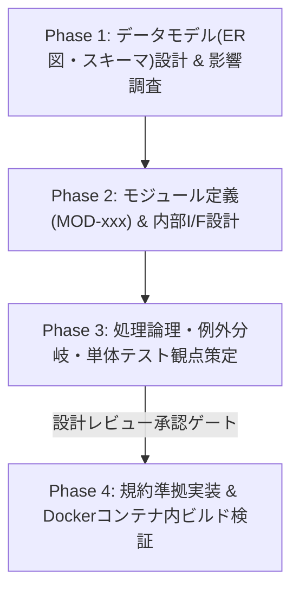

# IPA ソフトウェア詳細設計・実装統制スキル (`ipa-detail-designer`)

本スキルは、**IPA共通フレーム2013（SLCP-JCF2013）** の「ソフトウェア詳細設計（内部設計）」および「実装プロセス」に準拠し、データモデル（ER図）、モジュール分割（`MOD-xxx`）、内部関数インターフェース、処理アルゴリズムを設計・**差分更新（Living Documentation）**し、設計書と完全一致する高品質コードを実装するための手順を定める。

> **基本信条**: 「詳細設計書は単体テストの直接の検証根拠（オラクル）である。対象PBIおよび詳細設計書の差分更新が完了していない状態でのソースコード実装は一切行わない。また、壊れたデータモデルは全機能への負債となるため、データ構造変更時は全参照箇所の影響調査を必須とする。」

---

## 0. PBI駆動・差分更新モード（Living Documentation 標準動作）

本スキルは、設計書の新規作成だけでなく、**指定された `PBI-xxx`（`docs/backlog/*/PBI-xxx*.md`）に基づく既存マスター詳細設計書へのインクリメンタルな追記・修正**を標準動作とする。
1. **PBI種別（`type`）に応じたテーラリング**:
   - `feature`（新機能）: ER図/スキーマ、モジュール一覧（`MOD-xxx`）、内部関数（`INT-FN-xxx`）、処理フロー、単体テスト観点をマスター詳細設計書へ差分追記する。
   - `enhancement`（改善）: 影響を受けるモジュール（`MOD-xxx`）・スキーマ・内部関数の仕様と単体テスト観点を差分更新する。
   - `bugfix`（バグ修正）: バグの原因特定と既存詳細設計書（`MOD-xxx`）との乖離確認を行い、境界条件や例外分岐の記述を補正してから修正実装へ進む。
2. **PBIへのトレーサビリティ記録**: 追加・更新したモジュールID（`MOD-*`）を対象 `PBI-xxx.md` の YAML Frontmatter（`related_mod_ids`）および「5. 実行ログ・トレーサビリティ記録」へ記録する。

---

## 1. 参照・更新対象ドキュメント

本スキルを実行する際は、以下のテンプレートおよび既存設計図書を参照・更新すること。

### PBIバックログおよび参照テンプレート（差分更新・詳細設計の基準）
- **対象PBIファイル**: `docs/backlog/in_progress/PBI-xxx*.md`（または `todo/`）
- **ソフトウェア方式・詳細設計テンプレート**: `@[docs/templates/05_software_design.md](../../../docs/templates/05_software_design.md)`
- **テスト仕様書テンプレート（単体テスト観点の連携先）**: `@[docs/templates/06_test_specification.md](../../../docs/templates/06_test_specification.md)`
- **要件追跡マトリクス (RTM) テンプレート**: `@[docs/templates/99_traceability_matrix.md](../../../docs/templates/99_traceability_matrix.md)`

### 上流入力および本リポジトリの正本配置先（更新対象）
- **コーディング規約（最優先遵守）**: `@[docs/00_project_charter/02_coding_standards.md](../../../docs/00_project_charter/02_coding_standards.md)`
- **機能仕様書・外部I/F仕様書（上流入力）**:
  - `@[docs/02_basic_design/01_functional_specification.md](../../../docs/02_basic_design/01_functional_specification.md)`
  - `@[docs/02_basic_design/02_external_interface_specification.md](../../../docs/02_basic_design/02_external_interface_specification.md)`
- **詳細設計書群（正本）**:
  - **構造設計書**: `@[docs/03_detail_design/01_architectural_design.md](../../../docs/03_detail_design/01_architectural_design.md)`
  - **内部I/F仕様書**: `@[docs/03_detail_design/02_internal_interface_specification.md](../../../docs/03_detail_design/02_internal_interface_specification.md)`
  - **プログラム仕様書**: `@[docs/03_detail_design/03_program_specification.md](../../../docs/03_detail_design/03_program_specification.md)`
- **工程統制ルール**: `@[.agents/rules/ipa-process-gate.md](../../rules/ipa-process-gate.md)`

---

## 2. 着手前提条件（Entry Criteria & PBI駆動 Pre-Implementation Gate）

1. **詳細設計着手の前提**:
   - 対象となる `PBI-xxx.md` が存在し、上流の要件定義（`REQ-*`）および（必要な場合は）システム方式設計・外部I/F定義（`FNC-*`, `EXT-*`）の差分更新が完了していること。
2. **ソースコード実装着手の絶対ゲート（PBI駆動 Pre-Implementation Gate）**:
   - **実装コード（`src/`, `pptx_converter/`, `themes/`, `marp.config.js` 等）の変更は、対象となる `PBI-xxx.md` が存在し、かつそのPBIに対応する詳細設計書（`docs/03_detail_design/` または `docs/templates/05_software_design.md`）の差分更新が完了している場合のみ許可する。**
   - PBIまたは詳細設計書の差分更新が未完了の場合は、必ず本スキルにより詳細設計書の差分反映と `related_mod_ids` の記録を完了させてから実装（`status: "implementing"`）に移ること。

---

## 3. 実行ワークフロー（4フェーズ手順）

### Phase 1: データモデル・ER図設計と変更影響調査（Data Model Specialist 観点）
1. `@[docs/templates/05_software_design.md](../../../docs/templates/05_software_design.md)` に従い、エンティティ・データ構造（Mermaid `erDiagram` または `classDiagram`）およびZodスキーマ/TypeScript型定義を設計する。
2. 既存のデータ構造（`SlideDeck`, `TitleSlide`, `NormalSlide`, DOM計測構造体等）を変更する場合は、**変更影響調査**を省略せず実施する：
   - [ ] 該当データ構造を参照する全モジュール・関数・テンプレート・変換スクリプトを `grep` 等で機械的に列挙したか。
   - [ ] 後方互換性（既存スライドMarkdownやMCPクライアント呼び出しへの影響）を確認し、破壊的変更がある場合はエスカレーションフラグを立てたか。
   - [ ] 数値（座標計算・DPI変換・文字数上限）の丸め規則・境界値、文字列（UTF-8・特殊文字エスケープ）の扱いを明記したか。

### Phase 2: モジュール分割（`MOD-xxx`）と内部I/F設計
1. 機能を責務単位のモジュールに分割し、一意のモジュールID（`MOD-001` 等、または既存の `MOD-SRV-001`, `MOD-ENG-001`, `MOD-PPT-001`, `MOD-THM-001`）を採番・紐付けする。
2. 各モジュール内の内部関数（`INT-FN-xxx` 等）について以下を明記する：
   - **関数シグネチャ**: 関数名、引数名と厳密な型（`any` 型禁止）、戻り値型。
   - **事前条件・事後条件**: 入力値の前提条件と、正常終了時に保証される状態。
   - **副作用の範囲**: ファイルI/O、環境変数変更、外部プロセス起動の有無。

### Phase 3: アルゴリズム・例外処理論理と単体テスト観点の定義
1. プログラム単位（`PRG-xxx`）の処理ステップ（入力 → 分岐・ループ → 出力）をフローチャートまたは構造化手順で記述する。
2. **例外・エラー分岐の明記**:
   - 準正常系（想定された入力不備・ファイル不在）と異常系（未定義エラー受け皿）の分岐条件およびエラー返却ロジックを明記する。
3. **単体テスト観点（W字シフトレフト）**:
   - 詳細設計書内に、各モジュール・関数の「単体テスト観点（正常系・境界値・準正常系・異常系）」を列挙し、`ipa-qa-engineer` が作成する `06_test_specification.md`（`TEST-UT-xxx`）の直接の検証根拠とする。

### Phase 4: コーディング規約準拠の実装とDocker検証（設計承認後のみ）
詳細設計が承認された後、以下の実装統制チェックリストを厳守してコードを記述する：
- [ ] **【最重要】全行直上平易コメント規則（`docs/00_project_charter/02_coding_standards.md` 第3章）**:
  - 実行コードおよび宣言の**すべての行の直上**に、平易な日本語による説明コメント（`// ...` または `/* ... */`）を付与すること。1行たりともコメントのないコード行を作らないこと。
- [ ] **設計書との完全一致**:
  - 詳細設計書に定義されていない引数・項目・機能を「気を利かせて」勝手に追加しない（スコープクリープ禁止）。
- [ ] **仮定マーカーの同期**:
  - 未確定要件の仮定（`Q-xxx`）に依存する実装箇所には `// 【仮定: Q-xxx】 ...` を明記する。
- [ ] **Dockerコンテナ内での検証必須**:
  - ホストOS上で直接 `npm` や `node` を実行せず、必ず `docker compose run --rm app npm run build` を実行してTypeScriptコンパイルエラーが **0件** であることを確認する。

---

## 4. 完了判定チェックリスト（Definition of Done）

- [ ] 全モジュールに一意の `MOD-xxx` が採番され、上流の `REQ-*` および外部I/F（`EXT-*`）と紐付いているか。
- [ ] ER図/クラス図、データ構造定義、内部関数シグネチャ、処理フロー、エラー分岐が漏れなく記述されているか。
- [ ] 各モジュールの単体テスト観点が明記され、`06_test_specification.md` からトレース可能か。
- [ ] （実装を伴う場合）全ソースコード行に直上日本語コメントが付与され、Docker内の `npm run build` が成功（エラー0件）したか。
- [ ] `@[docs/templates/99_traceability_matrix.md](../../../docs/templates/99_traceability_matrix.md)`（または `docs/README.md`）に `REQ` ↔ `MOD` の対応が反映されているか。
