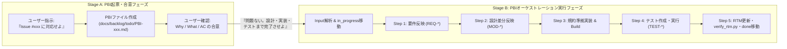

# IPA PBI駆動オーケストレータースキル (`ipa-pbi-orchestrator`)

本スキルは、**PBI（Product Backlog Item）駆動型アジャイル開発**の機動性と、**IPA共通フレーム2013（SLCP-JCF2013）** の厳格な品質保証サイクル（ミニ・ウォーターフォール）をハイブリッド統合する司令塔（Orchestrator）スキルである。
1つのPBIファイル（`docs/backlog/*/PBI-xxx*.md`）を起点として、既存のIPA各工程スキルを直列に呼び出し、マスター設計書の**差分更新（Living Documentation）**・規約準拠実装・テスト検証・RTM追跡性監査を一気通貫で完遂させる。

> **基本信条**: 「マクロはPBI駆動のアジャイルで高速に回し、ミクロ（1つのPBI内部）はIPA共通フレームのV字/W字品質ゲートを1ミリも妥協せず通過させる。」

---

## 1. アーキテクチャ方針とテーラリング基準

### 1.1 マクロはアジャイル、ミクロはIPA準拠
- すべての機能追加・仕様変更・バグ修正は、定型構文のPBIファイル（`docs/backlog/todo/PBI-xxx_*.md`）を唯一の起点として開始する。
- PBIライフサイクルディレクトリ：
  - `docs/backlog/todo/` : 未着手PBI（`status: "todo"`）
  - `docs/backlog/in_progress/` : 設計・実装・テスト進行中PBI（`status: "designing" | "implementing" | "testing"`）
  - `docs/backlog/done/` : 完了・RTM監査通過済みPBI（`status: "done"`）

### 1.2 ドキュメントの「差分更新（Living Documentation）」原則
- PBIごとに毎回ゼロから別個の設計書を作るのではなく、既存のマスター設計書（要件定義書、方式設計書、詳細設計書、テスト仕様書、要件追跡マトリクス）に対して、**PBI単位で差分をインクリメンタルに追記・更新**する。

### 1.3 PBI種別（`type`）に応じたテーラリング（軽量化ゲート）

| PBI種別 (`type`) | 用途・対象 | 実行するIPAミクロ工程（テーラリング定義） |
| :--- | :--- | :--- |
| **`feature`**<br>（新機能） | 新規MCPツール、新規レイアウト、新規コンバーター機能等の追加 | **全工程を実施**:<br>1. 要件追加 (`REQ-*`) → 2. 方式・詳細設計更新 (`EXT-*`/`MOD-*`) → 3. 実装 → 4. 単体/結合/総合テスト (`TEST-*`) → 5. RTM更新 |
| **`enhancement`**<br>（改善） | 既存機能のパラメータ拡張、バリデーション強化、リサイズ閾値改善等 | **影響範囲の差分更新を実施**:<br>1. 既存要件/AC差分更新 (`REQ-*`) → 2. 影響する設計書の差分更新 (`MOD-*`) → 3. 実装 → 4. テスト更新・実行 (`TEST-*`) → 5. RTM更新 |
| **`bugfix`**<br>（バグ修正） | 既存仕様からの乖離修正、レイアウト崩れ修正、例外処理漏れ修正 | **軽量化ゲートを適用（方式設計等はスキップ可）**:<br>1. 原因特定・既存詳細設計（`MOD-*`）との乖離確認 → 2. 修正実装 → 3. 回帰テスト（`TEST-*`）追加・実行 → 4. RTM更新 |

---

## 2. 参照・更新対象ドキュメントおよび連携スキル

### PBIテンプレート・バックログ
- **PBI標準テンプレート**: `@[docs/templates/98_pbi_template.md](../../../docs/templates/98_pbi_template.md)`
- **PBI管理ディレクトリ**: `docs/backlog/todo/`, `docs/backlog/in_progress/`, `docs/backlog/done/`

### 順次呼び出す既存IPAスキル群
1. **要件定義（差分更新）**: `@[.agents/skills/ipa-requirements-analyst/SKILL.md](../ipa-requirements-analyst/SKILL.md)`
2. **方式設計（差分更新）**: `@[.agents/skills/ipa-system-architect/SKILL.md](../ipa-system-architect/SKILL.md)`
3. **詳細設計・実装（差分更新）**: `@[.agents/skills/ipa-detail-designer/SKILL.md](../ipa-detail-designer/SKILL.md)`
4. **テスト・品質監査（差分更新）**: `@[.agents/skills/ipa-qa-engineer/SKILL.md](../ipa-qa-engineer/SKILL.md)`
5. **トレーサビリティ検証**: `@[.agents/skills/ipa-traceability-validator/SKILL.md](../ipa-traceability-validator/SKILL.md)` (`verify_rtm.py`)
6. **工程統制ルール**: `@[.agents/rules/ipa-process-gate.md](../../rules/ipa-process-gate.md)`

---

## 3. 2段階の対話ワークフロー（Issue起票から完了まで）



### Stage A: Issue・要求からのPBI起票フェーズ
ユーザーから「Issue #xxx に対応せよ」または機能要望が提示された場合：
1. 直ちに設計書やコードを編集せず、`docs/templates/98_pbi_template.md` のフォーマットに従い `docs/backlog/todo/PBI-xxx_<slug>.md` を作成する。
2. 曖昧さ4分類（【未定義】【多義】【暗黙】【矛盾】）を検出し、ユーザーにPBIの内容（Why / What / Given-When-Then形式のAC）の確認を求める。

### Stage B: PBI承認後の一気通貫オーケストレーション実行フェーズ
ユーザーから「問題ない。設計・実装・テストまで完了させよ」等の実行指示を受けた場合、次節（第4章）の **Input解析およびStep 1〜Step 5** を順序通りに実行する。

---

## 4. オーケストレーターの実行フロー定義（必須手順）

### 0. Input解析（着手・ステータス遷移）
1. 指定された `PBI-xxx.md` を読み込み、YAML Frontmatterの `type`（`feature` / `enhancement` / `bugfix`）、優先度、およびセクション3の「受け入れ基準（AC）」を解析する。
2. Frontmatterの `status` を `"designing"` に更新し、ファイルを `docs/backlog/todo/` から `docs/backlog/in_progress/` へ移動する。

### Step 1: 要件反映 (`ipa-requirements-analyst` 基準)
1. `type: "feature"` または `"enhancement"` の場合：
   - PBIのユーザーストーリーと受け入れ基準（AC）をマスターの要件定義書（`docs/01_requirements/01_requirements_specification.md` および `docs/templates/02_functional_requirements.md` / `03_non_functional_requirements.md`）へ差分追記または更新する。
   - 新規または更新対象の要件ID（`REQ-*`）を確定する。
2. `type: "bugfix"` の場合：
   - 修正対象が本来満たすべき既存の要件ID（`REQ-*`）を特定する。
3. 確定した `REQ-*` IDをPBIファイルのFrontmatter（`related_req_ids`）および「5. 実行ログ・トレーサビリティ記録」に記録する。

### Step 2: 設計差分反映 (`ipa-system-architect` & `ipa-detail-designer` 基準)
1. `type: "feature"` の場合：
   - 方式設計書（`docs/02_basic_design/` および `docs/templates/04_system_architecture.md`）に外部I/F（`EXT-*`）やエラーコード一覧（末尾の未定義エラー受け皿含む）の差分を追記する。
   - 詳細設計書（`docs/03_detail_design/` および `docs/templates/05_software_design.md`）にデータモデル・モジュール定義（`MOD-*`）・内部関数（`INT-*`）・単体テスト観点の差分を追記する。
2. `type: "enhancement"` の場合：
   - 影響を受ける方式設計書・詳細設計書の該当セクションのみ差分を更新し、対象 `MOD-*` IDを特定する。
3. `type: "bugfix"` の場合：
   - 原因特定と詳細設計書（`MOD-*`）との乖離確認を実施し、必要に応じて詳細設計書のエッジケース記述を補正する（方式設計はスキップ可）。
4. 対象モジュールID（`MOD-*`）をPBIファイルのFrontmatter（`related_mod_ids`）および「5. 実行ログ・トレーサビリティ記録」に記録する。

### Step 3: 実装 (`ipa-detail-designer` 実装統制基準)
1. **PBI駆動ゲート確認**: 対象 `PBI-xxx.md` が存在し、かつStep 2までの詳細設計書の差分更新が完了していることを確認する。
2. PBIファイルのFrontmatterの `status` を `"implementing"` に変更する。
3. 更新された詳細設計書および `@[docs/00_project_charter/02_coding_standards.md](../../../docs/00_project_charter/02_coding_standards.md)`（**全行直上平易コメント規則**）を100%遵守してソースコードを実装・修正する。
4. Dockerコンテナ内でビルド検証を実行し、コンパイルエラーが **0件** であることを確認する：
   ```bash
   docker compose run --rm app npm run build
   ```

### Step 4: テスト・検証 (`ipa-qa-engineer` 基準)
1. PBIファイルのFrontmatterの `status` を `"testing"` に変更する。
2. PBIの「受け入れ基準（AC-1, AC-2, ...）」を100%網羅するテスト仕様（`TEST-UT-*`, `TEST-IT-*`, `TEST-ST-*`）をマスターのテスト仕様書（`docs/templates/06_test_specification.md` 等）へ差分追記し、テストコードの作成およびDockerコンテナ内での検証を実行する。
3. テスト仕様書の数値サマリー表（計画/実測/合格件数/消化率100%）を最新の実測値に更新する。
4. 追加・更新した `TEST-*` IDをPBIファイルのFrontmatter（`related_test_ids`）および「5. 実行ログ・トレーサビリティ記録」に記録し、PBI内の全 `[ ] AC-*` チェックボックスを `[x]` に更新する。

### Step 5: RTM更新と完了 (`ipa-traceability-validator` 基準)
1. 要件追跡マトリクス（`docs/templates/99_traceability_matrix.md` および `docs/README.md`）の該当行に `PBI_ID`（`PBI-xxx`）、`REQ-*`, `MOD-*`, `TEST-*` の対応を追記・更新する。
2. PBIファイルのFrontmatterの `status` を `"done"` に変更し、ファイルを `docs/backlog/in_progress/` から `docs/backlog/done/` へ移動する。
3. Dockerコンテナ内で自動検証スクリプト `verify_rtm.py` を実行し、`PBI-xxx` ↔ `REQ-xxx` ↔ `MOD-xxx` ↔ `TEST-xxx` の双方向追跡性が完全に取れていること（断絶 **0件**、Exit Code `0`）を確認する：
   ```bash
   docker compose run --rm app python3 .agents/skills/ipa-traceability-validator/scripts/verify_rtm.py
   ```
4. `.agents/rules/ipa-process-gate.md` 第6章の「工程ゲート判定フォーマット」に従い、完了レポートをユーザーへ出力する。

---

## 5. 完了判定チェックリスト（Definition of Done）

- [ ] 対象PBIファイルが `docs/templates/98_pbi_template.md` のYAML Frontmatterおよび全5セクション構文に準拠しているか。
- [ ] PBIの `related_req_ids`, `related_mod_ids`, `related_test_ids` に実在するIDが漏れなく記録されているか。
- [ ] マスター設計書（要件定義・方式設計・詳細設計・テスト仕様・RTM）の差分更新が完了しているか。
- [ ] 変更したソースコードが「全行直上平易コメント規則」を100%遵守し、Docker内ビルド（`npm run build`）が成功しているか。
- [ ] `verify_rtm.py` が `PBI_ID` を含むトレーサビリティ検査で `PASS (Exit Code 0)` となり、PBIファイルが `docs/backlog/done/` へ移動されているか。
