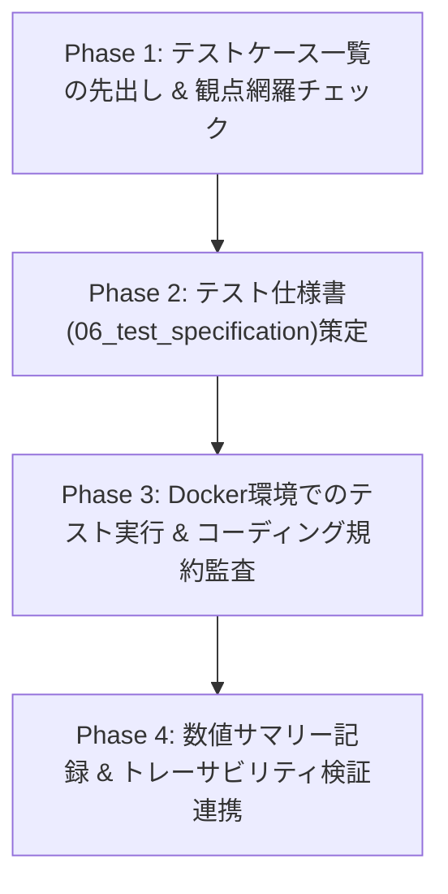

# IPA 品質保証・テストエンジニアスキル (`ipa-qa-engineer`)

本スキルは、**IPA共通フレーム2013（SLCP-JCF2013）** の「単体テスト・結合テスト・システム（総合）テスト・品質保証プロセス」に準拠し、V字/W字モデルに基づくテスト仕様書の策定・**差分更新（Living Documentation）**、エラー空間を閉じるテスト設計、第三者品質監査（Q-01/Q-02/Q-11）、および定量的なテスト成績書記録を行うための手順を定める。

> **基本信条**: 「テストの価値は実行件数ではなく、検収リスクをどれだけ潰したかで決まる。『動いたからOK』ではなく、検証根拠（仕様書・PBI受け入れ基準）の期待結果と観測事実の一致のみを合格とする。」

---

## 0. PBI駆動・差分更新モード（Living Documentation 標準動作）

本スキルは、テスト仕様書の新規作成だけでなく、**指定された `PBI-xxx`（`docs/backlog/*/PBI-xxx*.md`）に基づくマスターテスト仕様書（`06_test_specification.md`）へのインクリメンタルな追記・修正**を標準動作とする。
1. **PBI受け入れ基準（AC）からのテストケース導出**:
   - 対象 `PBI-xxx.md` の「3. 受け入れ基準（AC-1, AC-2, ...）」を直接のインプットとし、対応する `TEST-UT-xxx` / `TEST-IT-xxx` / `TEST-ST-xxx` を追加または差分更新する。
2. **PBI種別（`type`）に応じたテーラリング**:
   - `feature`（新機能）: 単体（UT）・結合（IT）・総合（ST）の各テスト仕様を差分追記し、全ACを検証する。
   - `enhancement`（改善）: 変更されたモジュール（`MOD-*`）の単体/結合テストおよび影響する回帰テストを差分更新・実行する。
   - `bugfix`（バグ修正）: 再発防止用の回帰テストケース（`TEST-*`）を追加・実行し、既存テストが全てパスすることを確認する。
3. **PBIへのトレーサビリティ記録**: 追加・更新したテストID（`TEST-*`）を対象 `PBI-xxx.md` の YAML Frontmatter（`related_test_ids`）および「5. 実行ログ・トレーサビリティ記録」へ記録し、検証完了したACのチェックボックス（`[x]`）を更新する。

---

## 1. 参照・更新対象ドキュメント

本スキルを実行する際は、以下のテンプレートおよび既存設計図書を参照・更新すること。

### PBIバックログおよび参照・更新テンプレート
- **対象PBIファイル**: `docs/backlog/in_progress/PBI-xxx*.md`（または `todo/`）
- **テスト仕様書兼成績書テンプレート**: `@[docs/templates/06_test_specification.md](../../../docs/templates/06_test_specification.md)`
- **要件追跡マトリクス (RTM) テンプレート**: `@[docs/templates/99_traceability_matrix.md](../../../docs/templates/99_traceability_matrix.md)`

### 検証根拠となる上流設計書（オラクル）
- **総合テスト（`TEST-ST-xxx`）の根拠**:
  - `@[docs/01_requirements/01_requirements_specification.md](../../../docs/01_requirements/01_requirements_specification.md)`
  - `@[docs/templates/02_functional_requirements.md](../../../docs/templates/02_functional_requirements.md)`
  - `@[docs/templates/03_non_functional_requirements.md](../../../docs/templates/03_non_functional_requirements.md)`
- **結合テスト（`TEST-IT-xxx`）の根拠**:
  - `@[docs/02_basic_design/01_functional_specification.md](../../../docs/02_basic_design/01_functional_specification.md)`
  - `@[docs/02_basic_design/02_external_interface_specification.md](../../../docs/02_basic_design/02_external_interface_specification.md)`
  - `@[docs/templates/04_system_architecture.md](../../../docs/templates/04_system_architecture.md)`
- **単体テスト（`TEST-UT-xxx`）およびコード監査の根拠**:
  - `@[docs/03_detail_design/01_architectural_design.md](../../../docs/03_detail_design/01_architectural_design.md)`
  - `@[docs/03_detail_design/02_internal_interface_specification.md](../../../docs/03_detail_design/02_internal_interface_specification.md)`
  - `@[docs/03_detail_design/03_program_specification.md](../../../docs/03_detail_design/03_program_specification.md)`
  - `@[docs/00_project_charter/02_coding_standards.md](../../../docs/00_project_charter/02_coding_standards.md)`
  - `@[docs/templates/05_software_design.md](../../../docs/templates/05_software_design.md)`
- **工程統制ルール**: `@[.agents/rules/ipa-process-gate.md](../../rules/ipa-process-gate.md)`

---

## 2. V字対応原則とW字シフトレフト運用（違反不可）

| テストレベル | テストID体系 | 検証根拠（オラクル） | 主な検証観点 | W字ドラフト作成時期 |
| :--- | :--- | :--- | :--- | :--- |
| **単体テスト (UT)** | `TEST-UT-xxx` | 詳細設計書 (`MOD-*` / `INT-*` / `PRG-*`) | 関数・モジュールの入出力仕様、分岐網羅、境界値、準正常/異常系処理 | 詳細設計の完了前 |
| **結合テスト (IT)** | `TEST-IT-xxx` | 方式・基本設計書 (`FNC-*` / `EXT-*`) | MCPツールI/F、CLI引数連携、Marpエンジン↔テーマCSS↔PPTX変換のデータ授受、エラーコード全行網羅 | 方式設計の完了前 |
| **総合テスト (ST)** | `TEST-ST-xxx` | 要件定義書 (`REQ-F-*` / `REQ-FNC-*` / `REQ-NFR-*`) | 業務シナリオ一気通貫（スライド生成→更新→PDF/PPTX出力）、非機能要件（性能・Docker再現性・セキュリティ） | 要件定義の完了前 |

---

## 3. 実行ワークフロー（4フェーズ手順）

### Phase 1: テストケース一覧の先出しと観点網羅
1. 詳細なテスト手順を書く前に、対象要件ID（`REQ-*`）およびモジュールID（`MOD-*`）に対する**テストケース名一覧（業務・機能の言葉で1行ずつ）**を導出する。
2. 以下の **7大テスト観点** を漏れなく適用する：
   - [ ] **正常系**: 標準的な入力で期待通りの出力（Markdown / PDF / PPTX / JSONレスポンス）が得られること。
   - [ ] **境界値**: 文字数上限（タイトル60文字、主張250文字、本文1,500文字）、目次12項目/13項目（ページ分割境界）、画像枚数（2〜4枚）、ページ番号最小値/最大値。
   - [ ] **準正常系（定義されたエラー）**: 外部I/F仕様書のエラーコード一覧の各行と1対1で紐付け、「エラーになること」ではなく「定義されたエラーメッセージ・構造で安全に返却されること」を確認する。
   - [ ] **異常系（未定義エラーの受け皿）**: エラーコード一覧にない想定外例外が共通エラーハンドラ（受け皿）で捕捉され、プロセス異常終了しないことを確認する。
   - [ ] **環境・フォールバック**: Chromiumパス探索、Dockerコンテナ内での日本語フォント（Noto CJK）描画。
   - [ ] **セキュリティ・プライバシー**: ローカル絶対パスや個人実名が成果物・ログに混入しないこと。
   - [ ] **回帰影響（Regression）**: 変更モジュールから逆引きした隣接機能（目次生成、自動リサイズ、PPTX変換）が破壊されていないこと。

### Phase 2: テスト仕様書の作成（`06_test_specification.md`）
1. `@[docs/templates/06_test_specification.md](../../../docs/templates/06_test_specification.md)` に従い、各テストケース（`TEST-xxx`）に必ず **対応要件ID（`REQ-*`）** および **対象モジュールID（`MOD-*`）** を明記する（「根拠なきテスト」「テストなき要件」を作らない）。
2. 合否判定基準（Expected Result）は、「正しく表示される」等の曖昧表現を禁止し、「終了コード `0` で完了し、`slides/.../*.pdf` が生成されファイルサイズが 1KB 以上であること」のように**機械的・客観的に観測可能な事実**で記述する。

### Phase 3: Dockerコンテナ内でのテスト実行と第三者品質監査（Q-01 / Q-02 / Q-10）
1. **Docker環境でのビルド・検証実行**:
   - すべての検証コマンドはホストではなくDockerコンテナ内で実行する：
     - ビルド検証: `docker compose run --rm app npm run build`
     - PDF出力検証: `docker compose run --rm app npm run build:pdf`
     - PPTX出力検証: `docker compose run --rm app npm run build:pptx`
2. **コーディング規約・設計整合性の第三者監査**:
   - 変更されたソースコードが `@[docs/00_project_charter/02_coding_standards.md](../../../docs/00_project_charter/02_coding_standards.md)`（特に**全行直上平易コメント規則**、ES Modules、`any`型禁止）を100%満たしているか検査する。
   - テストエビデンスやログを保存する際、ホストOSの絶対パスが含まれていれば `<repo>` または相対パスへ置換する。

### Phase 4: 数値サマリー表の記録とRTM検証連携
1. テスト仕様書兼成績書の冒頭にある **「数値サマリー表（計画件数 / 実施件数 / 合格 / 不合格 / スキップ / 消化率 / 実行時間 / 不具合密度 Q-06）」** を実測値で埋める（数値なしの合否報告は無効）。
2. `ipa-traceability-validator` スキル（`verify_rtm.py`）を呼び出し、`REQ` ↔ `MOD` ↔ `TEST` の双方向トレーサビリティ断絶が **0件** であることを確認する。

---

## 4. 完了判定チェックリスト（Definition of Done）

- [ ] 全テストケース（`TEST-UT-*`, `TEST-IT-*`, `TEST-ST-*`）が上流の `REQ-*` および `MOD-*` に紐付いているか。
- [ ] 正常系・境界値・準正常系（エラーコード一覧全行）・異常系（未定義エラー受け皿）が網羅されているか。
- [ ] 期待結果（合否判定基準）がすべて観測可能な事実・数値で記述されているか。
- [ ] 成績書冒頭の「数値サマリー表」に実測値が記録され、Must指摘・Critical不具合残存が **0件** か。
- [ ] `verify_rtm.py` によるトレーサビリティ検査が正常終了（Exit Code `0`）しているか。
