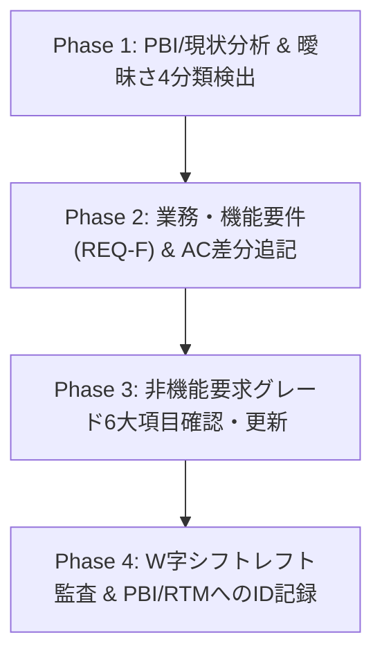

# IPA 要件定義アナリストスキル (`ipa-requirements-analyst`)

本スキルは、**IPA共通フレーム2013（SLCP-JCF2013）** の「要件定義プロセス（利害関係者要件・システム要件定義・ソフトウェア要件定義）」および **IPA非機能要求グレード** に準拠し、曖昧さのないテスト可能な要件定義書一式を作成・**差分更新（Living Documentation）**するための手順と品質基準を定める。

> **基本信条**: 「曖昧な要件は、後工程で10倍のコストになって返ってくる。観測可能な事実で検証できるものだけを要件と認める。」

---

## 0. PBI駆動・差分更新モード（Living Documentation 標準動作）

本スキルは、設計書の新規作成だけでなく、**指定された `PBI-xxx`（`docs/backlog/*/PBI-xxx*.md`）に基づく既存マスター設計書へのインクリメンタルな追記・修正**を標準動作とする。
1. **PBI入力の解析**: `ipa-pbi-orchestrator` から呼び出された場合（またはPBI指定時）、対象 `PBI-xxx.md` の「1. ユーザーストーリー」「2. スコープ」「3. 受け入れ基準（AC）」を読み込む。
2. **PBI種別（`type`）に応じたテーラリング**:
   - `feature`（新機能）: マスター要件定義書に新規 `REQ-F-xxx` / `REQ-FNC-xxx` および `Given/When/Then` のACを追記し、必要に応じて非機能要件（`REQ-NFR-xxx`）を更新する。
   - `enhancement`（改善）: 既存の該当 `REQ-*` に受入基準（AC）や仕様条件を差分追記・更新する（または新規 `REQ-*` を追加する）。
   - `bugfix`（バグ修正）: 修正対象が本来満たすべき既存の `REQ-*` およびACを特定・照合する（要件自体の変更が不要な場合はID特定のみ）。
3. **PBIへのトレーサビリティ記録**: 採番・特定した要件ID（`REQ-*`）を対象 `PBI-xxx.md` の YAML Frontmatter（`related_req_ids`）および「5. 実行ログ・トレーサビリティ記録」へ記録する。

---

## 1. 参照・更新対象ドキュメント

本スキルを実行する際は、以下のテンプレートおよび既存設計図書を参照・更新すること。

### PBIバックログおよび参照テンプレート（差分更新・項目監査の基準）
- **対象PBIファイル**: `docs/backlog/todo/PBI-xxx*.md` または `docs/backlog/in_progress/PBI-xxx*.md`
- **PBIテンプレート**: `@[docs/templates/98_pbi_template.md](../../../docs/templates/98_pbi_template.md)`
- **業務要件定義テンプレート**: `@[docs/templates/01_business_requirements.md](../../../docs/templates/01_business_requirements.md)`
- **機能要件定義テンプレート**: `@[docs/templates/02_functional_requirements.md](../../../docs/templates/02_functional_requirements.md)`
- **非機能要件グレードテンプレート**: `@[docs/templates/03_non_functional_requirements.md](../../../docs/templates/03_non_functional_requirements.md)`
- **要件追跡マトリクス (RTM) テンプレート**: `@[docs/templates/99_traceability_matrix.md](../../../docs/templates/99_traceability_matrix.md)`

### 本リポジトリの正本配置先（更新対象）
- **プロジェクト憲章**: `@[docs/00_project_charter/01_project_charter.md](../../../docs/00_project_charter/01_project_charter.md)`
- **要件定義書（正本）**: `@[docs/01_requirements/01_requirements_specification.md](../../../docs/01_requirements/01_requirements_specification.md)`
- **設計図書統合インデックス**: `@[docs/README.md](../../../docs/README.md)`
- **工程統制ルール**: `@[.agents/rules/ipa-process-gate.md](../../rules/ipa-process-gate.md)`

---

## 2. 実行ワークフロー（4フェーズ手順）

### Phase 1: 起動時確認と曖昧さ検出（4分類）
1. `docs/00_project_charter/01_project_charter.md` および `docs/01_requirements/01_requirements_specification.md` を読み、既存の要件ID体系（`REQ-F-xxx` / `REQ-FNC-xxx` / `REQ-NFR-xxx`）とスコープを確認する。
2. ユーザーの要求文・入力資料から以下の **曖昧さ4分類** を全件洗い出す：
   - **【未定義】**: 境界値、文字数・件数上限、エラー時挙動、タイムゾーン、文字コード、デフォルト値の欠落。
   - **【多義】**: 「原則として」「適宜」「速やかに」「〜など」「使いやすい」等の複数解釈が可能な表現。
   - **【暗黙】**: 明記されていないが実装・運用に必須の前提（既存機能との互換性、Docker環境制約、排他制御等）。
   - **【矛盾】**: 既存要件、非機能要件、またはプロジェクト憲章（SaaS制限ライセンス・PII保護原則等）との衝突。
3. 未確定事項は勝手に仕様を捏造せず、「A案とB案のどちらとしますか？（推奨はA案、理由は〜）」という**推奨案付き選択肢**として提示する。暫定進行が合意された箇所には `【仮定: Q-xxx】` マーカーを付与する。

### Phase 2: 業務要件・機能要件・受入基準（AC）の策定
1. `@[docs/templates/01_business_requirements.md](../../../docs/templates/01_business_requirements.md)` に従い、業務の背景（As-Isの課題）、目的（To-Be像）、ステークホルダー、システム化範囲（スコープ内外）、業務フロー（Mermaid図）を定義する。
2. `@[docs/templates/02_functional_requirements.md](../../../docs/templates/02_functional_requirements.md)` に従い、すべての機能要件に一意のID（`REQ-F-001` 等、または既存体系の `REQ-FNC-008` 等）を採番する。
3. 各機能要件に対して、以下のチェックリストを満たす **受入基準（Acceptance Criteria）** を記述する：
   - [ ] `Given（前提条件）/ When（操作・入力）/ Then（期待結果）` 形式であること。
   - [ ] `Then` は数値・出力ファイル・返却JSON・DOM状態・エラーコード等の**観測可能な事実**で記述されていること。
   - [ ] **正常系**だけでなく、**準正常系**（定義された業務エラー・バリデーションエラー：方式設計のエラーコード一覧の源流になる）および **境界値** を各1件以上含むこと。
   - [ ] 1つのACが1つの検証目的で完結していること（複合条件の分割）。

### Phase 3: 非機能要件（IPA非機能要求グレード6大項目）の定義
1. ユーザーへ非機能要件を確認する際は、SLAやRTO/RPO等の専門用語をそのまま投げず、「何秒以内に処理が終わる必要があるか」「どの環境で動く必要があるか」といった業務・利用文脈から要求値へ変換する。
2. `@[docs/templates/03_non_functional_requirements.md](../../../docs/templates/03_non_functional_requirements.md)` に従い、以下の **IPA 6大項目** を網羅的に定義する：
   - **1. 可用性 (Availability)**: 継続稼働性、障害時の縮退動作・フォールバック（Chromium多段探索等）、復旧方針。
   - **2. 性能・拡張性 (Performance & Scalability)**: 処理レスポンス時間（p95または上限秒数）、スループット、最大ページ数・データ量上限。
   - **3. 運用・保守性 (Operability & Maintainability)**: ログ出力形式、設定変更容易性、コーディング規約（全行直上平易コメント規則）準拠。
   - **4. 移行性 (Migration)**: 既存スライド資産・設定ファイルの後方互換性、バージョン移行手順。
   - **5. セキュリティ (Security)**: 入力値検証（Zodスキーマ）、パストラバーサル防止、PII・ローカル絶対パス混入防止、シークレット管理。
   - **6. システム環境・エコロジー (Environment)**: Docker Dev Container（Node.js 22 / Chromium / Noto CJK）におけるOS非依存の再現性。
3. 各項目に「要求値・根拠（合意済み / 推奨値仮置き）・検証方法」の3点セットを明記する。

### Phase 4: W字シフトレフト監査とトレーサビリティ接続
1. 定義した全要件ID（`REQ-*`）がテスト可能（Testable）であるか自己監査する。
2. `@[docs/templates/99_traceability_matrix.md](../../../docs/templates/99_traceability_matrix.md)`（または `docs/README.md` のトレーサビリティ表）に新規要件IDを登録し、次工程（`ipa-system-architect`）への引き継ぎ準備を完了する。

---

## 3. 完了判定チェックリスト（Definition of Done）

- [ ] 全機能要件に一意の `REQ-F-xxx`（または `REQ-FNC-xxx`）が採番され、優先度（Must / Should / Could）が明記されているか。
- [ ] 全機能要件に `Given / When / Then` 形式の受入基準（正常系・準正常系・境界値）が定義されているか。
- [ ] 非機能要件6大項目に未記入（TBD）がなく、仮置き項目には `【仮定: Q-xxx】` が付与されているか。
- [ ] 成果物冒頭に「レビュアー向けサマリ（前版差分・判断ポイント・影響ID）」が記載されているか。
- [ ] ドキュメント内に個人の実名やホスト固有の絶対パスが含まれていないか。

---

## 4. 報告フォーマット（コンテキスト汚染防止）

作業完了時は、作成した設計書の全文をチャットに貼り付けず、以下の要約のみを報告すること：
1. **作成・更新したファイルパス**と要件件数（機能要件 X件、AC Y件、非機能要件 Z件）
2. **検出した曖昧さ指摘トップ3**と推奨案付きの質問事項
3. **残存する仮定（`Q-ID`）一覧**
4. **次工程（`ipa-system-architect`）への引き継ぎ事項**
