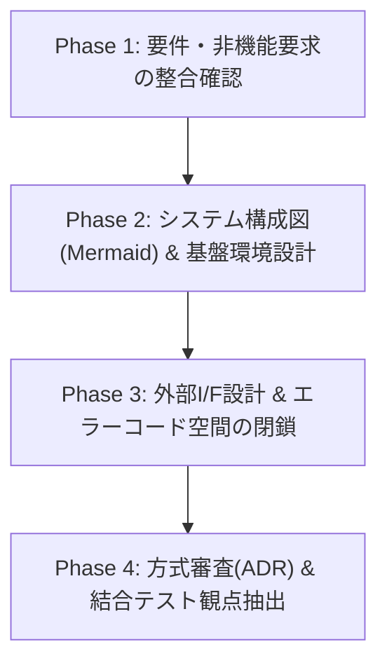

# IPA システム方式設計・アーキテクトスキル (`ipa-system-architect`)

本スキルは、**IPA共通フレーム2013（SLCP-JCF2013）** の「システム方式設計・ソフトウェア方式設計（基本設計 / 外部設計）」に準拠し、システム全体構成、基盤環境、外部インターフェース（I/F）、およびエラー空間の閉鎖を設計・**差分更新（Living Documentation）**・審査するための手順と基準を定める。

> **基本信条**: 「方式設計の判断基準は『動くか』ではなく『2年後に別の保守担当者が理解・変更でき、非機能要件を確実に満たせるか』である。外部I/Fは一度公開したら容易に変えられない契約である。」

---

## 0. PBI駆動・差分更新モード（Living Documentation 標準動作）

本スキルは、設計書の新規作成だけでなく、**指定された `PBI-xxx`（`docs/backlog/*/PBI-xxx*.md`）に基づく既存マスター方式設計書へのインクリメンタルな追記・修正**を標準動作とする。
1. **PBI種別（`type`）に応じたテーラリング**:
   - `feature`（新機能）: 影響するシステム構成図、外部I/F仕様（`EXT-*`）、エラーコード一覧（最終行の未定義エラー受け皿含む）をマスター方式設計書に差分追記する。
   - `enhancement`（改善）: 外部I/Fや構成に変更がある場合のみ該当箇所を差分更新する（内部実装のみの改善で外部I/F不変の場合は影響なしと記録して詳細設計へ進む）。
   - `bugfix`（バグ修正）: 原則として方式設計はスキップ可（外部I/F仕様自体の欠陥修正時のみ差分更新を実施）。

---

## 1. 参照・更新対象ドキュメント

本スキルを実行する際は、以下のテンプレートおよび既存設計図書を参照・更新すること。

### PBIバックログおよび参照テンプレート（差分更新・方式審査の基準）
- **対象PBIファイル**: `docs/backlog/in_progress/PBI-xxx*.md`（または `todo/`）
- **システム方式設計テンプレート**: `@[docs/templates/04_system_architecture.md](../../../docs/templates/04_system_architecture.md)`
- **ソフトウェア設計テンプレート（方式・データモデル部）**: `@[docs/templates/05_software_design.md](../../../docs/templates/05_software_design.md)`
- **要件追跡マトリクス (RTM) テンプレート**: `@[docs/templates/99_traceability_matrix.md](../../../docs/templates/99_traceability_matrix.md)`

### 上流入力および本リポジトリの正本配置先（更新対象）
- **要件定義書（上流入力）**: `@[docs/01_requirements/01_requirements_specification.md](../../../docs/01_requirements/01_requirements_specification.md)`
- **機能仕様書（基本設計正本）**: `@[docs/02_basic_design/01_functional_specification.md](../../../docs/02_basic_design/01_functional_specification.md)`
- **外部I/F仕様書（基本設計正本）**: `@[docs/02_basic_design/02_external_interface_specification.md](../../../docs/02_basic_design/02_external_interface_specification.md)`
- **設計図書統合インデックス**: `@[docs/README.md](../../../docs/README.md)`
- **工程統制ルール**: `@[.agents/rules/ipa-process-gate.md](../../rules/ipa-process-gate.md)`

---

## 2. 着手前提条件（Entry Criteria）

以下の条件を満たさない場合は方式設計に着手せず、`ipa-requirements-analyst` へ差し戻すこと：
1. 対象 `PBI-xxx.md` が存在し、対応する機能要件ID（`REQ-F-*` / `REQ-FNC-*`）および受入基準（AC）が定義・紐付け済みであること。
2. 非機能要件（性能・可用性・セキュリティ・稼働環境）に要求値（仮置き含む）が設定されていること。
3. 未確定要件に依存する箇所がある場合、`【仮定: Q-xxx】` マーカーが付与されていること。

---

## 3. 実行ワークフロー（4フェーズ手順）



### Phase 1: 上流要件のトレースとレイヤリング確認
1. 対象となる要件ID（`REQ-*`）を特定し、`docs/02_basic_design/01_functional_specification.md` の5層アーキテクチャ（1. Presentation Theme層 / 2. Rendering Engine層 / 3. Converter & Build Engine層 / 4. MCP Service層 / 5. AI Agent & UI層）のどの層に責務を配置するか決定する。
2. 層の責務越境（例：テーマ層にビジネスロジックを混入させる、MCP層で直接DOM操作を行う等）がないか検証する。

### Phase 2: システム方式設計（構成図・基盤環境・セキュリティ境界）
1. `@[docs/templates/04_system_architecture.md](../../../docs/templates/04_system_architecture.md)` に従い、以下を設計・記述する：
   - **システム全体構成図（Mermaid `flowchart` / `sequenceDiagram`）**: コンポーネント間の呼び出し方向、プロトコル（Stdio JSON-RPC、CLI、Puppeteer IPC）、データの流れを明記する。
   - **基盤環境・コンテナ構成**: Docker Dev Container（Node.js 22 LTS、Chromium、Noto CJKフォント）における稼働条件、環境変数（`CHROME_PATH`, `PUPPETEER_ARGS` 等）、障害時のフォールバック方式（多段階ブラウザ探索等）。
   - **信頼境界とセキュリティ設計**: 外部入力（MCPクライアントからのJSONペイロード、ファイルパス指定）のバリデーション境界、ローカルファイルアクセス制限、PII・絶対パス遮断方式。

### Phase 3: 外部I/F設計とエラー空間の閉鎖（最重要）
1. MCPツール（`EXT-MCP-xxx`）、CLIコマンド（`EXT-CLI-xxx`）、設定ファイル（`EXT-CFG-xxx`）の外部I/F仕様を定義する。
2. 全リクエスト/レスポンス項目について、**項目名・型・必須/任意・制約（文字数・正規表現・列挙値）・デフォルト値**を漏れなく定義する（「TBD」を残さない）。
3. **エラー空間の閉鎖（Closed Error Space）**:
   - 準正常系（設計された「できない」境界：バリデーション不正、対象ファイル不在、ページ番号範囲外等）のエラーコードを全数列挙する。
   - エラーコード一覧表の**最終行には必ず受け皿行「上記以外（未定義エラー / `ERR-SYS-999`）」を配置**し、共通エラーハンドラの挙動（プロセスクラッシュを防ぎ構造化エラーレスポンスを返す等）を定義する。これによりエラー空間を閉じ、後工程（結合テスト）で各行IDを1対1で検証可能にする。
4. 更新系I/Fの**冪等性**（二重実行時の挙動）および一時ファイル出力・クリーンアップ方式を明記する。

### Phase 4: 新規技術・ライブラリ導入審査（Architecture Guardian 審査）
新しいパッケージや設計パターンを導入する場合は、以下の基準で審査し、ADR（Architecture Decision Record）セクションに記録する：
- [ ] **既存手段での実現不能性**: 既存の依存関係（`@modelcontextprotocol/sdk`, `zod`, `@marp-team/marp-cli`, `puppeteer`, `pptxgenjs`）やNode.js標準APIで実現できない明確な理由があるか（既存で可能なら原則却下）。
- [ ] **保守容易性**: 2年後に別担当者が読んで理解できるか。
- [ ] **ライセンス・セキュリティ適合性**: OSS公開方針およびDockerコンテナビルドと競合しないか。
- [ ] **撤退容易性**: 特定モジュール内に隔離され、将来差し替え可能か。

---

## 4. 方式審査・判定フォーマット（必須）

方式設計の完了またはアーキテクチャ審査時は、以下の形式で判定を記録すること：

```markdown
## 方式設計審査判定: 承認 / 条件付き承認 / 却下 / 要人間判断
- **対象要件ID / 外部I/F ID**: `REQ-...` / `EXT-...`
- **判断理由（トレードオフと根拠 3点以内）**:
  1. ...
- **条件・却下代替案（該当する場合）**:
  - ...
- **ADR記録（決定事項 / 却下した代替案 / 影響範囲）**:
  - ...
```

---

## 5. 完了判定チェックリスト（Definition of Done）

- [ ] すべての要件ID（`REQ-*`）に対応する機能ID（`FNC-*`）または外部I/F ID（`EXT-*`）が割り当てられているか。
- [ ] システム構成図（Mermaid）が記載され、非機能要件（性能・可用性・Docker移植性）を満たす根拠が明記されているか。
- [ ] 外部I/Fの全項目に型・必須区分・制約が定義され、「TBD」が残っていないか。
- [ ] エラーコード一覧に準正常系が網羅され、最終行に受け皿「上記以外（未定義エラー）」が定義されているか。
- [ ] W字シフトレフトとして、結合テスト仕様（外部I/F検証観点）への入力情報が揃っているか。
