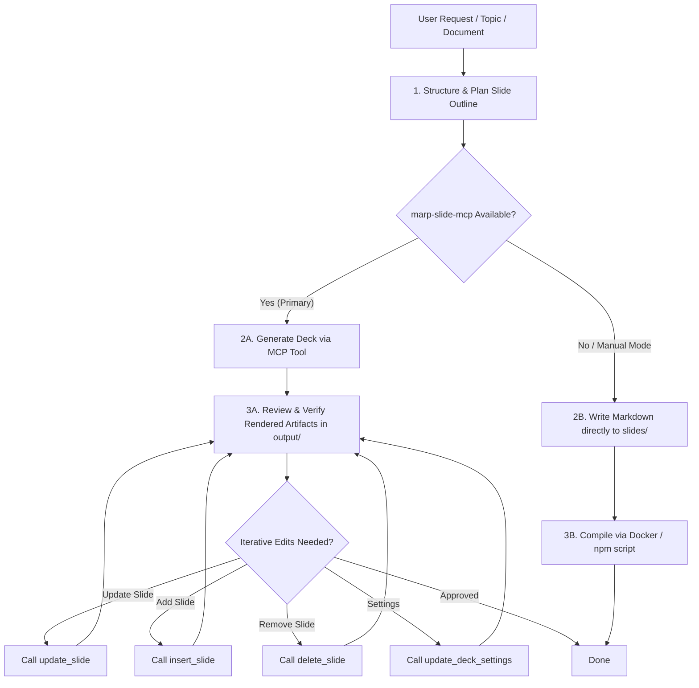

# Marp Slides Skill

This skill provides comprehensive instructions and best practices for creating, modifying, and exporting high-quality presentation slides using the `marp-slide-mcp` MCP server tools and the corporate consulting theme (`themes/*.css`, defaulting to `themes/business-slide-theme.css`).

## Overview

The presentation workflow follows the **MBB (McKinsey, BCG, Bain) consulting standard**:
- **One Slide, One Message ("ワンスライド・ワンメッセージ")**: Focus on a single core takeaway per slide.
- **Pyramid Principle / Conclusion First**: Lead with the key claim in the dedicated message band.
- **Structured Content**: Utilize 2-column comparisons, image grids, Mermaid diagrams, tables, and code blocks rather than unstructured text walls.
- **Dual-Mode Execution**:
  1. **MCP Mode (Recommended & Default)**: Programmatic deck creation, master JSON management, and automated HTML/PDF compilation via `marp-slide-mcp`.
  2. **Direct Markdown Fallback**: Direct Markdown authoring in `slides/` with CLI/container compilation when MCP is unavailable or when raw files are requested.

---

## Core Workflow



### Step 1: Analyze & Outline
1. Extract key topics and takeaways from the input material or user prompt.
2. Determine the slide aspect ratio:
   - `4:3` (Default, 960x720): Standard projector, document/print format.
   - `16:9` (Wide, 1280x720): Modern widescreen display, PC presentation, wide tables or 2-column layouts.
3. Select an appropriate theme color (e.g., Corporate Navy `#1f497d`, Forest Green `#2e7d32`, Crimson `#881b34`, Dark Slate `#2c3e50`).
4. Allocate 1 core claim per slide and choose the most effective body layout (`bodyContent`, `twoColumns`, `imageGrid`, Mermaid, or Table).

---

### Step 2A: Generate Slide Deck via MCP (Primary Route)
When `marp-slide-mcp` is active in the environment, call `generate_slide_deck` (via `call_mcp_tool` with `ServerName: "marp-slide-mcp"` or direct tool call):

```json
{
  "filenamePrefix": "proposal",
  "size": "16:9",
  "themeColor": "#1f497d",
  "logoPath": "../slides/N-Y-Public_Logo.jpg",
  "titleSlide": {
    "mainTitle": "次世代プラットフォーム戦略構想",
    "subTitle": "デジタル変革による事業成長のロードマップ",
    "bookNo": "DOC-2026-001",
    "author": "戦略推進部 / 担当者名",
    "date": "2026年9月1日",
    "copyright": "© 2026 N-Y-Public",
    "confidentiality": "CONFIDENTIAL"
  },
  "normalSlides": [
    {
      "pageTitle": "エグゼクティブサマリ",
      "claim": "市場拡大の好機を捉え、向こう3年でデジタル基盤刷新と収益多角化を同時達成する",
      "chartTitle": "戦略の全体像と期待効果",
      "twoColumns": {
        "leftContent": "### 現状の課題\n- レガシーシステムの維持コスト増大\n- 部門間データ分断による意思決定遅延\n- 新規サービス立ち上げリードタイムの長期化",
        "rightContent": "### 推進施策\n- **クラウドネイティブ基盤移行**\n- **全社データレイク統合**\n- **APIファーストによるアジャイル開発**"
      },
      "source": "出所: 社内戦略検討ワーキンググループまとめ"
    }
  ]
}
```

#### Verification & Iteration with MCP
- Artifacts generated: `output/<slideId>.json`, `.md`, `.html`, `.pdf`.
- Use granular tools for subsequent edits:
  - **`get_slide_deck`**: Inspect current slide structure and page numbers.
  - **`update_slide`**: Update title, claim, or body of page `N` (`targetPageNumber >= 2`).
  - **`insert_slide`**: Insert a new slide after page `N` (`insertAfterPage >= 1`).
  - **`delete_slide`**: Delete page `N` (`targetPageNumber >= 2`).
  - **`update_deck_settings`**: Update theme color, size ratio, logo path, or title slide metadata.
  - **`export_to_pdf`**: Re-export PDF from `fileId` or custom Markdown path.

---

### Step 2B: Direct Markdown Fallback (When MCP is Unavailable)
If the MCP server is not registered in the host agent environment or the user asks to save raw files under `slides/`:

1. Identify the active CSS theme in `themes/` (default: `themes/business-slide-theme.css`).
2. Create dedicated directory `slides/<deck_name>/` and author `slides/<deck_name>/<deck_name>.md` with frontmatter, style imports (`@import '../../themes/business-slide-theme.css'`), and anchor headings (see [Theme Guidelines](./references/theme_guidelines.md)).
3. Compile inside Docker sandbox container:
   ```bash
   docker exec -u node -w /workspaces/Marp <container_id> npm run build:pdf
   ```
   Or export via Marp CLI directly:
   ```bash
   docker exec -u node -w /workspaces/Marp <container_id> npx @marp-team/marp-cli slides/<deck_name>/<deck_name>.md --theme-set themes/business-slide-theme.css --pdf --allow-local-files -o slides/<deck_name>/<deck_name>.pdf
   ```

---

## Layout Rules & Constraints Quick Reference

| Element | Heading Anchor | Character / Line Guidelines | Notes |
| :--- | :--- | :--- | :--- |
| **Page Title** | `# ページタイトル` | **40–60 chars** (1–2 lines) | Top-left aligned. Subtitle/badge style supported. |
| **Page Claim** | `## ページ主張` | **Max 250 chars** (3–5 bullet lines) | Displayed in upper gray band. Can omit in `wide-content`. |
| **Chart Title** | `### 主張補足タイトル` | **Max 60 chars** (1 line) | Section header placed directly above the body area. |
| **Body Content** | `#### 本文` | **Max 1,500 chars** (10–15 lines) | Supports text, bullets, 2-column, image grid, Mermaid, tables, code. |
| **Source / Footnote**| `##### 図表出典` | **Max 100 chars** (1 line) | Bottom-right aligned above footer. |
| **Copyright** | `###### コピーライト` | Default: `© 2026 N-Y-Public` | Bottom-left footer. |
| **Confidentiality** | `###### 機密指定` | Default: `CONFIDENTIAL` | Bottom-right footer. |

> [!IMPORTANT]
> The theme uses Markdown headings purely as **positioning anchors**. The text of `# ...` is hidden by CSS. The actual text must be placed on the line immediately following the anchor heading.

---

## Portability & Theme Discovery

- **Theme Naming**: The standard theme is located in `themes/` (e.g. `themes/business-slide-theme.css`). Agents and users can inspect `themes/*.css` to adapt the `@import` path and `theme:` name accordingly.
- **Client Agnostic**: In addition to Antigravity, this skill and the underlying MCP server work with any MCP-compatible environment (Claude Desktop, Cursor, etc.). See [MCP Tools Reference](./references/mcp_tools.md) for configuration snippets.

---

## Detailed References

For comprehensive documentation, consult the following references:
- **[Theme & Layout Guidelines](./references/theme_guidelines.md)**: Deep dive into CSS mechanics, classes, sizing, anchor mappings, and direct Markdown templates.
- **[MCP Tools Reference](./references/mcp_tools.md)**: Full parameter schemas, constraints, client configuration examples, and call samples for all 7 MCP tools.
- **[Slide Patterns & Best Practices](./references/slide_patterns.md)**: Ready-to-use patterns for 2-column layouts, image grids, Mermaid diagrams, tables, and conversation cards.
- **[Sample Payload Example](./examples/sample_deck_payload.json)**: Complete multi-slide JSON payload for `generate_slide_deck`.
