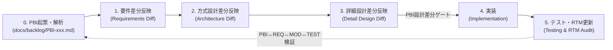

# Antigravity Agent Guidelines & Project Rules

This repository is a public Open Source Software (OSS) project for `marp-slide-mcp`.
All AI agents operating in **Antigravity 2.0** and **Antigravity IDE** MUST strictly follow the rules defined in this document.

---

## 1. CRITICAL MANDATE: Docker Development Environment Only

> [!IMPORTANT]
> **NEVER execute development commands directly on the host machine.**
> All installations, builds, type checking, tests, Marp conversions, and script executions MUST run inside the Docker container.

### Execution Policy
- **Antigravity IDE**: Open and operate within the DevContainer (`ms-vscode-remote.remote-containers`).
- **Antigravity 2.0 / Terminal Commands**: When executing shell commands from the host, always route them through Docker Compose:

```bash
# General command execution
docker compose run --rm app <command>

# Or use the provided helper scripts:
# Windows (PowerShell):
.\dev.ps1 run npm run build
.\dev.ps1 run npm run build:pdf

# Linux / Mac / WSL (Bash):
./dev.sh run npm run build
./dev.sh run npm run build:pdf
```

### Standard Automated Development Workflow
- **Dependency installation**: `docker compose run --rm app npm install`
- **TypeScript Build**: `docker compose run --rm app npm run build`
- **Slide PDF Export**: `docker compose run --rm app npm run build:pdf`
- **Slide PPTX Export**: `docker compose run --rm app npm run build:pptx`
- **Start MCP Server**: `docker compose run --rm app npm run start`
- **Traceability Matrix Audit**: `docker compose run --rm app python3 .agents/skills/ipa-traceability-validator/scripts/verify_rtm.py`

---

## 2. OSS Privacy & Identity Protection

> [!CAUTION]
> **NO PERSONAL IDENTIFIABLE INFORMATION (PII) OR LOCAL HOST PATHS.**
> This repository is publicly published on GitHub (`https://github.com/N-Y-Public/marp-slide-mcp`).

1. **Git Author / Committer Identity**:
   - Name: `N-Y-Public`
   - Email: `330902043+N-Y-Public@users.noreply.github.com`
   - Never use personal names or private email addresses.
   - The `.githooks/pre-commit` hook automatically enforces this policy.
   - In all design documents, review records, and test reports, use role IDs (e.g., `ROLE-PM`, `ROLE-ARCH`, `ROLE-DEV`, `ROLE-QA`) or `N-Y-Public`—never personal real names.

2. **No Local Host Paths**:
   - Never commit or log host-specific absolute paths (such as `/Users/...`, `/home/...`, or `C:\path\to\...`).
   - Always use relative paths from the repository root (e.g. `./slides/...`, `./src/...`, `./docs/...`) or `<repo>` placeholders in test evidence.

3. **No Secrets / Credentials**:
   - Never commit `.env`, API keys, tokens, or credential files.
   - Refer to `.gitignore` for excluded patterns.

4. **Pre-Execution Identity Gate (GitHub Operations)**:
   - Before executing any mutating GitHub operations (creating issues, PRs, comments, branches, or pushes) via GitHub MCP tools or GitHub API, all AI agents **MUST** first execute `get_me` to verify the authenticated user identity.
   - Enforced Identity Criterion:
     - Expected Account Login: `process.env.EXPECTED_GITHUB_LOGIN || "N-Y-Public"`.
     - Expected Account ID: If `EXPECTED_GITHUB_ID` is set, verify `id.toString() === process.env.EXPECTED_GITHUB_ID`. If unset and the login is the default `"N-Y-Public"`, enforce `id === 330902043`.
   - If `login` does NOT match the expected account or the check fails, the agent MUST immediately abort the operation and report the identity mismatch blocker to the user. Never perform GitHub write operations under unverified or mismatched accounts.

---

## 3. Project Architecture & Manual Source Integration

1. **Source Code Structure**:
   - Source files (TypeScript MCP server, custom Marp business themes, PPTX converter, slide templates, prompts, IPA design docs) are managed under `src/`, `themes/`, `slides/`, `templates/`, `prompts/`, `pptx_converter/`, and `docs/`.
   - The container image contains Node.js 22 LTS, Python 3, headless Chromium, Japanese CJK fonts (`fonts-noto-cjk`), and Puppeteer dependencies to guarantee pixel-perfect Marp PDF exports.

2. **Automated Verification Before Commit**:
   - Always ensure TypeScript compiles cleanly: `docker compose run --rm app npm run build`
   - Verify slide export renders properly if slide changes occur: `docker compose run --rm app npm run build:pdf`
   - Verify requirement-to-test traceability when design or implementation changes occur: `docker compose run --rm app python3 .agents/skills/ipa-traceability-validator/scripts/verify_rtm.py`

---

## 4. IPA Common Frame 2013 (SLCP-JCF2013) × PBI-Driven Agile Governance

This repository adopts a hybrid development governance framework combining **PBI-driven Agile development (Macro)** with **IPA Common Frame 2013 (SLCP-JCF2013) V-Model / W-Model quality gates (Micro)** (derived from `claude-code-project-pack` and optimized for Antigravity 2.0). Detailed gate criteria are enforced via `@[ipa-process-gate.md](.agents/rules/ipa-process-gate.md)`.

### 4.1 PBI-Driven Micro-Waterfall Sequence & Implementation Gate

All new feature development (`feature`), enhancements (`enhancement`), and bug fixes (`bugfix`) MUST start from a structured PBI file (`docs/backlog/*/PBI-xxx*.md`) and execute the five-stage IPA micro-cycle orchestrated by `ipa-pbi-orchestrator`:



> [!IMPORTANT]
> **PBI駆動・実装前設計書差分レビュー強制原則 (PBI Pre-Implementation Design Gate)**:
> **実装コード（`src/`, `pptx_converter/`, `themes/`, `marp.config.js`）の変更は、対象となる `PBI-xxx.md` が存在し、かつそのPBIに対応する詳細設計書（`docs/03_detail_design/` または `docs/templates/05_software_design.md`）の差分更新が完了している場合のみ許可する。**
> - **Living Documentation（差分更新原則）**: PBIごとにゼロから巨大な設計書を作るのではなく、既存のマスター設計書に対してPBI単位で差分を追記・更新する。
> - **PBI種別テーラリング**: `feature`（全工程実施）、`enhancement`（影響設計書の差分更新＋実装＋テスト＋RTM）、`bugfix`（原因特定・詳細設計乖離確認＋修正実装＋回帰テスト＋RTM、方式設計はスキップ可）。
> - **越境ルール**: 宣言された現在工程の外の作業を行う必要がある場合は、黙って越境せず、必ずユーザー（承認者）へ「現在の工程はXですが、工程Yの作業へ越境しますか？」と確認し、合意と理由を記録してから着手すること。

### 4.2 Ambiguity & Assumption Control (曖昧さ排除・仮定管理)

1. **テスト可能な要件・PBI受入基準記述**:
   - PBIの受入基準（AC）および機能要件（`REQ-F-xxx` / `REQ-FNC-xxx`）は、`Given（前提）/ When（操作）/ Then（観測可能な期待結果）` 形式で記述する。「適切に」「速やかに」「使いやすく」等の曖昧表現は禁止する。
2. **曖昧さ4分類の検出とエスカレーション**:
   - 要件や仕様に **【未定義】【多義】【暗黙】【矛盾】** を発見した場合は、AIの独断で仕様を捏造せず、推奨案付きの選択肢形式でユーザーへ確認を行う。
3. **仮定マーカー (`【仮定: Q-xxx】`)**:
   - 未確定事項を残したまま暫定進行が承認された場合は、PBI・設計書・テスト仕様書・コードコメントの該当箇所に `【仮定: Q-xxx】` を明記し、確定時に機械検索（grep）で確実に巻き戻せる状態を保つ。仮定の多段積みは最大2段までとし、3段目は必ず人間へエスカレーションする。

### 4.3 Quality Gates (QCD基準) & Separation of Concerns

| ゲートID | 統制項目 | 合否基準（デフォルト確定値） | 担当スキル / 検証手段 |
| :--- | :--- | :--- | :--- |
| **Q-01 / Q-11** | 生成と検証の分離 | 設計書・コードの作成と品質監査・RTM検証を分離（自己申告のみの完了禁止） | `ipa-qa-engineer` / `ipa-traceability-validator` |
| **Q-02** | 設計・コードMust指摘残存 | 重大欠陥（Must指摘）・ビルドエラー残存 **0件** | `docker compose run --rm app npm run build` |
| **Q-03** | トレーサビリティ断絶 | `PBI-*` ↔ `REQ-*` ↔ `MOD-*` ↔ `TEST-*` の孤立・未定義参照 **0件** | `verify_rtm.py` による自動検査 |
| **Q-06** | エラー空間の閉鎖 | 準正常系（定義済みエラーコード）と異常系受け皿（「上記以外（未定義エラー）」）の明記 | `ipa-system-architect` / `ipa-qa-engineer` |
| **Q-09** | セキュリティ・PII保護 | Critical/High脆弱性 **0件**、実名・ローカル絶対パス混入 **0件** | `.githooks/pre-commit` / 静的監査 |
| **Q-10** | コーディング規約準拠 | `docs/00_project_charter/02_coding_standards.md`（**全行直上平易コメント規則**）100%遵守 | `ipa-detail-designer` / `ipa-qa-engineer` |
| **D-01** | 進捗完了定義（0/100原則） | PBI・成果物の完了は「RTM検証・レビュー確認済み（100%）」のみ。「90%完了」等の曖昧報告は無効 | 全工程共通 |

### 4.4 Antigravity 2.0 Specialized Skills & Templates Catalog

| 工程 / 領域 | スキル名 (`.agents/skills/`) | 役割・責務 | 参照・更新対象テンプレート (`docs/templates/`) | 既存成果物配置先 (`docs/`) |
| :--- | :--- | :--- | :--- | :--- |
| **工程統制ルール** | `@[ipa-process-gate](.agents/rules/ipa-process-gate.md)` | PBI駆動V字/W字工程順序の強制、実装前設計差分ゲート判定、越境管理、QCD基準審査 | 全テンプレート共通 | `docs/README.md` |
| **0. PBI統制司令塔** | `ipa-pbi-orchestrator` | PBI起票・解析、種別テーラリング、Step 1〜5（要件→設計差分→実装→テスト→RTM）の直列実行 | `98_pbi_template.md` | `docs/backlog/{todo,in_progress,done}/` |
| **1. 要件定義(差分)** | `ipa-requirements-analyst` | PBIに基づく業務/機能要件（`REQ-F-*`）・AC差分追記、IPA非機能要求グレード6大項目定義 | `01_business_requirements.md`<br>`02_functional_requirements.md`<br>`03_non_functional_requirements.md` | `docs/01_requirements/` |
| **2. 方式設計(差分)** | `ipa-system-architect` | システム構成（Mermaid）、基盤環境、外部I/F差分更新、エラーコード空間閉鎖、方式審査 | `04_system_architecture.md`<br>`05_software_design.md` (方式部) | `docs/02_basic_design/` |
| **3. 詳細設計(差分)** | `ipa-detail-designer` | ER図・データモデル、モジュール分割（`MOD-*`）、内部I/F・処理論理の差分更新、規約準拠実装 | `05_software_design.md` | `docs/03_detail_design/` |
| **4. 品質保証・テスト** | `ipa-qa-engineer` | PBI受入基準（AC）に基づく単体/結合/総合テスト仕様（`TEST-*`）差分策定、数値サマリー記録 | `06_test_specification.md` | `docs/04_test/` (新規作成時) |
| **5. 追跡性検証** | `ipa-traceability-validator` | `PBI` ↔ `REQ` ↔ `MOD` ↔ `TEST` の双方向RTM更新・`verify_rtm.py` による機械的整合性検証 | `99_traceability_matrix.md` | `docs/README.md` (第3章) |
| **プレゼン生成** | `marp-slides` | 設計図書・要件定義・レビュー報告書のMBB標準Marpスライド自動生成・PDF/PPTX出力 | `templates/スライド*_テンプレ.md` | `slides/` |

---

## 5. タスク完了プロトコル (Task Completion Protocol) & Worktree 連携統制

Antigravity 2.0 はタスクごとに独立した Git Worktree を作成して自律開発を行います。一方、開発者・レビュー担当者は Antigravity IDE（メインリポジトリ / DevContainer）側で成果物を直接確認・検証します。両者をシームレスに連携させるため、**エージェントがタスクを完了する際は必ず以下のプロトコルを順序通りに完遂すること**。

1. **Git コミットの一元化**:
   - 変更・新規作成したすべてのファイルを適切なコミットメッセージでコミットする。
   - コミットはエージェント側のホスト環境（Worktree）から行い、コンテナ内と二重にコミットを作らない。

2. **Worktree ブランチ排他ロックの即座解放 (最重要)**:
   - Git の仕様により「1つのブランチは同時に2つ以上の Worktree でチェックアウトできない」ため、コミット完了後、**必ず自身の Worktree の HEAD をデタッチ（`git checkout --detach`）すること**。
   - これにより、ユーザーが Antigravity IDE（メインリポジトリ / DevContainer）側で即座に作業ブランチ（`git checkout <branch>`）をチェックアウトして成果物を確認・検証できるようになる。
   - デタッチ後もコミットやブランチ実体は完全に保持され、一切のデータ損失は発生しない。

3. **ユーザーへの再開・確認案内**:
   - ユーザーが Antigravity IDE 側でスムーズに成果物を確認できるよう、対象ブランチ名および IDE での確認手順を回答内に明確に案内すること。

