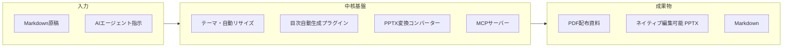

# 1 本書の位置づけ

## 1.1 目的
本プロジェクトの背景、目的、スコープ、成功基準、および開発推進の基本統制ルールを定める。

## 1.2 記述対象
記述対象は [[03_documentation_standard#2.1 図書一覧|図書一覧]] の本書の行に従う。

## 1.3 記述対象外と参照先
- 図書体系: [[03_documentation_standard#2 図書体系|図書体系]]
- コーディング規約: [[02_coding_standards#1 本書の位置づけ|コーディング規約]]
- 要件定義: [[01_requirements_specification#1 本書の位置づけ|要件定義書]]

## 1.4 改版履歴
| 版 | 日付 | 起因PBI | 変更概要 |
| :--- | :--- | :--- | :--- |
| 1.0.0 | 2026-11-04 | PBI-016 | 規約 DOC-GOV-003 準拠への再編 |

# 2 背景と目的

## 2.1 背景
現代のビジネス現場において、プレゼンテーション資料作成には多大な工数が投じられている。従来の作成手法には次の構造的課題が存在する。

1. **GUIスライド作成ツールの課題**:
   - 非構造化と属人化: デザインや配置が個人の手作業に依存し、組織全体の品質統一が困難である。
   - バージョン管理の欠落: バイナリ形式のため差分比較やプルリクエストによるレビューが困難である。
   - 生成AIとの親和性の低さ: 構造化情報からの自動生成に手順上の障壁が存在する。

2. **従来のMarkdownスライドツールの課題**:
   - デザイン性の制約: 既定テーマではビジネス報告で求められる水準を満たしにくい。
   - テキストや図表のはみ出し: 文字数や図表サイズにより画面外へはみ出し、手動微調整が発生する。
   - Office再編集性の欠落: 画像として出力される形式では、納品先でのテキスト再編集ができない。
   - 目次の手動保守: ページ増減に伴う目次更新や番号同期が手動となる。

## 2.2 目的
本プロジェクト「marp-slide-mcp」は、Markdownの運用容易性とビジネス水準のビジュアルを両立し、AIエージェントが自律的に資料作成や編集を行えるMCPインターフェースを提供する。

# 3 スコープ

## 3.1 対象範囲
1. **プレゼンテーションCSSテーマ (`themes/`)**:
   - ビジネス標準デザイン（4:3 および 16:9 比率）。
   - カラーパレット定義（`--primary-color` による一括切り替え）。
   - レイアウトクラス（通常、目次、2段組、画像並列、会話形式）。
   - 表、コード、Mermaid図、画像の自動リサイズ機構。
2. **カスタムMarpエンジン (`marp.config.js`)**:
   - 見出し抽出による目次自動生成プラグイン（`marp_toc`）。
   - 目次スライドの複数ページ分割とページ番号追従。
   - ヘッダーロゴの保持。
3. **カスタムPowerPoint変換エンジン (`pptx_converter/`)**:
   - DOM解析と計算済みスタイル計測。
   - ネイティブPowerPointオブジェクト変換。
4. **MCPサーバー (`src/index.ts`)**:
   - スライド操作およびPDF出力ツール群。
   - Zodによる型検証と構文解析。
5. **設計図書体系 (`docs/`)**:
   - 規約に準拠した仕様書群およびObsidian相互リンク網。

## 3.2 対象外
1. クラウド型SaaSプラットフォームやマルチテナントWeb UIの開発。
2. PowerPointアニメーションや画面切り替え効果の完全再現。

# 4 成功基準

## 4.1 成功基準一覧
| 基準 | 目標値 | 測定方法 |
| :--- | :--- | :--- |
| デザイン性 | 1スライド1メッセージと余白規則の充足 | サンプルスライドによる目視評価 |
| 自動化 | PDFおよびPPTX出力のCLI完了 | ビルドコマンドの正常終了 |
| AI連携 | 自然言語指示による作成と修正の完了 | MCPツール呼び出し試験 |
| 保守性 | 全行直上平易コメント規則の適用 | コードレビューおよび検査 |
| 移植性 | Dockerコンテナ完結と絶対パス0件 | テストおよび静的検査 |

# 5 体制と統制

## 5.1 体制
| ロールID | 責務 |
| :--- | :--- |
| `ROLE-PM` | プロジェクト統括、要件確定、リリース判定 |
| `ROLE-ARCH` | アーキテクチャ設計、方式審査、インターフェース整合性検証 |
| `ROLE-DEV` | ソースコード実装、単体テスト作成、コメント規約遵守 |
| `ROLE-QA` | テスト仕様書策定、テスト実行、トレーサビリティ監査 |

## 5.2 統制ルール
1. **Docker Sandbox環境の徹底**:
   開発コマンドおよびビルドはDockerコンテナ経由で実行し、ホスト環境を直接汚染しない。
2. **Gitブランチ戦略**:
   変更は規約準拠のブランチを作成して実施し、マージ後に整理する。
3. **二層分離アイデンティティとプライバシー統制**:
   コミットおよび公開成果物に個人実名やホスト絶対パスを含めない。
4. **PBI駆動アジャイルとV字品質ゲート**:
   機能追加・変更・修正はPBIを起点とし、設計差分反映、実装、テスト、RTM検証の順序を遵守する。
