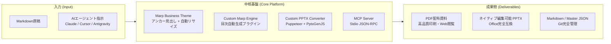
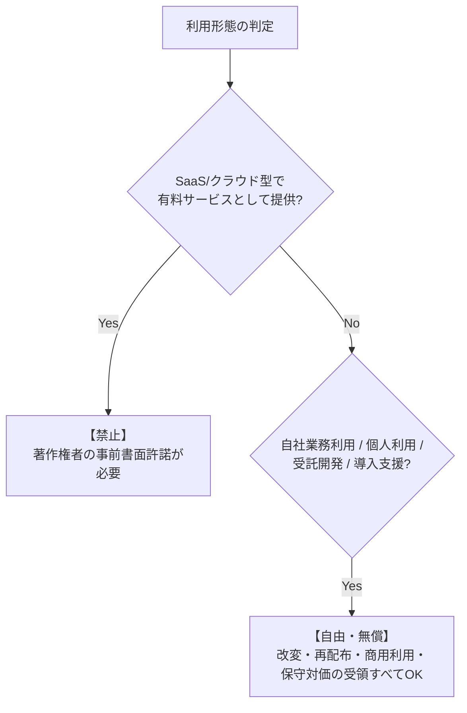

# プロジェクト憲章 (Project Charter)

本プロジェクト「**marp-slide-mcp (Marp スライド作成環境)**」は、Markdownベースのプレゼンテーション作成ツール「Marp」をビジネス実践で通用する水準に高め、さらにModel Context Protocol (MCP) を通じたAIエージェントとの完全協調を実現する次世代プレゼンテーション基盤の構築を目的とする。

---

## 1. プロジェクトの背景と課題認識

### 1.1 従来のスライド作成業務における構造的課題
現代のビジネス・エンジニアリング現場において、プレゼンテーション資料作成には膨大な工数が投じられている。従来の代表的なスライド作成手法には以下のトレードオフが存在していた：

1. **GUIスライド作成ツール（Microsoft PowerPoint 等）の課題**:
   - **非構造化と属人化**: デザイン・フォント・配置が各作成者のスキルに依存し、組織全体での品質統一が困難。
   - **バージョン管理の欠落**: バイナリ形式のため差分比較（diff）やPull Requestによるレビューが困難であり、Gitを活用したCI/CDパイプラインに組み込めない。
   - **生成AIとの親和性の低さ**: LLMがGUI操作を直接行うことは困難であり、構造化された情報からの自動生成に高いハードルが存在する。

2. **従来のMarkdownスライド（Marp等）の課題**:
   - **デザイン性の制約**: デフォルトテーマはアカデミック・テック向けであり、経営報告や顧客提案で求められる「洗練されたビジネス標準デザイン（MBB標準）」に達していない。
   - **テキスト・図表のはみ出し**: 文字量や表の行数・列数、画像の大きさに応じてレイアウトが崩れ、画面外にはみ出すため、執筆中に細かなレイアウト微調整を強いられる。
   - **Office再編集性の喪失**: 標準出力されるPowerPoint（.pptx）はスライド全体が1枚の画像として埋め込まれるため、納品先でのテキスト編集や微修正が不可能。
   - **目次やリンクの手動管理**: ページ数の増減に伴う目次スライドの更新やページ番号の同期が手動となり、メンテナンス負荷が高い。

### 1.2 本プロジェクトがもたらすブレークスルー
本プロジェクトは、**「エンジニアが愛好するプレーンテキスト／Markdownの運用容易性」** と **「経営層・顧客が納得するエンタープライズ品質のビジュアル」** を両立し、さらに **「AIエージェントが自律的に資料作成・更新を行えるMCPインターフェース」** を提供することで、スライド作成業務のパラダイムシフトを実現する。

---

## 2. プロジェクトの意義と基本方針

### 2.1 3大コアバリュー
1. **Zero-Configuration Layout (記法遵守による完全自動レイアウト)**:
   Markdownの標準見出しタグ（`#` 〜 `######`）をセマンティックなアンカーとして機能させ、余計なHTML/CSSを書くことなくビジネスプレゼンテーションの階層構造（タイトル・主張・図表見出し・本文・出典・脚注）を自動構成する。
2. **Dynamic Self-Fitting (はみ出し防止の自律リサイズ)**:
   CSSおよび静的エンジン処理により、テーブル行数、コード行数、Mermaid図、画像サイズを検知し、フォントサイズや拡大縮小率を自律調整。手動レイアウト調整工数をゼロにする。
3. **AI-First Collaboration via MCP (AIネイティブな資料生成エコシステム)**:
   Anthropic提唱のModel Context Protocolに準拠したサーバーを提供し、LLMがスライドの「構想立案」「一括生成」「特定ページのピンポイント編集」「PDF検証」を自律実行できる基盤を確立する。

---

## 3. プロジェクトスコープ

### 3.1 対象範囲 (In-Scope)
- **プレゼンテーションCSSテーマ (`themes/`)**:
  - ビジネス標準デザイン（4:3 および 16:9 比率対応）。
  - カラーパレット定義（`--primary-color` による一括切り替えシステム）。
  - 主要レイアウトクラス（通常、目次、2段組、画像並列2〜4枚、会話形式、ワイドコンテンツ）。
  - テーブル・コード・Mermaid・画像等の動的自動リサイズ機構。
- **カスタムMarpエンジン (`marp.config.js`)**:
  - H1アンカーおよび直下段落からのタイトル抽出による目次自動生成プラグイン（`marp_toc`）。
  - 目次スライドの複数ページ分割・ページ番号追従ロジック。
  - ヘッダーロゴトークンの保持・継承ロジック。
- **カスタムPowerPoint変換エンジン (`pptx_converter/`)**:
  - PuppeteerによるレンダリングDOM解析とComputed Style計測。
  - PptxGenJSを利用したネイティブPowerPointオブジェクト（テキストボックス、オートシェイプ、表、画像）変換。
- **MCPサーバー (`src/index.ts`)**:
  - StdioServerTransport に基づくスライドCRUD操作およびPDFエクスポートAPI群（7ツール）。
  - Zodを用いた厳格な型バリデーションおよびMarkdownパーサー/ジェネレーター。
- **AI Skill・プロンプトアセット (`.agents/skills/`, `prompts/`)**:
  - MBB（マッキンゼー、BCG等）標準に準拠したスライド論理構成プロンプト。
  - AIエージェント向け実行手順定義（Skill）。
- **設計図書体系 (`oss/main/docs/`)**:
  - 本憲章を含む、IPA標準に準拠した仕様書群およびObsidian相互リンク網。

### 3.2 非対象範囲 (Out-of-Scope)
- クラウド型SaaSプラットフォームやマルチテナントWeb UIの開発（ローカル・コンテナ実行およびエージェント連携に特化）。
- PowerPointアニメーションや複雑な画面切り替えトランジションの完全再現。

---

## 4. プロジェクト成功基準 (Success Criteria)

| 指標カテゴリ | 成功基準 | 評価方法 |
| :--- | :--- | :--- |
| **品質・デザイン性** | MBBコンサルティング標準（1スライド1メッセージ、視線誘導、余白規約）を100%充足すること。 | 公式サンプルスライド（`D01-000001`）による目視評価および顧客提示試験。 |
| **自動化・生産性** | Markdown記述後のPDFおよび編集可能PPTX出力がワンコマンド（CLI）で完了すること。 | `npm run build:pdf` および `npm run build:pptx-custom` の正常終了。 |
| **AI連携性能** | LLMクライアントからMCPツールを通じて、自然言語指示のみで全スライドの作成・個別修正がエラーなく完了すること。 | Claude Desktop / Cursor / Antigravity からのツール呼出し試験。 |
| **保守性・可読性** | 全TypeScript/JavaScriptコードにおいて「全行直上平易コメント」が徹底され、初見エンジニアの参入障壁が極小であること。 | コードレビューおよびリント検証。 |
| **移植性・安全性** | Docker Dev Container上で依存関係が完結し、ホスト環境を汚染しないこと。OSS公開時に個人情報・絶対パスが含まれないこと。 | CI/CDおよびコンテナ分離テスト。 |

---

## 5. 開発推進方針およびガバナンスルール

### 5.1 Docker Sandbox環境の徹底
- ホスト環境（Windows等）上での直接ビルド・実行は禁止し、Node.js 22 + Chromium + 日本語フォントが完備された **Docker Dev Container 内** でビルドおよび検証を実施する。
- メイン作業ツリーの汚染を防止するため、一時サンドボックス（`/tmp/sandbox`）または専用ワークツリーを活用する。

### 5.2 Git運用およびブランチ戦略
- すべての変更は専用のトピックブランチ（例: `fix/issue-XX`, `feat/slide-YY`）を作成して実施する。
- コミット・プッシュはエージェント側のホスト環境から一元的に行い、多重コミットによるコンフリクトを防止する。
- レビュー・マージ完了後はWorktreeのHEADをデタッチ（`git checkout --detach`）してブランチロックを解放する。

### 5.3 業界標準コーディング規約の適用
- TypeScript / ECMAScript (ESM) の最新仕様に準拠する。
- コードの可読性とAI協調動作を最大化するため、すべての処理行の直上に平易な日本語コメントを記述する（詳細は [[02_coding_standards|コーディング規約]] を参照）。

---

## 6. ライセンスおよび知的財産戦略

本ソフトウェアは、広く一般に技術を公開しつつ、不当な搾取を防止するため **SaaS提供制限付きライセンス（Source-Available）**（詳細は `LICENSE` ファイル参照）を採用する。

1. **許可される利用 (Permitted Usage)**:
   - 個人および自社内での無制限な業務利用（提案書、レポート、営業資料の作成）。
   - クライアント企業に対する本基盤の環境構築、受託開発、コンサルティング、および保守・運用支援の対価受領。
   - ソースコードの改変・社内フォーク。
2. **制限される利用 (Restricted Usage)**:
   - 本ソフトウェア（またはその改変物）を自社サーバーで稼働させ、一般ユーザーや外部企業に対してオンラインでスライドを自動生成するサービスを有料提供（SaaS、サブスクリプション、API課金等）すること。
3. **OSS個人情報保護方針**:
   - リポジトリ内には、個人名、ホスト固有の絶対パス（`/path/to/...` や `C:\path\to\...`）、シークレット、非公開認証情報を一切混入させない。

---

## 7. 関連設計図書への参照リンク

- [[02_coding_standards|コーディング規約]]: 本プロジェクトのコーディング基準およびコメント記述規則
- [[01_requirements_specification|要件定義書]]: 業務要件およびシステム機能・非機能要件
- [[01_functional_specification|機能仕様書]]: システム全体像と各機能の詳細仕様
- [[02_external_interface_specification|外部I/F仕様書]]: MCP、CLI、および外部ツール連携仕様
- [[01_architectural_design|構造設計書]]: モジュール構成およびコンポーネント設計
- [[02_internal_interface_specification|内部I/F仕様書]]: 内部データ型および関数仕様
- [[03_program_specification|プログラム仕様書]]: 各ソースコードの処理論理およびアルゴリズム
- [[../README|設計図書統合インデックス]]: 設計図書体系の全体マップ
