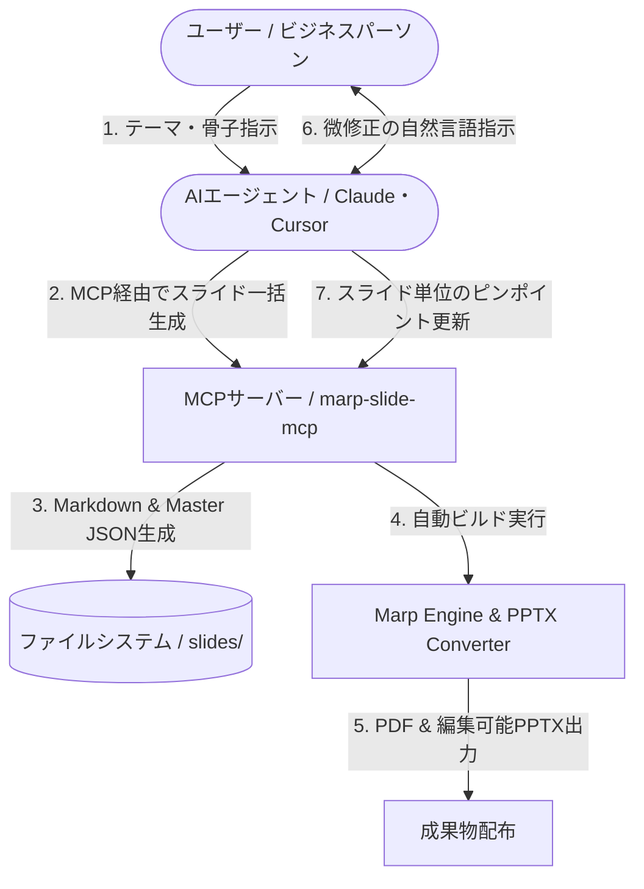
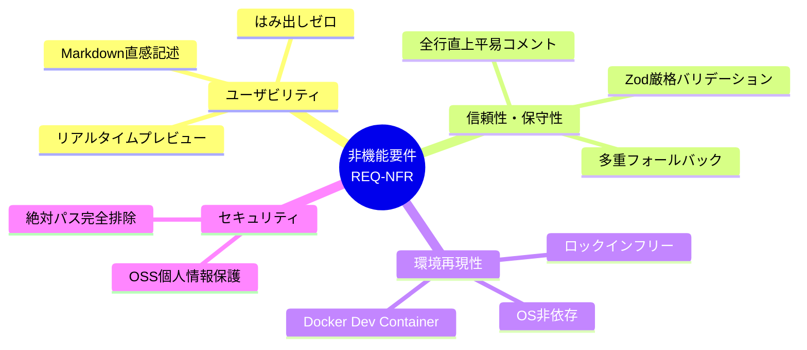

# 要件定義書 (Requirements Specification)

本ドキュメントは、IPA（情報処理推進機構）のシステム開発標準体系に準拠し、「**marp-slide-mcp (Marp スライド作成環境)**」における業務要件、機能要件、非機能要件、および制約事項を網羅的に定義する。

---

## 1. 業務要件およびシステム化の背景

### 1.1 現状の課題 (As-Is)
- **手作業によるレイアウト調整の浪費**: PowerPoint等でのスライド作成において、フォント・配置・余白の調整に作業時間の50%以上が費やされている。
- **Markdownツールのビジネス実用性不足**: 既存のMarkdownプレゼンツール（Marpデフォルト等）は、ビジネス特有の階層構造（主張帯、図表出典、機密表示、図書番号）に対応しておらず、文字溢れへの自動対処も存在しない。
- **AIとの分断**: 生成AI（LLM）にスライド作成を指示しても、出力されたテキストを人間が手作業でGUIスライドにコピー＆ペーストする必要があり、真のエンドツーエンド自動化が実現できていない。

### 1.2 達成すべき業務像 (To-Be)

- **テキスト駆動・AI協調**: Markdown記法または自然言語指示のみで、企業エグゼクティブ・顧客に提出可能なレベルのスライドが一撃で完成する。
- **完全自動リサイズ**: 文字量や図表の大きさに悩まされることなく、記述に集中できる環境を提供する。
- **オープンかつロックインフリー**: Gitで完全管理でき、必要に応じてOffice（PowerPoint）上でも再編集できるポータビリティを確保する。

---

## 2. システム化対象とステークホルダー定義

| ステークホルダー | 役割と関わり | システムへの期待 |
| :--- | :--- | :--- |
| **スライド作成者 (Author)** | 提案書や技術資料を執筆するエンジニア・コンサルタント | 見出し記法だけで美しいレイアウトが得られ、手動調整工数がゼロになること。 |
| **AIエージェント (AI Agent)** | スライド構成立案・生成・編集を代行するLLM | 構造化されたスキーマ（MCPツール）を通じて、確実にスライドを操作できること。 |
| **スライド閲覧者・顧客 (Audience)** | 経営層、クライアント、セミナー聴講者 | MBB品質の視線誘導、読みやすいフォント、明確な主張が一目で理解できること。 |
| **システム保守者 (Maintainer)** | 本基盤のテーマやコンバーターを改修するエンジニア | 徹底したコメントとIPA準拠の仕様書により、安全に機能拡張できること。 |

---

## 3. 機能要件一覧 (Functional Requirements)

本システムが提供する機能要件を以下の9カテゴリ（`REQ-FNC-001` 〜 `009`）に分類し定義する。

| 要件ID | 機能名称 | 概要 | 優先度 |
| :--- | :--- | :--- | :---: |
| **REQ-FNC-001** | ビジネス標準テーマ提供機能 | 見出しアンカー駆動によるビジネスレイアウト（表紙・通常スライド）の提供 | 高 (Must) |
| **REQ-FNC-002** | 自律的要素リサイズ機能 | テーブル、コード、Mermaid図、画像のはみ出しを防止する自動縮小機構 | 高 (Must) |
| **REQ-FNC-003** | 構造化レイアウトクラス群 | 2段組、画像並列（2〜4枚）、会話タイムライン、ワイド等のクラス提供 | 高 (Must) |
| **REQ-FNC-004** | 目次（TOC）完全自動生成機能 | スライドタイトルを自動抽出し、ページ番号とリンクを生成するエンジン拡張 | 高 (Must) |
| **REQ-FNC-005** | ネイティブPPTX変換機能 | DOM解析とPptxGenJSによる編集可能PowerPointオブジェクトへの出力 | 高 (Must) |
| **REQ-FNC-006** | MCPサーバー連携機能 | AIエージェントからスライド作成・編集・出力を実行するMCP Tools群 | 高 (Must) |
| **REQ-FNC-007** | AI協調プロンプト＆Skill資産 | MBB品質のスライド構成をAIに指示・実行させるプロンプトとSkillの提供 | 中 (Should) |
| **REQ-FNC-008** | GitHub MCP連携・PAT分離機能 | リポジトリ専用環境変数バインドおよび事前アカウント検証ゲートによる安全なGitHub連携 | 高 (Must) |
| **REQ-FNC-009** | 業界標準GitHub運用・エージェント支援機能 | Issue Forms、PRテンプレート、2層分離規約、Worktreeブランチ自動是正および運用スキル | 高 (Must) |

---

## 4. 機能要件詳細仕様

### REQ-FNC-001: ビジネス標準テーマ提供機能
- **REQ-FNC-001-01 (見出しアンカー規則)**: Markdownの見出し記法（`#` 〜 `######`）を画面上非表示とし、その直後の要素をレイアウト上の特定役割（スライドタイトル、主張、図表タイトル、本文、出典、コピーライト、機密表示）にマッピングすること。
- **REQ-FNC-001-02 (表紙レイアウト)**: 表紙スライドにおいて、メインタイトル（36pt）、サブタイトル（20pt）、図書番号（14pt）、作成元情報（16pt）、作成日、および装飾バナー画像を規定位置に整然と配置すること。
- **REQ-FNC-001-03 (テーマカラー動的切替)**: CSS変数 `--primary-color` を変更するだけで、主張帯、フッター帯、吹き出し背景等のアクセントカラーが一括連動して変化すること。
- **REQ-FNC-001-04 (アスペクト比対応)**: 4:3（960x720px）および 16:9（1280x720px）の双方において破綻なくデザインが適用されること。

### REQ-FNC-002: 自律的要素リサイズ機能
- **REQ-FNC-002-01 (テーブルリサイズ)**: 表の行数・列数、またはクラス指定（`.table-sm`, `.table-md` 等）に応じてフォントサイズおよびセルパディングを自動縮小し、画面下端へのはみ出しを防止すること。
- **REQ-FNC-002-02 (コードブロックリサイズ)**: コードの行数に応じてフォントサイズを縮小し、スクロールバーを発生させずに全行を美しく表示すること。
- **REQ-FNC-002-03 (Mermaid図リサイズ)**: フローチャートやシーケンス図のSVG要素をスライド本文領域の高さ・幅内に自動フィッティングさせること。
- **REQ-FNC-002-04 (画像リサイズ)**: 単一画像の最大高さを本文領域内に制限し、縦横比を維持したまま縮小表示すること。

### REQ-FNC-003: 構造化レイアウトクラス群
- **REQ-FNC-003-01 (2段組レイアウト `columns-2`)**: 箇条書き構文を用いて左右2列の均等分割カラムを構成し、対比・比較議論を容易にすること。
- **REQ-FNC-003-02 (画像横並びレイアウト `images-2`〜`images-4`)**: 2枚から4枚の画像を横一列に自動グリッド配置し、各画像直下に太字キャプションを密着表示すること。
- **REQ-FNC-003-03 (会話タイムライン `conversation-content`)**: 箇条書き構文から発言者アイコン・発言者名・吹き出しを自動生成し、インタビューや事例紹介を表現可能とすること。
- **REQ-FNC-003-04 (ワイドコンテンツ `wide-content`)**: 主張帯（グレー背景）を排し、画面全域を広く使用して巨大な表やダイアグラムを描画可能とすること。

### REQ-FNC-004: 目次（TOC）完全自動生成機能
- **REQ-FNC-004-01 (タイトル自動抽出)**: 各通常スライドのH1見出し、またはその直後の段落（`
`）から表題テキストを正確に収集すること（表紙スライドは自動除外）。
- **REQ-FNC-004-02 (目次レイアウトとドットリーダー)**: タイトルとページ番号の間にドットリーダー線を自動描画し、ページ番号をクリック可能なハイパーリンクとすること。
- **REQ-FNC-004-03 (ヘッダー・フッター記述保持)**: 元の目次スライドに任意で定義されたヘッダーディレクティブ（ロゴ画像やテキスト等）およびフッター見出しアンカー（`######` コピーライト・機密指定）が存在する場合、それを消去することなく全目次スライドに継承描画すること。
- **REQ-FNC-004-04 (複数ページ自動分割)**: 目次項目が上限（1スライドあたり12項目）を超過した場合（表紙込み15ページ／17ページ以上の多数ページ構成時）、`marpit_inline_svg` 処理前に独立した目次スライド（`目次 (続き)`）を自動生成し、以降の全スライドのページ番号（`id` 属性および `data-marpit-pagination`）と目次リンク先を正確にシフト調整すること。

### REQ-FNC-005: ネイティブPPTX変換機能
- **REQ-FNC-005-01 (編集可能オブジェクト化)**: 単なる画像貼り付けではなく、テキストをPowerPointのテキストボックス、図形をオートシェイプ、表をPowerPointテーブルとして忠実に再現出力すること。
- **REQ-FNC-005-02 (DOM解析パイプライン)**: Puppeteer（Chromium）を用いてレンダリングされたHTMLの全要素位置（x, y, w, h）、計算済みスタイル（フォント、色、境界線）を正確に抽出すること。
- **REQ-FNC-005-03 (単位変換精度)**: CSSピクセル（px）からPowerPointインチ（inch）への変換を96DPI基準で高精度に実行すること。

### REQ-FNC-006: MCPサーバー連携機能
- **REQ-FNC-006-01 (スライドデッキ一括生成 `generate_slide_deck`)**: JSONスキーマに従った構造化データからMarp形式Markdownファイルを生成・保存すること。
- **REQ-FNC-006-02 (スライドデッキ構文解析 `get_slide_deck`)**: 既存のMarkdownファイルを解析し、フロントマターや各スライド要素を構造化JSONとして返却すること。
- **REQ-FNC-006-03 (スライド単体挿入 `insert_slide`)**: 指定ページ位置に新規スライドを挿入し、ファイルを安全に再構築すること。
- **REQ-FNC-006-04 (スライド単体更新 `update_slide`)**: 指定ページのスライド（タイトル、主張、本文等）のみをピンポイントで更新すること。
- **REQ-FNC-006-05 (スライド単体削除 `delete_slide`)**: 指定ページのスライドを削除し、ページ構成を整合させること。
- **REQ-FNC-006-06 (デッキ設定更新 `update_deck_settings`)**: テーマカラー、比率、表紙バナー等を一括更新すること。
- **REQ-FNC-006-07 (PDFエクスポート `export_to_pdf`)**: 内部からMarp CLIを実行し、指定されたMarkdownから高品質PDFを出力すること。

### REQ-FNC-007: AI協調プロンプト＆Skill資産
- **REQ-FNC-007-01 (MBB標準プロンプト)**: ワンスライド・ワンメッセージ、ピラミッド原則、文字数制限（タイトル60文字、主張250文字等）を遵守させるプロンプトテンプレートの提供。
- **REQ-FNC-007-02 (エージェントSkill)**: AIエージェントが自律的にMCPツールを選択・実行するためのワークフロールール定義（SKILL.md）の提供。

### REQ-FNC-008: GitHub MCP連携およびリポジトリ別PAT完全分離機能
- **REQ-FNC-008-01 (リポジトリ単位のPAT分離)**: ホスト環境変数 `GITHUB_PAT_MARP_SLIDE_MCP` を最優先でロードし、別プロジェクトのPATとの混線や漏洩を物理的に防止すること。
- **REQ-FNC-008-02 (OSSポータビリティ担保)**: 第三者がクローンした際にホスト環境を汚さず動作可能とするため、`.env.example` の提供および標準環境変数 `GITHUB_PERSONAL_ACCESS_TOKEN` / `.env` への多段フォールバックを実装すること。
- **REQ-FNC-008-03 (揮発性ワンショット実行)**: `docker compose run --rm -T` により必要な都度起動し、処理終了後はコンテナを自動破棄して常駐ゾンビ化を防止すること。
- **REQ-FNC-008-04 (事前アカウント検証ゲート)**: GitHub外部書き込み操作（Issue/PR作成等）の実行直前に、必ず `get_me` を実行して認証ユーザー名を検証すること。検証基準は環境変数 `EXPECTED_GITHUB_LOGIN`（未指定時はメンテナーデフォルト `"N-Y-Public"`）とし、ID検証は `EXPECTED_GITHUB_ID` 指定時（未指定かつデフォルト名の場合は `330902043`）に機械照合する。不一致時または取得失敗時は即座に処理を中断（ABORT）し、別アカウントによる誤爆を物理的に防止すること。

### REQ-FNC-009: 業界標準GitHubテンプレートおよびエージェント運用支援機能
- **REQ-FNC-009-01 (GitHub Issue Forms & PR Template)**: バグ報告（`bug_report.yml`）、機能要望（`feature_request.yml`）、ドキュメント改善（`documentation.yml`）の各入力フォームを提供し、空Issue作成（`blank_issues_enabled: false`）を防止すること。また、PR作成時に変更内容や機密・パス除外チェックリストを提示する標準PRテンプレート（`pull_request_template.md`）を提供すること。
- **REQ-FNC-009-02 (2層分離コントリビューション規約)**: 外部コントリビューターが特定のアカウント名を強要されることなく各自のGitHubアカウント・クレジットで開発参加できるよう、`CONTRIBUTING.md` を配備し、ブランチ命名規則（`{種別}/{アカウントまたはAI名}/issue-{番号}/{説明}`）および事前アカウント検証ゲートの各自環境設定手順（`EXPECTED_GITHUB_LOGIN` 設定による自立検証）を明確化すること。
- **REQ-FNC-009-03 (AIエージェント運用支援スキル `github-workflows`)**: AIエージェントがIssue起票・ブランチ命名・PR作成を行う際に、テンプレート読み込み、規約準拠ブランチ名導出、およびGit設定（noreplyメール利用推奨案内）を自動支援するスキルを提供すること。
- **REQ-FNC-009-04 (Worktree初期化およびブランチ命名自動是正統制)**: Google Antigravity 2.0 等の自律エージェント環境において、Worktreeを選択してセッションを開始した際に自動採番される一時ブランチ名（`resolve_issue_eight` 等）がリポジトリ命名規約（`{種別}/{アカウントまたはAI名}/issue-{番号}/{説明}`）に反することを防止するため、タスク開始時プロトコル（Task Initiation Protocol）を策定・配備すること。エージェントはセッション開始時・PBI着手前に現在のブランチ名を自動検査し、規約違反を検知した場合は `git branch -m` により規約準拠ブランチ名へと自動是正すること。また、ファイルシステム安全なWorktreeディレクトリ命名形式（`{種別}_{アカウント名またはAI名}_issue-{番号}_{説明}`）を規定すること。

---

## 5. 非機能要件一覧 (Non-Functional Requirements)

IPA標準（非機能要件グレード）に基づき、以下のカテゴリで定義する。

| 要件ID | 分類 | 要件内容 | 検証基準 |
| :--- | :--- | :--- | :--- |
| **REQ-NFR-USE-01** | ユーザビリティ | HTML/CSSの詳細知識なしに、標準Markdown見出し記法のみでスライド作成が完結すること。 | 初学者によるMarkdown執筆テスト |
| **REQ-NFR-USE-02** | ユーザビリティ | VS Code拡張機能（Marp for VS Code）上でリアルタイムに本番同等のプレビューが表示されること。 | VS Codeプレビュー表示確認 |
| **REQ-NFR-REL-01** | 信頼性 | 外部バイナリ（Chromium）のパスが未指定の場合でも多段探索により自動解決し、Marp CLI実行時のstdin待機ハング（`--no-stdin`）およびサンドボックス解除（`CHROME_NO_SANDBOX=1`）により安定変換を保証すること。 | パス未指定環境およびDocker非対話実行試験 |
| **REQ-NFR-REL-02** | 信頼性 | 入力データの形式不正に対し、Zodバリデーションにより明確なエラーメッセージを返却し、プロセス異常終了を防止すること。 | 異常系JSON投入テスト |
| **REQ-NFR-PER-01** | 性能・効率性 | 20ページ規模のスライドデッキにおいて、Marp CLIによるPDF出力が30秒以内に完了すること。 | ベンチマーク測定 |
| **REQ-NFR-MNT-01** | 保守性 | すべてのTypeScript/JavaScriptコードにおいて「全行直上平易コメント」を徹底し、コード意図の透明性を100%とすること。 | ソースコード全行レビュー |
| **REQ-NFR-POR-01** | 移植性 | Node.js 22環境のDocker Dev Container上で、非対話パイプ実行時のstdinデッドロックなく、ホストOS（Windows/Linux/macOS）を問わず完全に同一のビルド結果が得られること。 | コンテナ内ビルド検証 |
| **REQ-NFR-SEC-01** | セキュリティ | リポジトリ内に開発者個人の実名、ホスト固有の絶対パス（`/path/to/...` や `C:\path\to\...`）、秘密鍵、認証情報を一切含めないこと。 | 静的テキストスキャン検証 |
| **REQ-NFR-SEC-02** | セキュリティ | PAT（パーソナルアクセストークン）の平文をディスク（.env等）に書き込まず、OS環境変数から直接メモリ注入することで漏洩リスクを最小化すること。 | 静的スキャンおよびファイル存在検証 |

---

## 6. 制約事項および前提条件

1. **実行環境前提**:
   - Node.js バージョン 22.x 以上。
   - Chromium または Google Chrome の実行可能バイナリがアクセス可能であること（PuppeteerによるPDF/PPTX生成のため）。
2. **文字コード・改行コード**:
   - ソースコードおよびドキュメントは UTF-8 (BOMなし)、改行コードは LF を標準とする。
3. **ライセンス制約**:
   - `LICENSE`（SaaS提供制限付きライセンス）に基づき、本ソフトウェアをクラウド型有料SaaSとして外部提供する場合は著作者の事前許諾を要する。

---

## 7. 要件トレーサビリティマトリクス

| 要件ID | 要件名称 | 実現機能 (基本設計) | 実装モジュール (詳細設計) |
| :--- | :--- | :--- | :--- |
| `REQ-FNC-001` | ビジネス標準テーマ | `FNC-001` / `LAY-001`〜`003` | `themes/business-slide-theme.css` |
| `REQ-FNC-002` | 自律的要素リサイズ | `FNC-002` / `LAY-004` | `themes/business-slide-theme.css`, `marp.config.js` |
| `REQ-FNC-003` | 構造化レイアウトクラス | `FNC-003` / `LAY-005`〜`008` | `themes/business-slide-theme.css`, `src/index.ts` |
| `REQ-FNC-004` | 目次完全自動生成 | `FNC-004` / `LAY-002` | `marp.config.js` (`marp_toc`) |
| `REQ-FNC-005` | ネイティブPPTX変換 | `FNC-005` / `EXT-CLI-002` | `pptx_converter/convert.js` |
| `REQ-FNC-006` | MCPサーバー連携 | `FNC-006` / `EXT-MCP-001`〜`007` | `src/index.ts` |
| `REQ-FNC-007` | AIプロンプト＆Skill | `FNC-007` | `.agents/skills/marp-slides/`, `prompts/` |
| `REQ-FNC-008` | GitHub MCP連携・PAT分離 | `FNC-008` | `MOD-INF-001` (`docker-compose.yml`, `.agents/mcp_config.json`) |
| `REQ-FNC-009` | 業界標準GitHub運用・エージェント支援 | `FNC-009` | `MOD-SKL-001` (`.github/`, `CONTRIBUTING.md`, `.agents/skills/github-workflows/`) |

---

## 8. 関連設計図書への参照リンク

- [[01_project_charter|プロジェクト憲章]]: プロジェクト全体の理念・背景・成功基準
- [[02_coding_standards|コーディング規約]]: 開発標準およびコメント記述基準
- [[01_functional_specification|機能仕様書]]: 本要件を具体化した機能詳細およびレイアウト定義
- [[02_external_interface_specification|外部I/F仕様書]]: MCPツールおよびCLIのI/F定義
- [[01_architectural_design|構造設計書]]: モジュール構造およびコンポーネント依存関係
- [[03_program_specification|プログラム仕様書]]: 各要件を実現するプログラム詳細ロジック
- [[../README|設計図書統合インデックス]]: 設計図書体系の全体マップ
