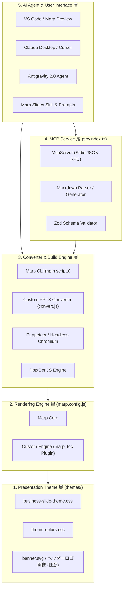
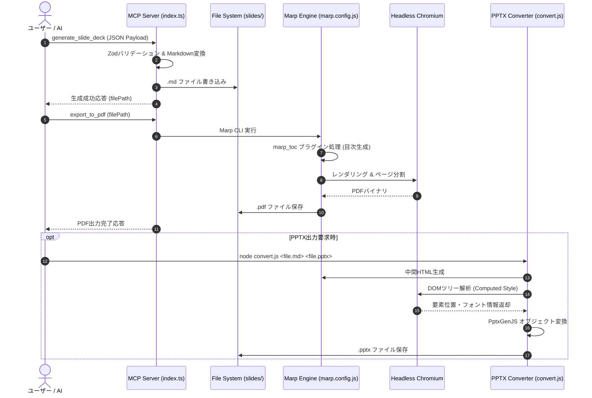

# 機能仕様書 (Functional Specification)

本ドキュメントは、「**marp-slide-mcp (Marp スライド作成環境)**」において提供される全機能の構造、画面（スライド）レイアウト仕様、およびデータ処理フローを定義する基本設計書である。

---

## 1. システム全体アーキテクチャ

本システムは、責務の分離と独立したテスト容易性を確保するため、以下の5層アーキテクチャで構成される。



---

## 2. 機能一覧 (Function List)

| 機能ID | 機能名 | 対応要件ID | 概要 |
| :--- | :--- | :--- | :--- |
| **FNC-001** | スライドテーマ・スタイリング | `REQ-FNC-001` | 見出しアンカー駆動の配置規則とテーマカラー連動システム |
| **FNC-002** | 自律的要素リサイズ | `REQ-FNC-002` | 表・コード・Mermaid・画像のはみ出し防止縮小 |
| **FNC-003** | 構造化レイアウト提供 | `REQ-FNC-003` | 2段組、画像並列、会話形式、ワイド等のクラス群 |
| **FNC-004** | 目次（TOC）自動生成 | `REQ-FNC-004` | H1/段落タイトル収集、ページ番号計算、ロゴ保持 |
| **FNC-005** | 高度PowerPoint変換 | `REQ-FNC-005` | レンダリングDOM解析による編集可能PPTXオブジェクト出力 |
| **FNC-006** | MCPスライド操作サービス | `REQ-FNC-006` | Stdioプロトコルによるデッキ生成・編集・PDF出力API |
| **FNC-007** | AI協調支援 | `REQ-FNC-007` | MBB標準プロンプトおよびエージェント向け実行Skill |
| **FNC-008** | GitHub MCP連携・PAT分離 | `REQ-FNC-008` | リポジトリ専用環境変数バインドおよび動的前検証ゲートによる安全なGitHub連携 |
| **FNC-009** | GitHub標準テンプレート・運用支援 | `REQ-FNC-009` | 2層分離コントリビューション規約、標準Issue/PRテンプレート、ブランチ運用スキル |

---

## 3. 各機能の詳細仕様

### 3.1 FNC-001: スライドテーマ・スタイリング機能
1. **見出しアンカー機構**:
   - スライド内の標準見出し（`h1`〜`h5`）はCSSで非表示化（`visibility: hidden`, `height: 0`）され、直後の要素が絶対配置（`position: absolute`）により特定の位置・タイポグラフィで描画される。
2. **テーマカラー動的連動**:
   - ルートで定義された `--primary-color`（デフォルト: `#1f497d`）を起点とし、フッター帯（スライド下部40px）、主張欄アクセント、会話吹き出し背景（`color-mix` による明度調整）が連動して切り替わる。
3. **アスペクト比対応**:
   - `4:3`（960x720px）および `16:9`（1280x720px）の双方において、幅に応じた `calc()` スタイルが適用される。

### 3.2 FNC-002: 自律的要素リサイズ機能
1. **テーブル自動調整**:
   - デフォルトで行数・列数に応じた動的フォントサイズ計算（14pt〜28pt）、余白を圧縮。
   - 手動調整用として10段階の統一数字クラス `.table-1`（26pt）〜 `.table-10`（6pt）を提供。`.table-10` は従来の最小限界 `.table-xxs`（8pt）よりさらに2段階小さい極小サイズとして設計。
   - 既存の `.table-xl`〜`.table-xxs` はエイリアスとして完全維持。
2. **本文テキスト自動・手動調整**:
   - 行数・段落数に応じた自動縮小（`--txt-scale`）に加え、手動調整用として10段階の統一数字クラス `.text-1`〜`.text-10`（エイリアス: `.body-1`〜`.body-10`）を提供。倍率は 1.0 〜 0.35（従来の最小 `.densest` の 0.50 よりさらに2段階小さい）。
   - 既存の `.roomy`, `.dense`, `.denser`, `.densest` はエイリアスとして完全維持。
3. **Mermaid図自動フィッティング**:
   - Mermaidの生成する `<svg>` に対し、スライド本文領域（最大高さ440px/550px、最大幅100%）内に収まる `max-height: 100%`, `max-width: 100%`, `object-fit: contain` を強制適用。
   - 手動調整用として10段階の統一数字クラス `.mermaid-1`（100%）〜 `.mermaid-10`（28%）を提供。`.mermaid-10` は従来の最小限界 `.mermaid-xs`（55%）よりさらに2段階小さい極小サイズとして設計。
   - 既存の `.mermaid-sm`, `.mermaid-xs` はエイリアスとして完全維持。
4. **画像自動縮小・手動微調整**:
   - 単一画像に対し縦横比を維持して中央配置する自律フィットに加え、手動調整用として10段階の統一数字クラス `.img-1`〜`.img-10`（エイリアス: `.image-1`〜`.image-10`）を提供。最大高さを 100% 〜 20% で制限。
5. **コードブロック自動・手動調整**:
   - `pre code` は基準 14pt で表示し、手動調整用として10段階の統一数字クラス `.code-1`（18pt）〜 `.code-10`（5pt）を提供。`.code-10` は従来の最小限界 `.code-xxs`（7pt）よりさらに2段階小さい極小サイズとして設計。
   - 既存の `.code-lg`, `.code-sm`, `.code-xs`, `.code-xxs` はエイリアスとして完全維持。

### 3.3 FNC-003: 構造化レイアウト提供機能
1. **2段組レイアウト (`columns-2`)**:
   - スライド内の最初のレベル1箇条書き項目を「左カラム」、2つ目の項目を「右カラム」として幅48%ずつ左右均等に配置。
2. **画像横並びレイアウト (`images-2` 〜 `images-4`)**:
   - 枚数に応じたCSS Gridを自動形成。画像下部にキャプション（太字テキスト）を密着表示。
3. **会話形式レイアウト (`conversation-content`)**:
   - 箇条書き構文 `-  **発言者名** 発言内容` を解析し、左側に丸型アバター、右側に吹き出し（Tail付き）をタイムライン状に配置。アイコン省略時はデフォルトのSVGシルエットを表示。
4. **ワイドコンテンツ (`wide-content`)**:
   - 主張欄（グレー帯）を非表示化し、本文領域の上部パディングを `230px` から `110px` に短縮。有効表示領域を大幅に拡張。

### 3.4 FNC-004: 目次（TOC）自動生成機能
1. **トークン二段階走査**:
   - 第1走査: Markdown-itトークン列を走査し、各スライドのH1見出しおよび直下段落テキストを収集（表紙・目次自身は除外）。
   - 第2走査: 目次スライド（`<!-- _class: toc -->`）のトークン群を置換し、収集されたタイトル・ページ番号・ドットリーダー線・リンクアンカー（`#ページ番号`）を注入。
2. **ヘッダーロゴ保持**:
   - 元の目次スライドの `<header>` トークン（ロゴ画像）を抽出し、生成される目次スライドに明示的に再注入。
3. **複数ページ分割**:
   - 目次が12項目を超える場合、自動的に新規スライド区切り（`hr` トークン）を挿入し、以降のスライドページ番号を補正。

### 3.5 FNC-005: 高度PowerPoint変換機能
1. **Marp中間HTMLレンダリング**:
   - Marp CLIを実行し、スタイルとアセットが解決された中間HTMLを出力。
2. **PuppeteerによるDOM解析**:
   - 仮想ブラウザ上で各スライド要素のレンダリング位置（`getBoundingClientRect`）および計算済みスタイル（フォント、色、配置）を取得。
3. **PptxGenJSへのマッピング**:
   - テキストノード → PptxGenJSテキストボックス（フォントサイズ、カラー、太字、配置を反映）。
   - 背景・境界線 → PptxGenJSオートシェイプ。
   - `<table>` 要素 → PptxGenJSネイティブテーブル（セル結合、セル背景色反映）。
   - `` / `<svg>` → 高解像度画像オブジェクトとして配置。

### 3.6 FNC-006: MCPスライド操作サービス機能
1. **Stdio JSON-RPC**:
   - 標準入出力を通じたMCPプロトコル通信。AIクライアント（Claude Desktop, Cursor等）と直接接続。
2. **提供ツール群（7ツール）**:
   - `generate_slide_deck`: デッキ一括新規生成。
   - `get_slide_deck`: 既存デッキ解析・JSON化。
   - `insert_slide`: スライド挿入。
   - `update_slide`: スライド更新。
   - `delete_slide`: スライド削除。
   - `update_deck_settings`: 設定一括更新。
   - `export_to_pdf`: PDF変換・保存。

### 3.7 FNC-008: GitHub MCP連携・PAT分離機能
1. **リポジトリ別PAT完全分離**:
   - ホスト環境変数 `GITHUB_PAT_MARP_SLIDE_MCP` を優先ロードし、別プロジェクトのPATとの混線を防止。
   - OSSクローン利用時の多段フォールバック（`GITHUB_PERSONAL_ACCESS_TOKEN` / `.env`）をサポート。
2. **動的事前アカウント検証ゲート (Pre-Execution Identity Gate)**:
   - 外部書き込み処理（Issue/PR作成、コメント等）直前に `get_me` を実行し、環境変数 `EXPECTED_GITHUB_LOGIN`（未設定時はメンテナーデフォルト `N-Y-Public`）と照合。
   - 不一致時または取得失敗時は即座に処理を中断（ABORT）し、外部発信事故を物理遮断。

### 3.8 FNC-009: 業界標準GitHubテンプレートおよびエージェント運用支援機能
1. **GitHub Issue Forms & PR Template**:
   - バグ報告、機能要望、ドキュメント改善の各フォームおよび機密・絶対パス除外チェックリスト付きPRテンプレートを提供。
2. **2層分離コントリビューション規約**:
   - 外部コントリビューターが特定のアカウント名を強要されることなく、各自のGitHubアカウント・クレジットで開発参加可能。
   - 規約準拠ブランチ命名（`{種別}/{アカウントまたはAI名}/issue-{番号}/{説明}`）の強制。
3. **タスク開始時・Worktreeブランチ自動是正統制**:
   - Google Antigravity 2.0 等の自律エージェント環境において、Worktreeを選択してセッションを開始した際に自動採番される一時ブランチ名（`resolve_issue_eight` 等）がリポジトリ命名規約に反している場合、エージェントがタスク開始時（PBI着手・初期化フェーズ）に現在のブランチ名を自動検査し、`git branch -m <compliant_branch_name>` により規約準拠ブランチ名へと自動是正する。
4. **ファイルシステム安全なWorktreeディレクトリ命名規約**:
   - ブランチ名（スラッシュ階層構造）とファイルシステムのパス区切り制約を両立させるため、Worktreeディレクトリ名は `{type}_{author}_issue-{number}_{description}`（`/` を `_` に置換したフラット形式）を正本規則とする。

---

## 4. スライド画面・レイアウト仕様 (Layout Specification)

### 4.1 表紙スライド仕様 (`LAY-001`)

```
+-----------------------------------------------------------------------+
|  [ヘッダー領域: ロゴ画像/テキスト (任意)] (右寄せ)                   |
|                                                                       |
|  メインタイトル (h1 ~ p: 36pt / Bold / #000000)                       |
|  サブタイトル (h2 ~ p: 20pt / #666666)                                |
|                                                                       |
|  [装飾バナー: banner.svg (data:URI)] (中央・全幅)                     |
|                                                                       |
|                                         図書番号 (h3 1つ目 ~ p: 14pt) |
|  所属・氏名 (h3 2つ目 ~ p: 16pt)                                      |
|  作成日 (h4 ~ p: 14pt)                                                |
|                                                                       |
|=======================================================================|
| (下部40px: テーマカラー帯 #1f497d)                                    |
| コピーライト (h6 1つ目: 白文字 10pt)          機密指定 (h6 2つ目: 赤 10pt) |
+-----------------------------------------------------------------------+
```

### 4.2 通常スライド仕様 (`LAY-002`)

```
+-----------------------------------------------------------------------+
| ページタイトル (h1 ~ p: 22pt / Bold)               [ロゴ] (右寄せ)    |
|-----------------------------------------------------------------------|
| ページ主張 / メッセージ (h2 ~ p: 14pt / 背景: グレー帯 + 左アクセント)  |
|-----------------------------------------------------------------------|
|               主張補足 / 図表タイトル (h3 ~ p: 13pt / 中央寄せ)        |
|                                                                       |
|  本文 / メインコンテンツ (h4 ~ p / テーブル / 図 / コード / 2段組)     |
|  - 上部マージン: 230px                                                |
|  - 左右マージン: 40px                                                 |
|  - 高さ領域: 最大約420px                                              |
|                                                                       |
|                                         図表出典 (h5 ~ p: 11pt 右下)  |
|=======================================================================|
| (下部40px: テーマカラー帯 #1f497d)                                    |
| コピーライト (h6 1つ目: 白文字 10pt)          機密指定 (h6 2つ目: 赤 10pt) |
+-----------------------------------------------------------------------+
```

### 4.3 見出しアンカーマッピング詳細表 (`LAY-003`)

| 見出しタグ | 表紙での役割 | 通常スライドでの役割 | フォントサイズ | 配置・デザイン特性 |
| :--- | :--- | :--- | :---: | :--- |
| `h1` | メインタイトル | ページタイトル | 表紙: 36pt / 通常: 22pt | 表紙: 左寄せBold / 通常: 上端左寄せ（左マージン20px） |
| `h2` | サブタイトル | ページ主張 | 表紙: 20pt / 通常: 14pt | 表紙: グレー / 通常: グレー背景帯（`#f2f2f2`）＋左アクセント |
| `h3` (1つ目) | 図書番号 | 図表タイトル | 表紙: 14pt / 通常: 13pt | 表紙: 右寄せ / 通常: 中央寄せ |
| `h3` (2つ目) | 所属・氏名 | — | 表紙: 16pt | 表紙: 左寄せ下部 |
| `h4` | 作成日 | 本文コンテンツ | 表紙: 14pt / 通常: 18pt | 通常: リスト・表・段落の基準フォント |
| `h5` | — | 図表出典・脚注 | 11pt | 通常: 右下寄せ（グレー文字） |
| `h6` (1つ目) | コピーライト | コピーライト | 10pt | フッター帯内・左端（白文字） |
| `h6` (2つ目) | 機密指定 | 機密指定 | 10pt | フッター帯内・右端（赤文字・太字） |

### 4.4 特殊レイアウト仕様一覧 (`LAY-004` 〜 `LAY-008`)

- **`LAY-004` 目次 (`toc`)**:
  - 見出しは左マージン `50px`、リスト全体も左 `50px`、幅 `calc(100% - 100px)` で完全左揃え。
  - タイトルとページ番号を `border-bottom: 2px dotted #cccccc`（ドットリーダー）で連結。
- **`LAY-005` 2段組 (`columns-2`)**:
  - `display: flex; justify-content: space-between; gap: 24px;` により左右2列に等幅（48%）配置。
- **`LAY-006` 画像並列 (`images-2` 〜 `images-4`)**:
  - `images-2`: 幅48% x 2列。
  - `images-3`: 幅31% x 3列。
  - `images-4`: 幅23% x 4列。
  - キャプションは各画像直下に太字（`font-weight: bold; font-size: 13pt;`）で密着配置。
- **`LAY-007` 会話形式 (`conversation-content`)**:
  - アバター画像は `width: 50px; height: 50px; border-radius: 50%;` の正円。
  - 吹き出しは `background: var(--bubble-bg-color); border-radius: 8px; position: relative;`。
- **`LAY-008` ワイドコンテンツ (`wide-content`)**:
  - `section.wide-content` により `h2 ~ p` の背景帯を非表示化、上部パディングを `110px` に縮小。

---

## 5. 状態遷移およびデータ処理フロー



---

## 6. 関連設計図書への参照リンク

- [[01_requirements_specification|要件定義書]]: 本機能仕様が満たすべき要件一覧
- [[02_external_interface_specification|外部I/F仕様書]]: MCPツールI/FおよびCLIコマンドI/Fの詳細
- [[01_architectural_design|構造設計書]]: モジュール構造およびコンポーネント依存関係
- [[02_internal_interface_specification|内部I/F仕様書]]: 内部データ型および関数I/F仕様
- [[03_program_specification|プログラム仕様書]]: 各機能の具体的実装ロジック
- [[../README|設計図書統合インデックス]]: 設計図書体系の全体マップ
