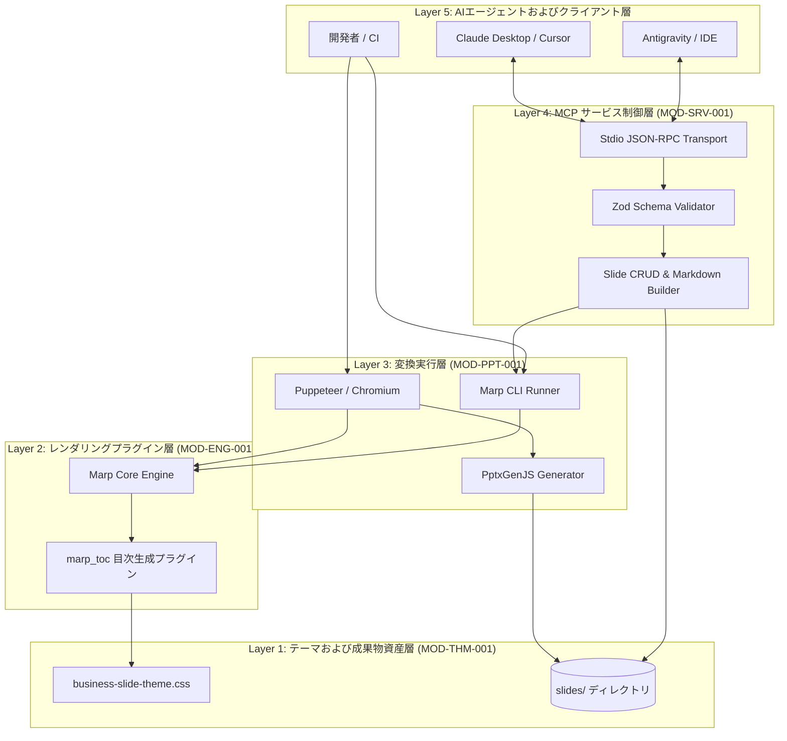

# 1 本書の位置づけ

## 1.1 目的
「marp-slide-mcp」におけるシステム全体構成、実行基盤、および主要な方式判断記録（ADR）を定める。

## 1.2 記述対象
記述対象は [[03_documentation_standard#2.1 図書一覧|図書一覧]] の本書の行に従う。

## 1.3 記述対象外と参照先
- システム要件: [[01_requirements_specification#1 本書の位置づけ|要件定義書]]
- 機能仕様: [[02_functional_specification#1 本書の位置づけ|機能仕様書]]
- 外部I/Fおよびエラー体系: [[03_external_interface_specification#1 本書の位置づけ|外部I/F仕様書]]
- ソフトウェア内部構造: [[01_software_structure_design#1 本書の位置づけ|ソフトウェア構造設計書]]

## 1.4 改版履歴
| 版 | 日付 | 起因PBI | 変更概要 |
| :--- | :--- | :--- | :--- |
| 1.0.0 | 2026-11-04 | PBI-016 | 規約 DOC-GOV-003 準拠への再編および旧方式設計テンプレート統合 |
| 1.1.0 | 2026-11-07 | PBI-019 | 24H365Dマルチエージェント自律開発・2階層レポーティング方式（ADR-005）の追加 |

# 2 システム構成

## 2.1 構成図
本システムは5つの階層によって構成される。

## 2.2 実行環境
| 項目 | 内容 |
| :--- | :--- |
| コンテナOS | Debian GNU/Linux 12 (bookworm) |
| ランタイム | Node.js 22 LTS, Python 3.11 |
| ブラウザ | Chromium (headless) |
| フォント | `fonts-ipafont-gothic`, `fonts-noto-cjk` |
| 開発統制 | Docker Compose Sandbox |

# 3 方式判断記録

## 3.1 ADR-001 Docker Sandbox環境の徹底
| 項目 | 内容 |
| :--- | :--- |
| 上位ID | `REQ-CON-001` |
| 状態 | Approved |
| 後継ID | なし |
| 背景 | ホストOS差分によるフォント崩れやレンダリング差異を防止する必要があった |
| 判断 | すべての開発、ビルド、テスト実行をDockerコンテナ経由に限定する |
| 代替案 | ホスト直接実行 |
| 影響 | ホスト環境を汚染しない再現性を確保する |

## 3.2 ADR-002 Stdio JSON-RPC 2.0 によるMCPサーバー統合
| 項目 | 内容 |
| :--- | :--- |
| 上位ID | `REQ-FNC-006` |
| 状態 | Approved |
| 後継ID | なし |
| 背景 | AIエージェントが安全かつローカル完結でスライド操作を行えるプロトコルが必要であった |
| 判断 | Model Context Protocol公式SDKに基づくStdioServerTransportを採用する |
| 代替案 | HTTP REST APIサーバー |
| 影響 | ネットワークポート開放なしでAIクライアントと直結可能とする |

## 3.3 ADR-003 Puppeteer DOM解析によるネイティブPPTX変換
| 項目 | 内容 |
| :--- | :--- |
| 上位ID | `REQ-FNC-005` |
| 状態 | Approved |
| 後継ID | なし |
| 背景 | Marp標準PPTX出力はスライドが1枚画像となり再編集ができなかった |
| 判断 | Puppeteerで中間HTMLのDOM座標とスタイルを計測しPptxGenJSオブジェクトへ変換する |
| 代替案 | Pandoc PPTX変換 |
| 影響 | テキストや図形をPowerPoint上で個別選択・再編集可能とする |

## 3.4 ADR-004 統一数字クラス命名体系による要素リサイズ
| 項目 | 内容 |
| :--- | :--- |
| 上位ID | `REQ-FNC-002` |
| 状態 | Approved |
| 後継ID | なし |
| 背景 | 表やコードブロックのクラス名が不統一で微調整段階が不足していた |
| 判断 | 全主要要素共通の10段階数字クラス（`{要素名}-1`〜`10`）を導入する |
| 代替案 | Tシャツサイズクラスの細分化 |
| 影響 | 直感的な微調整を可能としつつ既存クラスとの後方互換性を維持する |

## 3.5 ADR-005 マルチエージェント分離審査と2階層定期レポーティングによる24H365D自律開発方式
| 項目 | 内容 |
| :--- | :--- |
| 上位ID | `REQ-FNC-011` `REQ-NFR-008` |
| 状態 | Approved |
| 後継ID | なし |
| 背景 | メンテナーが不在の間も自律的にIssueを消化しつつ、単一AIの自己承認による品質劣化を防ぎ、メンテナーと上位マネジメント双方に非同期報告を行う必要があった |
| 判断 | Stage A起票エージェントとStage A→Bゲート審査エージェントを別コンテキストに分離し、1日3回（07:30/11:50/18:00）のメンテナー向け日報と毎週水曜16:00のプロジェクトとりまとめ向け週報を専用テンプレートから自動生成する方式を採用する |
| 代替案 | 単一エージェントによる自己完結実行および単一フォーマットの日次報告 |
| 影響 | 自己承認による手戻りを防止し、現場メンテナーと上位マネジメントそれぞれの意思決定粒度に最適化された非同期協業を実現する |
