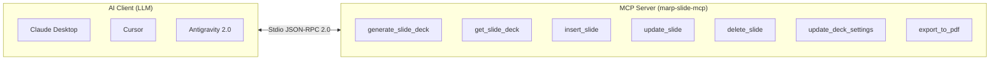

# 外部I/F仕様書 (External Interface Specification)

本ドキュメントは、「**marp-slide-mcp (Marp スライド作成環境)**」が外部システム、AIクライアント（LLM）、および開発者・実行環境に対して提供・連携するすべてのインターフェース仕様を定義する。

---

## 1. 外部インターフェース一覧

本システムは、以下の4カテゴリの外部インターフェースを有する。

| I/F ID | カテゴリ | 相手先システム / クライアント | プロトコル / 形式 |
| :--- | :--- | :--- | :--- |
| **EXT-MCP-001〜007** | MCP Tools I/F | Claude Desktop, Cursor, Antigravity | JSON-RPC 2.0 over Stdio (Model Context Protocol) |
| **EXT-CLI-001〜003** | コマンドライン I/F | 開発者、CI/CDパイプライン、Docker | CLI Arguments, Environment Variables, Exit Codes |
| **EXT-LIB-001〜003** | 外部ライブラリ連携 I/F | Marp Core, Puppeteer, PptxGenJS | Node.js JavaScript/TypeScript API |
| **EXT-CFG-001〜002** | 設定ファイル I/F | VS Code, AI クライアント | JSON 設定ファイル |
| **EXT-DOC-001** | GitHub テンプレート・規約 I/F | 外部コントリビューター、AI エージェント | GitHub Issue Forms (YAML), PR Template, CONTRIBUTING.md |

---

## 2. Model Context Protocol (MCP) ツール仕様 (`EXT-MCP`)

本システムの MCP サーバー（`src/index.ts`）は、標準入出力（`stdio`）を通じて以下の7つのツールを提供する。



### 2.1 EXT-MCP-001: `generate_slide_deck`
- **概要**: 構造化されたスライドデッキデータから、Marp形式のMarkdownファイルを新規生成・保存する。
- **入力パラメータ (JSON Schema / Zod)**:
  ```json
  {
    "filenamePrefix": "string (任意: ファイル名プレフィックス。未指定時はDOC-YYYYMMDD-UUID)",
    "size": "'4:3' | '16:9' (任意: デフォルト '4:3')",
    "themeColor": "string (任意: 16進カラーコード 例: '#1f497d')",
    "logoPath": "string (任意: ヘッダーロゴ相対パス)",
    "banner": "string (任意: バナー画像URL/相対パス/data:URI、または 'none')",
    "titleSlide": {
      "mainTitle": "string (必須: 36pt メインタイトル)",
      "subTitle": "string (必須: 20pt サブタイトル)",
      "bookNo": "string (必須: 図書番号)",
      "author": "string (必須: 所属・氏名)",
      "date": "string (任意: 作成日)",
      "copyright": "string (デフォルト: '© 2026 N-Y-Public')",
      "confidentiality": "string (デフォルト: 'CONFIDENTIAL')"
    },
    "normalSlides": [
      {
        "pageTitle": "string (必須: 60文字以内)",
        "claim": "string (任意: 250文字以内)",
        "chartTitle": "string (任意: 60文字以内)",
        "bodyContent": "string (任意: Markdownテキスト。twoColumns/imageGrid指定時は省略可)",
        "twoColumns": {
          "leftContent": "string (左カラムMarkdown)",
          "rightContent": "string (右カラムMarkdown)"
        },
        "imageGrid": [
          { "imagePath": "string", "caption": "string (任意)", "alt": "string (任意)" }
        ],
        "source": "string (任意: 図表出典)",
        "classes": "string[] (任意: ['columns-2', 'wide-content', 'mermaid-sm'] 等)"
      }
    ]
  }
  ```
- **出力 (レスポンス)**:
  ```json
  {
    "content": [
      {
        "type": "text",
        "text": "スライドデッキを生成しました: slides/<filename>/<filename>.md\n全 X ページ"
      }
    ]
  }
  ```

### 2.2 EXT-MCP-002: `get_slide_deck`
- **概要**: 既存のスライドMarkdownファイルを読み込み、フロントマター設定および各スライドの構成要素を解析して返却する。
- **入力パラメータ**:
  - `filePath`: `string` (必須: 解析対象のMarkdownファイルパス)
- **出力**:
  - パースされたスライド一覧（ページ番号、タイトル、主張、本文、適用クラス等）のJSON構造。

### 2.3 EXT-MCP-003: `insert_slide`
- **概要**: 指定したスライドファイルの特定インデックス位置に新しいスライドを挿入する。
- **入力パラメータ**:
  - `filePath`: `string` (必須)
  - `index`: `number` (必須: 挿入先の0始まりインデックス。表紙は0、1枚目通常スライドは1)
  - `slide`: `NormalSlideSchema` (必須: 挿入するスライドの構造化データ)
- **出力**: 挿入完了メッセージおよび総スライド数。

### 2.4 EXT-MCP-004: `update_slide`
- **概要**: 指定したインデックスのスライド内容（タイトル、主張、本文等）を更新する。
- **入力パラメータ**:
  - `filePath`: `string` (必須)
  - `index`: `number` (必須: 更新対象スライドのインデックス)
  - `slide`: `NormalSlideSchema` (必須: 更新後のスライド構造化データ)
- **出力**: 更新完了メッセージ。

### 2.5 EXT-MCP-005: `delete_slide`
- **概要**: 指定したインデックスのスライドを削除する。
- **入力パラメータ**:
  - `filePath`: `string` (必須)
  - `index`: `number` (必須: 削除対象スライドのインデックス。表紙の削除は不可)
- **出力**: 削除完了メッセージ。

### 2.6 EXT-MCP-006: `update_deck_settings`
- **概要**: デッキ全体の設定（テーマカラー、比率、表紙バナー、ロゴ画像等）を一括更新する。
- **入力パラメータ**:
  - `filePath`: `string` (必須)
  - `primaryColor`: `string` (任意: 新しいテーマカラー)
  - `size`: `'4:3' | '16:9'` (任意)
  - `bannerImage`: `string` (任意: バナー画像指定)
- **出力**: 設定更新完了メッセージ。

### 2.7 EXT-MCP-007: `export_to_pdf`
- **概要**: 内部からMarp CLIを呼び出し、指定されたMarkdownスライドをPDFに変換・出力する。
- **入力パラメータ**:
  - `filePath`: `string` (必須: 変換対象Markdownファイルパス)
  - `outputPath`: `string` (任意: 出力先PDFファイルパス。未指定時は拡張子を `.pdf` に置換)
- **出力**: 出力先PDFファイルの絶対/相対パスおよび成功ステータス。

---

## 3. コマンドライン（CLI）インターフェース仕様 (`EXT-CLI`)

### 3.1 EXT-CLI-001: Marp CLI による PDF 出力
- **コマンド**:
  ```bash
  npm run build:pdf
  # または特定ファイル指定:
  npx marp <スライドMarkdownパス> --theme-set themes/business-slide-theme.css --output <出力PDFパス> --allow-local-files
  ```
- **主要オプション**:
  - `--theme-set`: カスタムテーマCSSファイルのパス。
  - `--allow-local-files`: ローカル画像・アセットの読み込みを許可。
  - `--html`: スライド内のインラインHTMLタグを有効化。
- **終了ステータス**: `0`: 成功, `1`: ビルドエラー

### 3.2 EXT-CLI-002: カスタム PPTX 変換コマンド
- **コマンド**:
  ```bash
  node pptx_converter/convert.js <入力Markdownパス> [出力PowerPointパス]
  # npmスクリプト:
  npm run build:pptx-custom
  ```
- **引数仕様**:
  - 第1引数（必須）: 変換元の `.md` ファイルパス。
  - 第2引数（任意）: 出力先 `.pptx` ファイルパス。省略時は入力ファイルと同ディレクトリ・同名で出力。
- **環境変数**:
  - `CHROME_PATH`: Puppeteerが使用するChromiumのバイナリ絶対パス。未指定時は自動検出。
- **終了ステータス**: `0`: 成功, `1`: ファイル不存在または変換例外

### 3.3 EXT-CLI-003: TypeScript ビルドコマンド
- **コマンド**:
  ```bash
  npm run build
  ```
- **動作**: `tsconfig.json` に基づき `src/index.ts` をコンパイルし、`build/index.js` を生成。

---

## 4. 外部ライブラリ・API連携仕様 (`EXT-LIB`)

### 4.1 EXT-LIB-001: Marp Core API (`@marp-team/marp-core`)
- **利用箇所**: `marp.config.js`, `src/index.ts`
- **主要API**:
  - `new Marp(options)`: Marp変換インスタンスの初期化。
  - `marp.use(plugin)`: Markdown-itプラグインの注入（目次自動生成 `marp_toc`）。
  - `marp.render(markdown)`: MarkdownテキストからHTMLおよびCSS文字列を生成。

### 4.2 EXT-LIB-002: Puppeteer API (`puppeteer`)
- **利用箇所**: `src/index.ts`, `pptx_converter/convert.js`
- **主要API**:
  - `puppeteer.launch({ executablePath, args: ['--no-sandbox'] })`: ヘッドレスブラウザ起動。
  - `page.setViewport({ width, height })`: 仮想スライド解像度設定。
  - `page.evaluate()`: ブラウザコンテキスト内でのDOMノード走査、スタイル（`window.getComputedStyle`）取得。

### 4.3 EXT-LIB-003: PptxGenJS API (`pptxgenjs`)
- **利用箇所**: `pptx_converter/convert.js`
- **主要API**:
  - `new PptxGenJS()`: プレゼンテーション新規作成。
  - `pptx.defineLayout({ name, width, height })`: スライド物理サイズ定義。
  - `slide.addText(text, options)`: 編集可能テキストボックスの配置。
  - `slide.addShape(shape, options)`: 背景・枠線用オートシェイプの描画。
  - `slide.addTable(rows, options)`: ネイティブ表オブジェクトの描画。
  - `pptx.writeFile({ fileName })`: PPTXバイナリファイルのディスク保存。

---

## 5. AIクライアント設定仕様 (`EXT-CFG`)

### 5.1 Claude Desktop 設定 (`claude_desktop_config.json`)
```json
{
  "mcpServers": {
    "marp-slide-mcp": {
      "command": "node",
      "args": [
        "<リポジトリルートへの絶対パス>/build/index.js"
      ],
      "env": {
        "CHROME_PATH": "/usr/bin/chromium"
      }
    }
  }
}
```

### 5.2 Antigravity 2.0 Skill 定義 (`.agents/skills/marp-slides/SKILL.md`)
- エージェントがMCPツールを認識し、自然言語によるプレゼン作成依頼に対して自律的に `generate_slide_deck` や `update_slide` を呼び出すためのトリガー定義。

---

## 6. 関連設計図書への参照リンク

- [[01_requirements_specification|要件定義書]]: 本外部I/Fが対応する機能要件
- [[01_functional_specification|機能仕様書]]: 機能全体像およびスライドレイアウト
- [[01_architectural_design|構造設計書]]: モジュール内部の設計構造
- [[02_internal_interface_specification|内部I/F仕様書]]: 内部関数・データ型の詳細仕様
- [[03_program_specification|プログラム仕様書]]: 各APIハンドラーの実装コード仕様
- [[../README|設計図書統合インデックス]]: 設計図書体系の全体マップ
