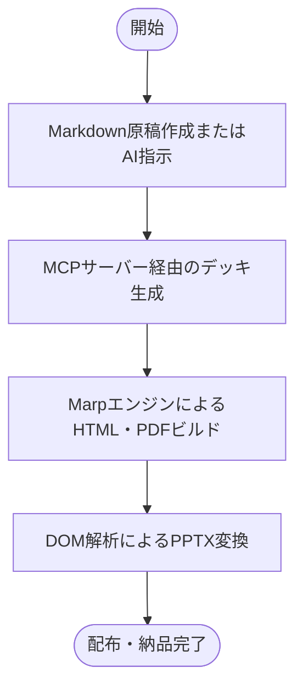
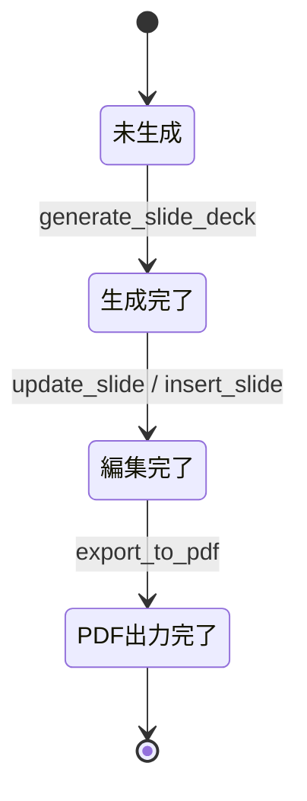

# 1 本書の位置づけ

## 1.1 目的
「marp-slide-mcp」が提供する各機能の振る舞い、業務フロー、および機能単位の状態遷移を定める。

## 1.2 記述対象
記述対象は [[03_documentation_standard#2.1 図書一覧|図書一覧]] の本書の行に従う。

## 1.3 記述対象外と参照先
- システム要件: [[01_requirements_specification#1 本書の位置づけ|要件定義書]]
- 外部I/F仕様: [[03_external_interface_specification#1 本書の位置づけ|外部I/F仕様書]]
- 画面レイアウトおよび画面遷移: [[07_screen_specification#1 本書の位置づけ|画面仕様書]]
- モジュール構造: [[01_software_structure_design#1 本書の位置づけ|ソフトウェア構造設計書]]

## 1.4 改版履歴
| 版 | 日付 | 起因PBI | 変更概要 |
| :--- | :--- | :--- | :--- |
| 1.0.0 | 2026-11-04 | PBI-016 | 規約 DOC-GOV-003 準拠への再編および画面仕様分離 |
| 1.1.0 | 2026-11-07 | PBI-019 | 24H365D自律開発統制・日報週報生成機能（FNC-011）の追加 |
| 1.2.0 | 2026-11-08 | PBI-020 | 中見出しスライド生成および章別目次機能（FNC-012）の追加 |
| 1.3.0 | 2026-11-08 | PBI-021 | 中見出しスライドの表示位置・機密表示配置・リンクHTML化・4:3比率適用の品質是正 |
| 1.4.0 | 2026-11-09 | PBI-022 | 常駐Pythonオーケストレーターによる24H365D自律開発デーモン機能（FNC-013）の追加 |

# 2 機能仕様

## 2.1 FNC-001 スライドテーマ・スタイリング機能
| 項目 | 内容 |
| :--- | :--- |
| 上位ID | `REQ-FNC-001` |
| 状態 | Approved |
| 後継ID | なし |
| 概要 | 見出し記法をアンカーとして扱い直後要素をレイアウト配置する |

### 2.1.1 振る舞い
スライド内の見出し（`h1`〜`h5`）はCSSで非表示化され、直後の要素が特定位置へ描画される。画面寸法や配置の詳細は [[07_screen_specification#3.1 SCR-001 表紙スライド|表紙スライド画面仕様]] を参照する。

## 2.2 FNC-002 自律的要素リサイズ機能
| 項目 | 内容 |
| :--- | :--- |
| 上位ID | `REQ-FNC-002` |
| 状態 | Approved |
| 後継ID | なし |
| 概要 | 表、コード、Mermaid図、画像のはみ出し防止自動縮小および10段階統一数字クラス群 |

### 2.2.1 振る舞い
表、本文、Mermaid図、画像、コードブロックに対して、共通の10段階数字クラス（`table-1`〜`10` 等）を提供する。1を最大とし、数字が増加するにつれて縮小する。

## 2.3 FNC-003 構造化レイアウト提供機能
| 項目 | 内容 |
| :--- | :--- |
| 上位ID | `REQ-FNC-003` |
| 状態 | Approved |
| 後継ID | なし |
| 概要 | 2段組、画像並列、会話タイムライン、ワイドコンテンツのレイアウト提供 |

### 2.3.1 振る舞い
`columns-2` クラス指定時は左右2列均等配置、`images-2`〜`4` 指定時は画像横並びグリッド、`conversation-content` 指定時は吹き出し形式で描画する。

## 2.4 FNC-004 目次自動生成機能
| 項目 | 内容 |
| :--- | :--- |
| 上位ID | `REQ-FNC-004` |
| 状態 | Approved |
| 後継ID | なし |
| 概要 | 見出しタイトルを自動収集しページ番号とリンクを生成する |

### 2.4.1 振る舞い
通常スライドのタイトルを収集し、13項目以上の場合は12項目ごとに独立した目次スライドへ分割生成する。

## 2.5 FNC-005 高度PowerPoint変換機能
| 項目 | 内容 |
| :--- | :--- |
| 上位ID | `REQ-FNC-005` |
| 状態 | Approved |
| 後継ID | なし |
| 概要 | レンダリングDOM解析による編集可能PPTXオブジェクト出力 |

### 2.5.1 振る舞い
Puppeteerで中間HTMLを描画し、各要素のDOM矩形と計算済みスタイルを抽出してPptxGenJSオブジェクトを生成する。

## 2.6 FNC-006 MCPスライド操作サービス機能
| 項目 | 内容 |
| :--- | :--- |
| 上位ID | `REQ-FNC-006` |
| 状態 | Approved |
| 後継ID | なし |
| 概要 | Stdioプロトコルによるデッキ生成・編集・PDF出力API |

### 2.6.1 振る舞い
MCPツール（`generate_slide_deck`, `get_slide_deck`, `insert_slide`, `update_slide`, `delete_slide`, `update_deck_settings`, `export_to_pdf`）を提供する。インターフェース詳細は [[03_external_interface_specification#2.1 EXT-MCP-001 generate_slide_deck|EXT-MCP-001]] を参照する。

## 2.7 FNC-007 AI協調支援機能
| 項目 | 内容 |
| :--- | :--- |
| 上位ID | `REQ-FNC-007` |
| 状態 | Approved |
| 後継ID | なし |
| 概要 | MBB標準プロンプトおよびエージェント向け実行スキル |

### 2.7.1 振る舞い
1スライド1主張を徹底したスライド構成プロンプトおよびAIエージェント向けスキルを提供する。

## 2.8 FNC-008 GitHub MCP連携・PAT分離機能
| 項目 | 内容 |
| :--- | :--- |
| 上位ID | `REQ-FNC-008` |
| 状態 | Approved |
| 後継ID | なし |
| 概要 | リポジトリ専用環境変数バインドおよび事前アカウント検証ゲート |

### 2.8.1 振る舞い
外部書き込み操作の直前に `get_me` を実行し、認証アカウントが期待値と一致する場合のみ書き込みを許可する。

## 2.9 FNC-009 業界標準GitHub運用・エージェント支援機能
| 項目 | 内容 |
| :--- | :--- |
| 上位ID | `REQ-FNC-009` |
| 状態 | Approved |
| 後継ID | なし |
| 概要 | 2層分離規約、Issue Forms、PRテンプレート、ブランチ自動是正 |

### 2.9.1 振る舞い
セッション開始時に現在のGitブランチ名を検査し、規約違反を検知した場合は `git branch -m` により自動是正する。

## 2.10 FNC-010 設計図書記述規約・構文検査機能
| 項目 | 内容 |
| :--- | :--- |
| 上位ID | `REQ-FNC-010` |
| 状態 | Approved |
| 後継ID | なし |
| 概要 | 図書体系、共通記述構文、ID附番規則、構文検査器 |

### 2.10.1 振る舞い
`verify_doc_syntax.py` が `doc_standard` を持つ図書を自動走査し、規約違反を検出する。

## 2.11 FNC-011 24H365D自律開発統制・日報週報生成機能
| 項目 | 内容 |
| :--- | :--- |
| 上位ID | `REQ-FNC-011` |
| 状態 | Approved |
| 後継ID | なし |
| 概要 | Issue優先度選定、Stage A→B別エージェント審査、1日3回の日報生成、毎週水曜16:00の週報生成、および非同期フィードバック反映 |

### 2.11.1 振る舞い
未対応Issueを優先度と依存関係に基づき選定し、Stage A起票エージェントが作成したPBIを独立した審査エージェント（`stage-gate-reviewer-agent`）が審査して合格（`PASS`）時のみStage Bへ移行させる。毎日3回（`07:30`, `11:50`, `18:00`）にメンテナー向け日報を `tpl_96_daily_report.md` から生成し、毎週水曜 `16:00` にはプロジェクトとりまとめ向け週報を `tpl_97_weekly_report.md` から併せて生成する。インターフェース詳細は [[03_external_interface_specification#2.11 EXT-CLI-003 autonomous_dev_loop|EXT-CLI-003]] および [[03_external_interface_specification#2.12 EXT-CLI-004 generate_reports|EXT-CLI-004]] を参照する。

## 2.12 FNC-012 中見出し（セクションディバイダー）スライド生成および章別目次機能
| 項目 | 内容 |
| :--- | :--- |
| 上位ID | `REQ-FNC-012` |
| 状態 | Approved |
| 後継ID | なし |
| 概要 | 複数ページを章として区切る4種類の中見出し（セクションディバイダー）スライド生成、ページ内アンカーリンク遷移、専用CSSスタイル、および章タイトルのみを抽出する章別目次モードの提供 |

### 2.12.1 振る舞い
スライドデッキ生成・更新時に中見出しスライド（`SectionDividerSlide`）を受け入れ、4つのパターン（`title-only`, `title-and-pages`, `all-chapters`, `all-chapters-and-pages`）に応じて左寄せ垂直中央配置の構造化HTMLと専用クラス `section-divider` を出力する。通常スライド左上のヘッダータイトル（h1コンテンツ）は中見出しスライドでは非表示化され、章題名がスライド中央の適正位置に大見出し（32pt以上太字・テーマカラー装飾バー）として表示される。ページタイトル一覧には生MarkdownではなくクリッカブルなHTMLアンカーリンク（`<a href="#スライド番号">`）をセマンティックに出力し、他章タイトルは `.dim` クラスで薄色表示する。フッター（コピーライト・機密指定区分）は通常スライドと同一の最下部フッター帯（`bottom: 12px`, `bottom: 8px`）の絶対位置を維持する。また `marp.config.js` において `toc-chapters-only` クラスを持つ目次スライドを検知した場合、中見出しスライドの章タイトルとページ番号のみを抽出して目次を自動生成する。さらに 4:3（960x720）および 16:9（1280x720）の両画面比率においてピクセルパーフェクトなレイアウト描画を担保する。インターフェース詳細は [[03_external_interface_specification#2.1 EXT-MCP-001 generate_slide_deck|EXT-MCP-001]] を参照する。

## 2.13 FNC-013 常駐Pythonオーケストレーターによる24H365D自律開発デーモン機能
| 項目 | 内容 |
| :--- | :--- |
| 上位ID | `REQ-FNC-013` |
| 状態 | Approved |
| 後継ID | なし |
| 概要 | 常駐デーモンループによる定時レポート自動生成、メンテナー指示定期スキャン、工程別ステートレスAIワーカー起動、独立ゲート審査強制、DoD自動検証、PR生成、および次Issueへの連続自律遷移 |

### 2.13.1 振る舞い
常駐Pythonデーモン（`scripts/autonomous_daemon.py` および `scripts/autonomous_dev_loop.py run-daemon`）がメインループを継続実行する。各サイクルにおいてJST現在時刻を監視し、日報スケジュール（`07:30`, `11:50`, `18:00`）および週報スケジュール（水曜 `16:00`）の到来時に未発行であればAIを介さず直接レポートを生成して発行済みスロットを記録する。次に `docs/reports/daily/` 配下の日報ファイルからメンテナー指示タグをスキャンして状態管理データへ反映する。`--issues-json` が未指定（デフォルト）の場合は GitHub REST API から対象リポジトリ（`N-Y-Public/marp-slide-mcp`）の Open Issue 一覧を自動取得し、1度に並行して取り組むIssue数の上限（デフォルト `max_concurrent_issues = 1`）に従って未着手Issueから最優先タスクを1件選定する。選定されたIssueに対して、Stage A（PBI起票）、Stage A→B独立ゲート審査（`ROLE-PM` とは異なる `ROLE-ARCH` による審査）、Stage B（設計・実装・テスト）をそれぞれ独立したステートレスAIワーカープロセスとして起動・破棄する。Stage B完了後にDoD検証（ビルド・自動テスト・`verify_rtm.py`）および事前アカウント検証ゲートを実行し、合格時は `.github/pull_request_template.md` 準拠のPRドラフトを生成して当該Issueを完了記録し、停止せず次の未対応Issueへ自動遷移する。インターフェース詳細は [[03_external_interface_specification#2.13 EXT-CLI-005 autonomous_daemon|EXT-CLI-005]] を参照する。

# 3 業務フローおよび状態遷移

## 3.1 業務フロー

## 3.2 機能状態遷移

