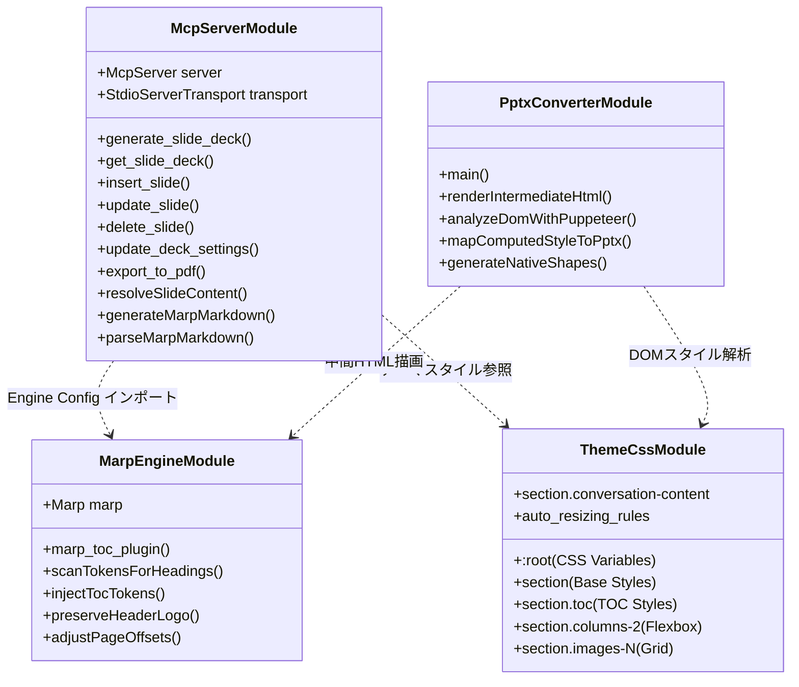
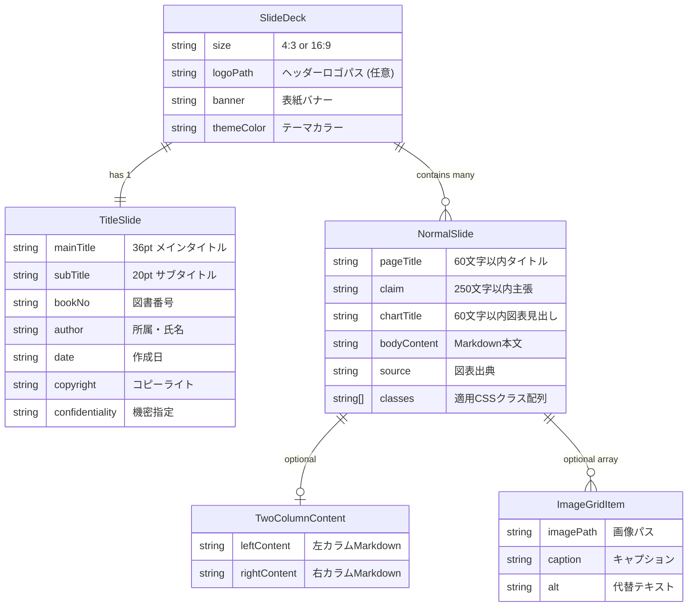

# 構造設計書 (Architectural Design)

本ドキュメントは、「**marp-slide-mcp (Marp スライド作成環境)**」を構成するモジュールの物理・論理構造、コンポーネント間の依存関係、データ構造モデル、およびプロセスの実行ライフサイクルを定義する詳細設計書である。

---

## 1. モジュール構造およびコンポーネント関連

本システムは、高い凝集性と疎結合性を保つため、独立した4つのコアサブシステム（モジュール）によって構成される。



### 1.1 モジュール一覧 (`MOD`)

| モジュールID | モジュール名 | 主要ファイル | 責務概要 |
| :--- | :--- | :--- | :--- |
| **MOD-SRV-001** | MCP サービスモジュール | `src/index.ts` | MCPプロトコル処理、スキーマ検証、Markdown変換、CRUDロジック |
| **MOD-ENG-001** | カスタム Marp エンジン | `marp.config.js` | 目次自動生成プラグイン、Markdown-itトークン走査、静的リサイズ |
| **MOD-PPT-001** | PPTX カスタムコンバーター | `pptx_converter/convert.js` | PuppeteerによるDOM計測、PptxGenJSオブジェクト変換 |
| **MOD-THM-001** | ビジネステーマスタイル | `themes/business-slide-theme.css` | 見出しアンカー非表示・絶対配置、自動リサイズ、レイアウト定義 |

---

## 2. ディレクトリおよびファイル構造設計

```
oss/main/
├── .agents/skills/marp-slides/     # AIエージェント用実行定義
│   ├── SKILL.md                    # エージェント行動規範・ワークフロー
│   ├── references/                 # 参照ガイド（テーマ・レイアウト規約）
│   └── examples/                   # ペイロード例
├── pptx_converter/                 # PowerPoint変換サブシステム
│   └── convert.js                  # DOM解析＆PPTX生成スクリプト (MOD-PPT-001)
├── prompts/                        # AIプロンプト資産
│   └── mcp_slide_generator.md      # MBB標準スライド自動生成プロンプト
├── slides/                         # スライド管理ディレクトリ
│   └── D01-000001_Marpの使い方/    # 資料別独立ディレクトリ
│       ├── D01-000001_Marpの使い方.md
│       ├── D01-000001_Marpの使い方.pdf
│       ├── D01-000001_Marpの使い方.pptx
│       ├── banner.svg
│       └── N-Y-Public_Logo.jpg
├── src/                            # TypeScriptソースコード
│   └── index.ts                    # MCPサーバー本体 (MOD-SRV-001)
├── templates/                      # Markdownスライドひな形集
│   ├── スライドタイトル_テンプレ.md
│   ├── スライド通常ページ_テンプレ.md
│   ├── スライド2段組_テンプレ.md
│   ├── スライド画像並列_テンプレ.md
│   ├── スライド通常_会話形式_テンプレ.md
│   └── スライドワイドコンテンツ_テンプレ.md
├── themes/                         # スタイルシート・アセット
│   ├── business-slide-theme.css    # コアテーマCSS (MOD-THM-001)
│   ├── theme-colors.css            # カラーパレットプリセット定義
│   ├── banner.svg                  # 表紙標準装飾SVG
│   └── vendor/                     # ハイライトCSS・Mermaidスクリプト
├── marp.config.js                  # Marpカスタムエンジン設定 (MOD-ENG-001)
├── package.json                    # ビルド・依存関係定義
└── tsconfig.json                   # TypeScriptコンパイラ設定
```

---

## 3. データ構造モデル設計 (`MOD-DAT`)

MCPサーバー（`src/index.ts`）内で使用される、Zod定義に基づく中核データモデル。



### 3.1 `MOD-DAT-001`: `SlideDeck`
スライドデッキ全体を表現するルートモデル。
- `size`: `'4:3' | '16:9'`（スライド物理比率）
- `logoPath`: 全ページ共通ヘッダー画像パス（任意、未指定時は省略）
- `banner`: 表紙中央の装飾バナー（URL、相対パス、Base64 Data URI、または `'none'`）
- `themeColor`: `--primary-color` に適用するカラーコード
- `titleSlide`: `TitleSlide` オブジェクト
- `normalSlides`: `NormalSlide` オブジェクトの配列

### 3.2 `MOD-DAT-002`: `NormalSlide`
2ページ目以降の通常スライドを表現するモデル。
- `pageTitle`: ページ上部に配置されるスライド表題（最大60文字）
- `claim`: グレー帯内に配置される主要な主張・要約（最大250文字）
- `chartTitle`: 主張補足または図表タイトル（最大60文字）
- `bodyContent`: スライド中央のメインコンテンツ（Markdown）
- `twoColumns`: 2段組構造化データ（指定時、自動で `columns-2` クラスとMarkdown箇条書きに展開）
- `imageGrid`: 画像並列構造化データ（指定時、自動で `images-N` クラスと画像記法に展開）
- `source`: 右下に配置される図表出典・脚注
- `classes`: スライドに個別適用するCSSクラスの配列

---

## 4. プロセス実行モデルおよびライフサイクル

### 4.1 MCP サーバー起動およびメッセージディスパッチ
1. **プロセス起動**: Node.js により `build/index.js` が実行される。
2. **環境検出**: `CHROME_PATH` の存在確認、およびフォールバック走査による自動設定。
3. **サーバー初期化**: `new McpServer()` および `new StdioServerTransport()` を生成。
4. **ツール登録**: 7つのMCPツールをスキーマ・ハンドラーと共に関数登録。
5. **接続待機**: `server.connect(transport)` により標準入出力のJSON-RPCリスナーを開始。

### 4.2 PPTX コンバーターのレンダリング・抽出パイプライン
1. **中間HTML生成**: `marp --html --theme-set themes/business-slide-theme.css -o temp.html` を同期実行。
2. **ヘッドレスブラウザ起動**: Puppeteer で Chromium を起動（`--no-sandbox`）。
3. **DOMツリー走査**: 各スライド `section` 要素内の子孫要素を再帰的にトラバース。
4. **Computed Style 取得**: ブラウザのレンダリングエンジンから正確な座標（x, y, w, h）、フォント（font-family, font-size, font-weight, color）、背景色、枠線を抽出。
5. **PptxGenJS オブジェクト生成**: 96DPI基準でインチ座標に変換し、PowerPointシェイプ/テキストボックスを生成。
6. **ファイル保存**: 一時HTMLを削除し、`.pptx` ファイルを出力。

---

## 5. モジュール間依存関係マトリクス

| 呼出元 \ 参照先 | `MOD-SRV-001` (MCP) | `MOD-ENG-001` (Marp Engine) | `MOD-PPT-001` (PPTX) | `MOD-THM-001` (Theme CSS) |
| :--- | :---: | :---: | :---: | :---: |
| **`MOD-SRV-001`** | — | インポート参照 | CLI呼出可能 | パス参照 |
| **`MOD-ENG-001`** | — | — | — | CSS解析 |
| **`MOD-PPT-001`** | — | CLI経由で呼出 | — | CSS適用レンダリング |
| **`MOD-THM-001`** | — | — | — | — |

---

## 6. 関連設計図書への参照リンク

- [[01_requirements_specification|要件定義書]]: 本構造設計の前提となる要件一覧
- [[01_functional_specification|機能仕様書]]: 基本設計における機能構成
- [[02_external_interface_specification|外部I/F仕様書]]: 外部通信I/F仕様
- [[02_internal_interface_specification|内部I/F仕様書]]: 関数I/Fおよび詳細型定義
- [[03_program_specification|プログラム仕様書]]: 各モジュールの実装コード詳細仕様
- [[../README|設計図書統合インデックス]]: 設計図書体系の全体マップ
