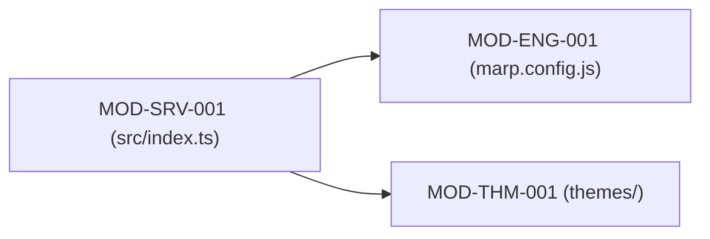
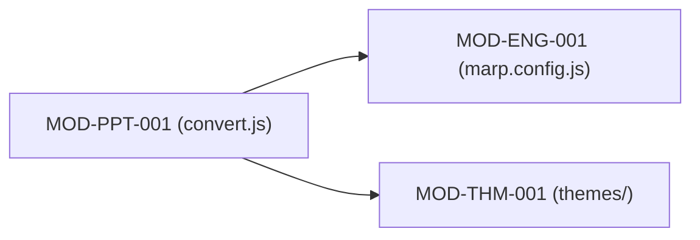
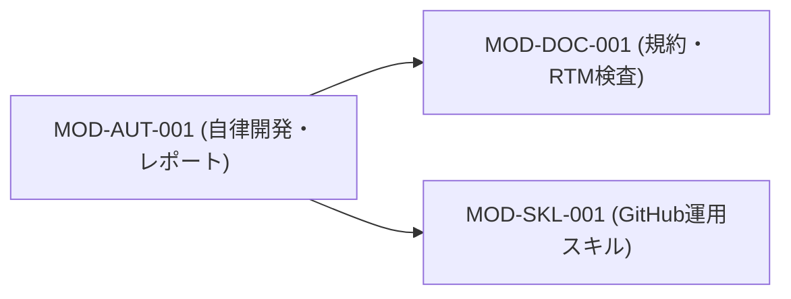

# 1 本書の位置づけ

## 1.1 目的
「marp-slide-mcp」を構成するモジュールおよびクラスの物理・論理構造と依存関係を定める。

## 1.2 記述対象
記述対象は [[03_documentation_standard#2.1 図書一覧|図書一覧]] の本書の行に従う。

## 1.3 記述対象外と参照先
- システム全体方式: [[01_system_architecture#1 本書の位置づけ|システム方式設計書]]
- 内部I/Fシグネチャ: [[02_internal_interface_specification#1 本書の位置づけ|内部I/F仕様書]]
- プログラム処理ロジック: [[03_program_specification#1 本書の位置づけ|プログラム仕様書]]
- データ構造の型形式: [[06_data_structure_specification#1 本書の位置づけ|データ構造仕様書]]

## 1.4 改版履歴
| 版 | 日付 | 起因PBI | 変更概要 |
| :--- | :--- | :--- | :--- |
| 1.0.0 | 2026-11-04 | PBI-016 | 規約 DOC-GOV-003 準拠への再編およびデータ構造分離 |
| 1.1.0 | 2026-11-07 | PBI-019 | 24H365D自律開発統制・レポーティングモジュール（MOD-AUT-001）の追加 |
| 1.2.0 | 2026-11-08 | PBI-020 | 中見出しスライド生成および章別目次機能に伴う MOD-SRV-001 および MOD-ENG-001 の責務拡張 |

# 2 モジュール構成

## 2.1 MOD-SRV-001 MCPサービスモジュール
| 項目 | 内容 |
| :--- | :--- |
| 上位ID | `FNC-006` |
| 状態 | Approved |
| 後継ID | なし |
| 主要ファイル | `src/index.ts` |
| 責務 | MCPプロトコル処理、Zodスキーマ検証、Markdown変換、中見出しスライド生成、CRUDロジック |

### 2.1.1 依存関係

## 2.2 MOD-ENG-001 カスタムMarpエンジン
| 項目 | 内容 |
| :--- | :--- |
| 上位ID | `FNC-004` |
| 状態 | Approved |
| 後継ID | なし |
| 主要ファイル | `marp.config.js` |
| 責務 | 目次自動生成プラグイン（章別目次モード抽出含む）、Markdown-itトークン走査、静的リサイズ |

### 2.2.1 依存関係

## 2.3 MOD-PPT-001 PPTXカスタムコンバーター
| 項目 | 内容 |
| :--- | :--- |
| 上位ID | `FNC-005` |
| 状態 | Approved |
| 後継ID | なし |
| 主要ファイル | `pptx_converter/convert.js` |
| 責務 | PuppeteerによるDOM計測、PptxGenJSオブジェクト変換 |

### 2.3.1 依存関係

## 2.4 MOD-THM-001 ビジネステーマスタイル
| 項目 | 内容 |
| :--- | :--- |
| 上位ID | `FNC-001` |
| 状態 | Approved |
| 後継ID | なし |
| 主要ファイル | `themes/business-slide-theme.css` |
| 責務 | 見出しアンカー非表示・絶対配置、自動リサイズ、レイアウト定義 |

### 2.4.1 依存関係

## 2.5 MOD-INF-001 GitHub MCP連携インフラ
| 項目 | 内容 |
| :--- | :--- |
| 上位ID | `FNC-008` |
| 状態 | Approved |
| 後継ID | なし |
| 主要ファイル | `docker-compose.yml`, `.agents/mcp_config.json` |
| 責務 | リポジトリ専用PAT環境変数バインド、揮発性ワンショット実行統制 |

### 2.5.1 依存関係

## 2.6 MOD-SKL-001 GitHub運用支援スキル体系
| 項目 | 内容 |
| :--- | :--- |
| 上位ID | `FNC-009` |
| 状態 | Approved |
| 後継ID | なし |
| 主要ファイル | `.agents/skills/github-workflows/SKILL.md`, `.github/` |
| 責務 | Issue Forms/PRテンプレート、コントリビューション規約、ブランチ運用スキル |

### 2.6.1 依存関係

## 2.7 MOD-DOC-001 設計図書規約・構文検査モジュール
| 項目 | 内容 |
| :--- | :--- |
| 上位ID | `FNC-010` |
| 状態 | Approved |
| 後継ID | なし |
| 主要ファイル | `docs/00_project_charter/03_documentation_standard.md`, `verify_doc_syntax.py` |
| 責務 | 図書体系・記述構文・ID附番規則の正本、および構文検査器 |

### 2.7.1 依存関係

## 2.8 MOD-AUT-001 24H365D自律開発統制・レポーティングモジュール
| 項目 | 内容 |
| :--- | :--- |
| 上位ID | `FNC-011` |
| 状態 | Approved |
| 後継ID | なし |
| 主要ファイル | `scripts/autonomous_dev_loop.py`, `scripts/generate_reports.py`, `scripts/autonomous_config.json`, `docs/templates/tpl_96_daily_report.md`, `docs/templates/tpl_97_weekly_report.md` |
| 責務 | Issue優先度選定、Stage A→B別エージェント審査ゲート、非同期フィードバック解析、およびテンプレート駆動の日報（1日3回）・週報（毎週水曜16:00）生成 |

### 2.8.1 依存関係

# 3 クラス構成

## 3.1 CLS-PPT-001 PptxConverter
| 項目 | 内容 |
| :--- | :--- |
| 上位ID | `MOD-PPT-001` |
| 状態 | Approved |
| 後継ID | なし |
| 所属モジュール | `MOD-PPT-001` |
| 責務 | DOM計測結果をPptxGenJSシェイプおよびテキストボックスへマッピングする |
