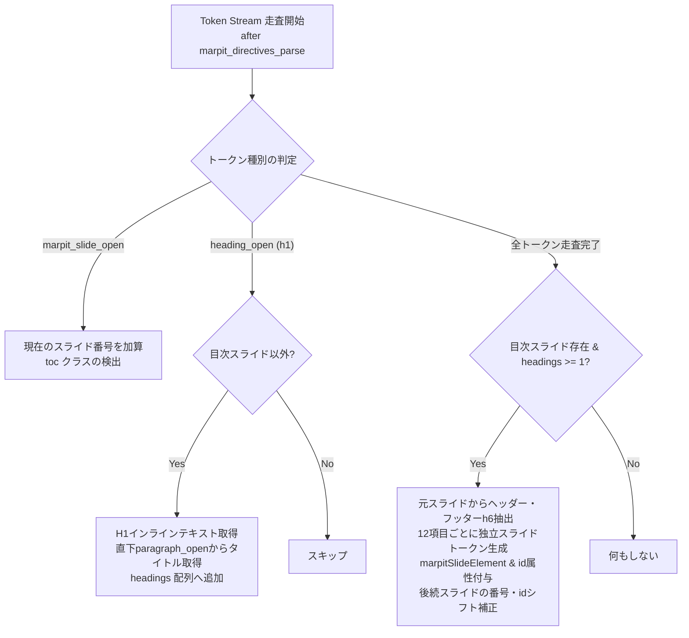

# 内部I/F仕様書 (Internal Interface Specification)

本ドキュメントは、「**marp-slide-mcp (Marp スライド作成環境)**」の各モジュール内部において呼び出される関数、メソッド、およびデータ受け渡しインターフェースのシグネチャと仕様を定義する詳細設計書である。

---

## 1. 内部インターフェース一覧

| I/F ID | モジュール | 関数 / メソッド名 | 責務 |
| :--- | :--- | :--- | :--- |
| **INT-FN-001** | `src/index.ts` | `resolveSlideContent` | 構造化レイアウト（2段組・画像グリッド）のMarkdown結合とクラス解決 |
| **INT-FN-002** | `src/index.ts` | `generateMarpMarkdown` | `SlideDeck` オブジェクトから Marp 形式 Markdown 全文の生成 |
| **INT-FN-003** | `src/index.ts` | `parseMarpMarkdown` | 既存 Markdown テキストからフロントマターとスライド要素の構文解析 |
| **INT-FN-004** | `src/index.ts` | `buildSlideMarkdown` | 単一 `NormalSlide` から Marp スライド Markdown 単位の生成 |
| **INT-FN-005** | `src/index.ts` | `ensureOutputDir` | 出力先ディレクトリの非同期・安全作成 |
| **INT-ENG-001** | `marp.config.js` | `engine(opts)` | カスタム Marp インスタンス生成およびプラグイン登録フック |
| **INT-ENG-002** | `marp.config.js` | `marp_toc` | Markdown-it コアルールへの目次スライド自動生成プラグイン |
| **INT-DOM-001** | `pptx_converter/convert.js` | `main()` | PPTX 変換の全体制御・実行パイプライン |
| **INT-DOM-002** | `pptx_converter/convert.js` | `page.evaluate()` | ヘッドレスブラウザ内での DOM ノードおよび計算済みスタイル抽出 |

---

## 2. MCP サービス内部関数仕様 (`src/index.ts`)

### 2.1 INT-FN-001: `resolveSlideContent`
- **シグネチャ**:
  ```typescript
  function resolveSlideContent(
    slide: z.infer<typeof NormalSlideSchema>
  ): { bodyContent: string; classes: string[] }
  ```
- **引数**:
  - `slide`: 通常スライドの構造化データ（`NormalSlideSchema` 準拠）。
- **返却値**:
  - `bodyContent`: 展開された Markdown 本文文字列。
  - `classes`: 自動付与されたレイアウトクラスを含むクラス配列。
- **処理ロジック**:
  1. `slide.classes` をコピーして配列を初期化。
  2. `slide.twoColumns` が存在する場合:
     - `classes` に `columns-2` を追加。
     - 左カラム各行を 2 スペースでインデント、右カラム各行を 2 スペースでインデント。
     - `- <左カラム>\n\n- <右カラム>` の箇条書き構造として結合。
  3. `slide.imageGrid` が存在する場合:
     - 枚数（2〜4）に応じたクラス `images-${count}` を追加。
     - 各画像を `- \n  **<caption>**` 形式に整形して結合。
  4. いずれも指定がなく、本文（`bodyContent`）が空で `slide.pageTitle` が `"目次"` または `"Table of Contents"`（大文字小文字不問）の場合:
     - `classes` に `"toc"` が未含有であれば自動的に `"toc"` を追加し、Marpエンジンの目次自動生成を確実に発動させる。
  5. 上記以外の場合は `slide.bodyContent` をそのまま採用。

### 2.2 INT-FN-002: `generateMarpMarkdown`
- **シグネチャ**:
  ```typescript
  function generateMarpMarkdown(deck: SlideDeck): string
  ```
- **引数**:
  - `deck`: スライドデッキ全体の構造化オブジェクト。
- **返却値**:
  - Marp 互換の完全な Markdown 文字列。
- **処理ロジック**:
  1. フロントマターディレクティブ（`marp: true`, `theme: business-slide`, `size`, `paginate: true`, `header`）を組み立て。
  2. `--primary-color` および `--banner-image` の `<style>` 定義を生成。
  3. 表紙スライド（`<!-- _class: title-slide -->`、`#` メインタイトル、`##` サブタイトル等）を構築。
  4. `normalSlides` 配列をループし、`resolveSlideContent` を呼び出しながら各スライドを `---` で区切って結合。

### 2.3 INT-FN-003: `parseMarpMarkdown`
- **シグネチャ**:
  ```typescript
  function parseMarpMarkdown(content: string): {
    frontmatter: Record<string, any>;
    slides: Array<{ raw: string; index: number }>;
  }
  ```
- **引数**:
  - `content`: Markdown ファイルのテキスト全文。
- **返却値**:
  - フロントマターの辞書オブジェクトおよびスライドごとの生テキスト配列。
- **処理ロジック**:
  1. 正規表現 `^---\r?\n([\s\S]*?)\r?\n---` によりフロントマターを抽出。
  2. 残りの本文をスライド区切り記号 `\n---\n` により分割。
  3. 各スライドの生テキストおよびインデックスを配列化して返却。

### 2.4 INT-FN-004: `buildSlideMarkdown`
- **シグネチャ**:
  ```typescript
  function buildSlideMarkdown(slide: z.infer<typeof NormalSlideSchema>): string
  ```
- **引数**:
  - `slide`: 通常スライドの構造化データ。
- **返却値**:
  - 単一スライドの Markdown 文字列（`#`, `##`, `###`, `####`, `#####`, `######` のアンカー構造を含む）。

---

## 3. Marp カスタムエンジン プラグイン仕様 (`marp.config.js`)

### 3.1 INT-ENG-001: `engine(opts)`
- **シグネチャ**:
  ```javascript
  export default {
    options: { html: true },
    engine: function(opts) => Marp
  }
  ```
- **処理ロジック**:
  - `opts.html = true` を設定して `new Marp(opts)` を生成。
  - `marp.use()` を介して Markdown-it プラグイン（`marp_toc`）を登録。

### 3.2 INT-ENG-002: Markdown-it コアルール `marp_toc`
- **フック位置**: `md.core.ruler.after('marpit_directives_parse', 'marp_toc', (state) => { ... })`（`marpit_inline_svg`・`marpit_directives_apply`・`marpit_header_and_footer`・`marpit_collect` の直前に実行。`state.inlineMode` 時は即時リターン）
- **トークン操作仕様**:



1. **タイトル取得のフォールバック優先順位**:
   - `paragraph_open` の直後のインラインテキスト（`<br>` を空白に置換）。
   - 見出しタグ `h1` の直後のインラインテキスト。
2. **ヘッダーロゴおよびフッター（`h6`）の保持**:
   - `marpit_directives_parse` 直後に実行するため、各目次スライドの `marpit_slide_open.meta.marpitDirectives` が後続の `marpit_header_and_footer` に引き継がれ、全目次ページに `<header>`（ロゴ画像等）および `<footer>` が自動生成される。また既に存在する `marpit_header_open` / `marpit_footer_open` トークンおよび元の目次スライド内の `h6`（コピーライト・機密指定）＋直後段落トークンも抽出し、分割された全目次スライドへ複製注入する。
3. **複数ページ分割とページ番号オフセット**:
   - 目次が12項目を超える場合、12項目ごとに独立した `marpit_slide_open`（`meta.marpitSlideElement = 1`, `id` 属性設定）〜 `marpit_slide_close`（`meta.marpitSlideElement = -1`）を生成。
   - 後続スライドのリンク先、表示ページ番号、および後続 `marpit_slide_open` / `marpit_slide_close` の `meta.marpitSlide`・`meta.marpitSlideTotal`・`id` 属性に `+(totalAddedSlides - 1)` を加算補正し、`marpit_inline_svg` および `marpit_directives_apply` によるSVGページ分割とページ番号付与を100%整合させる。
4. **長文タイトルの自動折り返し・見切れ防止仕様**:
   - `themes/business-slide-theme.css` の目次リンク（`section.toc>ul>li.toc-item>p>a`）において、`white-space: normal !important;`, `overflow-wrap: anywhere !important;`, `word-break: break-word !important;` を適用し、タイトルが長文の場合でも省略記号（`...`）で見切れず複数行に折り返されるようにする。
   - Flexboxコンテナ（`li.toc-item>p`）の `align-items: baseline` と連動し、複数行タイトルの最終行のベースラインにドットリーダー線（`p:after`）およびページ番号（`span.toc-page`）が整然と配置される。
   - `max-width: calc(100% - 100px)` により、ドットリーダー線とページ番号のための描画幅を確保する。

---

## 4. PPTX コンバーター 内部制御仕様 (`pptx_converter/convert.js`)

### 4.1 INT-DOM-001: `main()` パイプライン
- **実行ステップ**:
  1. CLI引数（`process.argv`）から `INPUT_MD` および `OUTPUT_PPTX` を解決。
  2. `execSync` により `npx marp ... -o temp.html` を同期実行。
  3. `puppeteer.launch` により Chromium を起動。
  4. `page.goto('file://' + TEMP_HTML)` でロード。
  5. `page.evaluate()` によりスライド要素を解析。
  6. `new PptxGenJS()` に解析結果をマッピング。
  7. `pptx.writeFile()` で保存後、`fs.unlinkSync(TEMP_HTML)` で一時ファイルを破棄。

### 4.2 INT-DOM-002: DOM 解析および座標変換
- **定数定義**:
  - `SCREEN_WIDTH = 960` (4:3基準ピクセル)
  - `SCREEN_HEIGHT = 720` (4:3基準ピクセル)
  - `PX_TO_INCH = 1 / 96` (96DPI基準)
- **要素解析ルール**:
  - `section` を1つのスライド（`pptx.addSlide()`）として認識。
  - 各テキストノードの `getBoundingClientRect()` を取得し、`x = rect.left * PX_TO_INCH`, `y = rect.top * PX_TO_INCH`, `w = rect.width * PX_TO_INCH`, `h = rect.height * PX_TO_INCH` を算出。
  - `window.getComputedStyle(el)` から `fontFamily`, `fontSize`, `fontWeight`, `color`, `backgroundColor` を抽出。

---

## 5. 関連設計図書への参照リンク

- [[01_architectural_design|構造設計書]]: モジュール構造およびデータモデル
- [[02_external_interface_specification|外部I/F仕様書]]: 外部APIと内部関数の対応関係
- [[03_program_specification|プログラム仕様書]]: 各関数の詳細アルゴリズムおよびエラーハンドリング
- [[../README|設計図書統合インデックス]]: 設計図書体系の全体マップ
