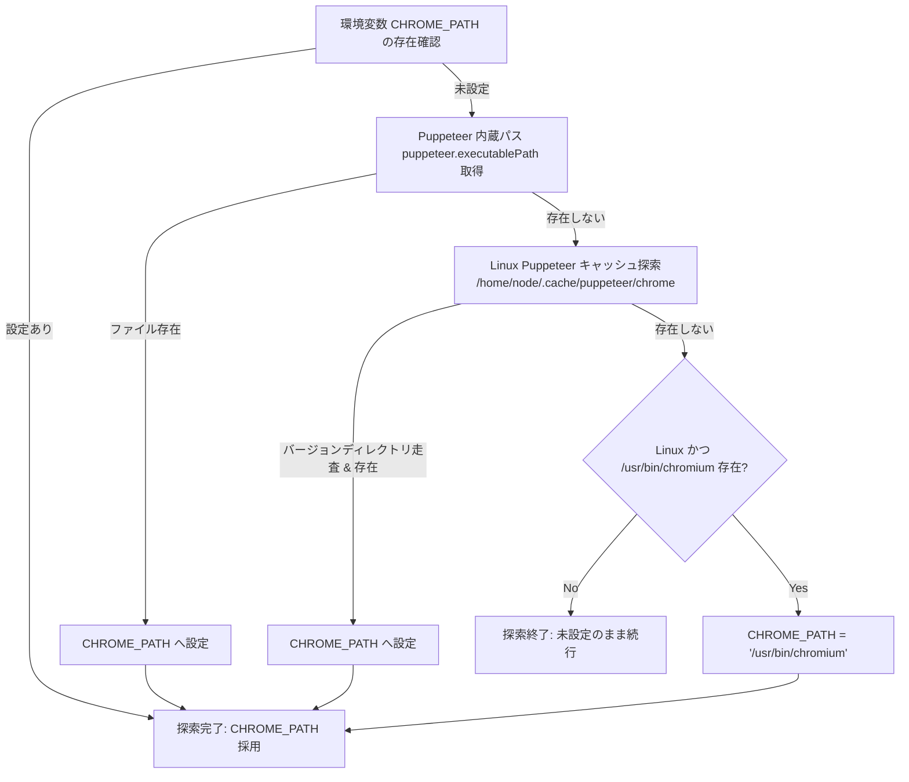
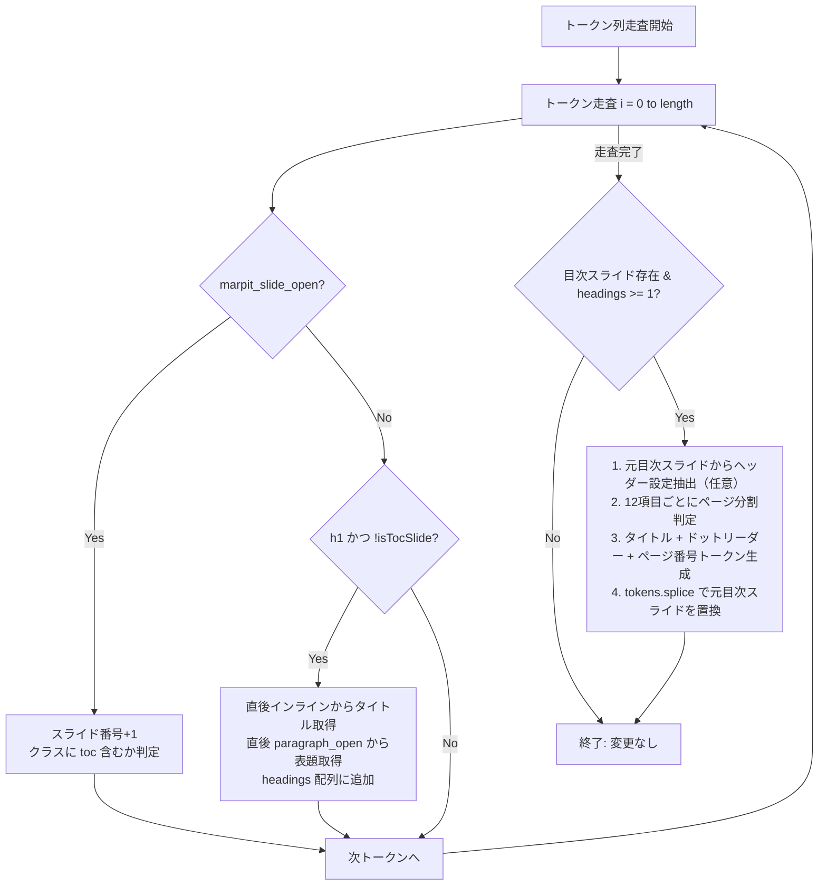

# プログラム仕様書 (Program Specification)

本ドキュメントは、「**marp-slide-mcp (Marp スライド作成環境)**」を構成する各プログラムファイルの詳細処理論理、アルゴリズム、制御構造、および例外処理仕様を定義する詳細設計書である。

---

## 1. プログラム一覧

| プログラムID | ファイルパス | 種別 | 責務概要 |
| :--- | :--- | :---: | :--- |
| **PRG-SRV-001** | `src/index.ts` | TypeScript | MCPサーバー本体（Stdio通信、スライドCRUD、PDF出力、パス自動解決） |
| **PRG-ENG-001** | `marp.config.js` | JavaScript | カスタムMarpエンジン（目次生成プラグイン、Markdown-itトークン操作） |
| **PRG-PPT-001** | `pptx_converter/convert.js` | JavaScript | PPTX変換スクリプト（PuppeteerによるDOM計測、PptxGenJS生成） |
| **PRG-THM-001** | `themes/business-slide-theme.css` | CSS | ビジネステーマスタイル（アンカー非表示・絶対配置、自動リサイズ） |
| **PRG-SKL-001** | `.agents/skills/github-workflows/SKILL.md` | Skill / Markdown | GitHub運用支援スキル（Issue起票、ブランチ命名規則、PR文面自動生成） |

---

## 2. PRG-SRV-001: MCP サーバー (`src/index.ts`) 仕様

### 2.1 環境初期化および Chromium 探索アルゴリズム
Puppeteer や Marp CLI が必要とする Chromium 実行可能バイナリを、環境差分（Windows, Linux, Docker Dev Container）に依存せず確実に特定するため、以下の4段階フォールバック探索を行う。



### 2.2 主要ツールの処理論理

#### 1. `generate_slide_deck`
1. 入力パラメータ（`SlideDeckSchema`）を Zod で検証。
2. `filenamePrefix` が未指定の場合、`DOC-YYYYMMDD-UUID` 形式で一意なファイル名を採番。
3. `slides/<filename>/` ディレクトリを `ensureOutputDir` で作成。
4. `generateMarpMarkdown(deck)` を呼び出し、Marp 互換 Markdown テキストを生成。
5. ディレクトリ内に `<filename>.md` として保存。
6. 同時に、後続のプログラム解析用に構造化データを `<filename>.json` としてキャッシュ保存。
7. 生成成功メッセージとファイルパスを返却。

#### 2. `get_slide_deck`
1. 指定された `filePath` の存在を確認し、ファイルを非同期読込。
2. `parseMarpMarkdown(content)` を呼び出し、フロントマターと各スライドの Markdown ブロックを抽出。
3. 各スライドのタイトル、主張、本文を正規表現で解析し、構造化 JSON として返却。

#### 3. `insert_slide` / `update_slide` / `delete_slide`
1. 対象ファイルを読み込み、スライド単位で分割。
2. 指定インデックス（`index`）の妥当性をチェック（表紙 `index === 0` に対する不当操作を防止）。
3. 挿入時は `splice(index, 0, newSlideMarkdown)`、更新時は `splice(index, 1, updatedMarkdown)`、削除時は `splice(index, 1)` を実行。
4. スライド群を `\n---\n` で再結合し、アトミックにファイルへ書き戻し。

#### 4. `export_to_pdf`
1. 入力ファイルパスの存在を検証。
2. 出力パスが未指定の場合、同一ディレクトリ内の `.pdf` パスを生成。
3. Marp Core / CLI を非同期プロセス（`child_process`）として呼び出し、Marp エンジン経由でレンダリング。
4. 成功時は出力先パスを返却し、失敗時は標準エラー出力をキャプチャしてエラー応答。

---

## 3. PRG-ENG-001: カスタム Marp エンジン (`marp.config.js`) 仕様

### 3.1 目次（TOC）自動生成アルゴリズム (`marp_toc`)



### 3.2 複数スライド分割およびページ番号シフト論理
1. **スライド分割閾値**: 1スライドあたり最大 12 項目。
2. 収集された `headings.length > 12` の場合、12項目ごとに `marpit_slide_open`（クラス `toc` 継承）および `marpit_slide_close` を生成。
3. 目次スライドが `N` 枚増加した場合（`totalAddedSlides = Math.ceil(headings.length / 12)`）、目次以降のスライドの実ページ番号は `+(totalAddedSlides - 1)` シフトされる。
4. リンク先アンカーおよび表示ページ番号にシフト値を反映し、リンク不整合を完全に防止。

---

## 4. PRG-PPT-001: PPTX 変換スクリプト (`pptx_converter/convert.js`) 仕様

### 4.1 変換パイプライン処理フロー
1. **初期化**:
   - `INPUT_MD` の存在確認。
   - `THEME_CSS = 'themes/business-slide-theme.css'` の設定。
   - `SCREEN_WIDTH = 960`, `SCREEN_HEIGHT = 720`, `PX_TO_INCH = 1 / 96` を定義。
2. **中間HTMLレンダリング**:
   - `npx marp "${INPUT_MD}" --html --allow-local-files --theme-set "${THEME_CSS}" -o "${TEMP_HTML}"` を実行。
3. **Puppeteer による DOM スキャン**:
   - Chromium をヘッドレスモードで起動。
   - `page.goto('file://' + TEMP_HTML)` により完全レンダリングを待機。
   - 各スライド `section` の子ノードを再帰走査：
     - `nodeType === 3`（テキストノード）: 親要素のスタイル（フォント名、サイズpt、色、Bold、位置）を抽出。
     - `tagName === 'TABLE'`: 行・列・セル結合・境界線を抽出。
     - `tagName === 'IMG'` / `SVG`: 画像データURIまたはローカルパス、位置を抽出。
     - 背景色を持つコンテナ: オートシェイプ矩形情報を抽出。
4. **PptxGenJS オブジェクト描画**:
   - `new PptxGenJS()` を初期化し、4:3 / 16:9 レイアウトを定義。
   - スキャンした要素群を座標（インチ単位）変換して `slide.addText()`, `slide.addShape()`, `slide.addTable()`, `slide.addImage()` で配置。
5. **後処理**:
   - `pptx.writeFile({ fileName: OUTPUT_PPTX })` を実行。
   - `fs.unlinkSync(TEMP_HTML)` により中間一時ファイルを削除。

---

## 5. PRG-THM-001: ビジネステーマスタイル (`business-slide-theme.css`) 仕様

### 5.1 CSS 変数およびカスケード構造
```css
:root {
  /* 基底テーマカラー（デフォルト: コーポレートブルー） */
  --primary-color: var(--theme-color, #1f497d);
  /* 会話吹き出し背景（primary-colorを40%白と混合） */
  --bubble-bg-color: color-mix(in srgb, var(--primary-color) 40%, white);
  /* 吹き出し文字色 */
  --bubble-text-color: #222222;
  /* 表紙バナー（Base64 SVG埋め込み） */
  --banner-image: url('data:image/svg+xml;base64,...');
}
```

### 5.2 見出しアンカー駆動の配置ルール
- `section h1, section h2, section h3, section h4, section h5, section h6`:
  - `visibility: hidden; height: 0; margin: 0; padding: 0;` により非表示化。
- 直後の要素に対する配置ルール：
  - `section:not(.title-slide) h1 ~ p:first-of-type`: スライドタイトル（`position: absolute; top: 25px; left: 20px; font-size: 22pt; font-weight: bold;`）。
  - `section:not(.title-slide) h2 ~ p:first-of-type`: 主張欄（`position: absolute; top: 80px; left: 20px; width: calc(100% - 40px); background: #f2f2f2; border-left: 8px solid var(--primary-color);`）。
  - `section:not(.title-slide) h3 ~ p:first-of-type`: 図表タイトル（`position: absolute; top: 165px; left: 0; width: 100%; text-align: center; font-size: 13pt;`）。
  - `section:not(.title-slide) h5 ~ p:first-of-type`: 出典・脚注（`position: absolute; bottom: 45px; right: 20px; font-size: 11pt; color: #666666;`）。

### 5.3 自動リサイズ機構の実装
- **テーブル**:
  - `section table { font-size: 14pt; margin: auto; border-collapse: collapse; }`
  - `section.table-sm table { font-size: 11pt; }`
  - `section.table-xs table { font-size: 9pt; }`
- **コードブロック**:
  - `section pre code { font-size: 13pt; line-height: 1.3; font-family: 'Consolas', monospace; }`
  - `section.code-sm pre code { font-size: 10pt; line-height: 1.2; }`
- **Mermaid 図**:
  - `section .mermaid svg { max-width: 100% !important; max-height: 400px !important; object-fit: contain; }`

---

## 6. 関連設計図書への参照リンク

- [[01_architectural_design|構造設計書]]: モジュール構造およびコンポーネント依存関係
- [[02_internal_interface_specification|内部I/F仕様書]]: 関数シグネチャおよび内部型定義
- [[02_external_interface_specification|外部I/F仕様書]]: 外部プロトコルおよびCLI仕様
- [[../00_project_charter/02_coding_standards|コーディング規約]]: 全行直上コメントおよび記述規範
- [[../README|設計図書統合インデックス]]: 設計図書体系の全体マップ
