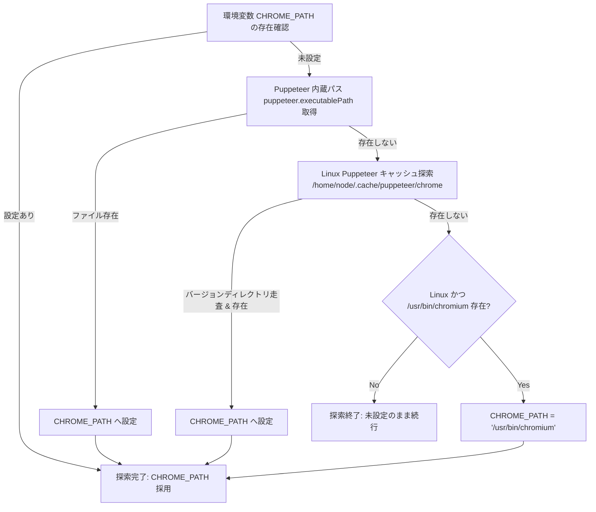
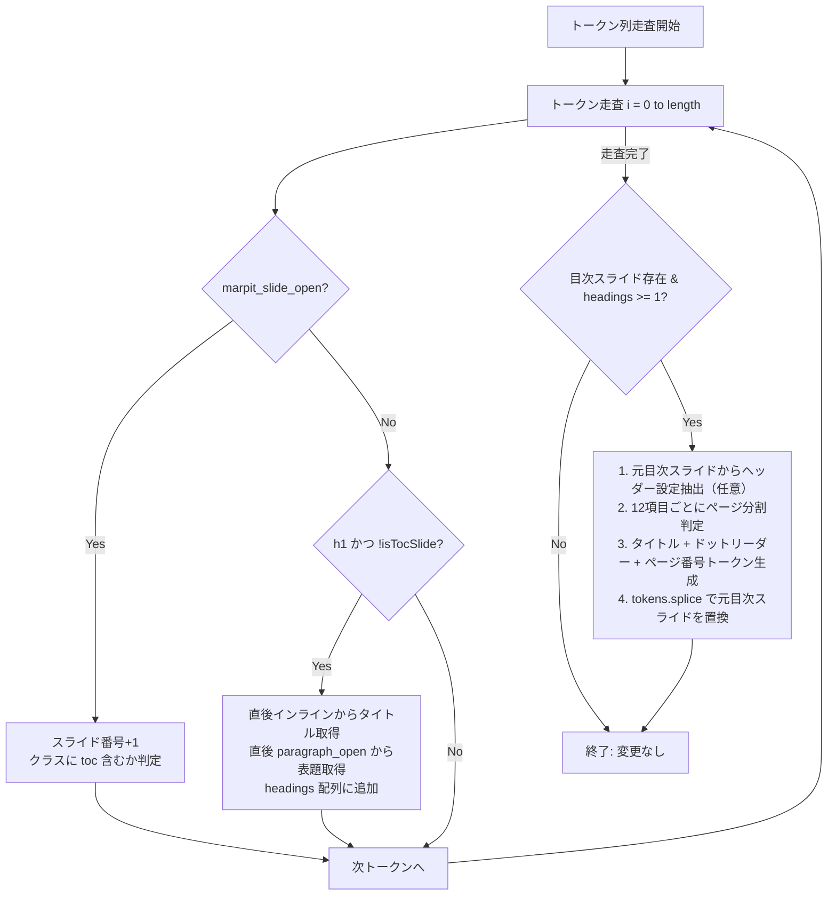

# プログラム仕様書 (Program Specification)

本ドキュメントは、「**marp-slide-mcp (Marp スライド作成環境)**」を構成する各プログラムファイルの詳細処理論理、アルゴリズム、制御構造、および例外処理仕様を定義する詳細設計書である。

---

## 1. プログラム一覧

| プログラムID | ファイルパス | 種別 | 責務概要 |
| :--- | :--- | :---: | :--- |
| **PRG-SRV-001** | `src/index.ts` | TypeScript | MCPサーバー本体（Stdio通信、スライドCRUD、PDF出力、パス自動解決） |
| **PRG-ENG-001** | `marp.config.js` | JavaScript | カスタムMarpエンジン（目次生成プラグイン、Markdown-itトークン操作） |
| **PRG-PPT-001** | `pptx_converter/convert.js` | JavaScript | PPTX変換スクリプト（PuppeteerによるDOM計測、PptxGenJS生成） |
| **PRG-THM-001** | `themes/business-slide-theme.css` | CSS | ビジネステーマスタイル（アンカー非表示・絶対配置、自動リサイズ） |
| **PRG-SKL-001** | `.agents/skills/github-workflows/SKILL.md` | Skill / Markdown | GitHub運用支援スキル（Issue起票、ブランチ命名規則、PR文面自動生成） |

---

## 2. PRG-SRV-001: MCP サーバー (`src/index.ts`) 仕様

### 2.1 環境初期化および Chromium 探索アルゴリズム
Puppeteer や Marp CLI が必要とする Chromium 実行可能バイナリを、環境差分（Windows, Linux, Docker Dev Container）に依存せず確実に特定するため、以下の4段階フォールバック探索を行う。



### 2.2 主要ツールの処理論理

#### 1. `generate_slide_deck`
1. 入力パラメータ（`SlideDeckSchema`）を Zod で検証。
2. `filenamePrefix` が未指定の場合、`DOC-YYYYMMDD-UUID` 形式で一意なファイル名を採番。
3. `slides/<filename>/` ディレクトリを `ensureOutputDir` で作成。
4. `generateMarpMarkdown(deck)` を呼び出し、Marp 互換 Markdown テキストを生成。
5. ディレクトリ内に `<filename>.md` として保存。
6. 同時に、後続のプログラム解析用に構造化データを `<filename>.json` としてキャッシュ保存。
7. 生成成功メッセージとファイルパスを返却。

#### 2. `get_slide_deck`
1. 指定された `filePath` の存在を確認し、ファイルを非同期読込。
2. `parseMarpMarkdown(content)` を呼び出し、フロントマターと各スライドの Markdown ブロックを抽出。
3. 各スライドのタイトル、主張、本文を正規表現で解析し、構造化 JSON として返却。

#### 3. `insert_slide` / `update_slide` / `delete_slide`
1. 対象ファイルを読み込み、スライド単位で分割。
2. 指定インデックス（`index`）の妥当性をチェック（表紙 `index === 0` に対する不当操作を防止）。
3. 挿入時は `splice(index, 0, newSlideMarkdown)`、更新時は `splice(index, 1, updatedMarkdown)`、削除時は `splice(index, 1)` を実行。
4. スライド群を `\n---\n` で再結合し、アトミックにファイルへ書き戻し。

#### 4. `export_to_pdf`
1. 入力ファイルパスの存在を検証。
2. 出力パスが未指定の場合、同一ディレクトリ内の `.pdf` パスを生成。
3. Marp Core / CLI を非同期プロセス（`child_process`）として呼び出し、Marp エンジン経由でレンダリング。
4. 成功時は出力先パスを返却し、失敗時は標準エラー出力をキャプチャしてエラー応答。

---

## 3. PRG-ENG-001: カスタム Marp エンジン (`marp.config.js`) 仕様

### 3.1 目次（TOC）自動生成アルゴリズム (`marp_toc`)



### 3.2 複数スライド分割およびページ番号シフト論理
1. **フック登録位置**: `md.core.ruler.after('marpit_directives_parse', 'marp_toc', ...)` により、`marpit_inline_svg`・`marpit_directives_apply`・`marpit_header_and_footer`・`marpit_collect` の前段で実行する（`state.inlineMode` 時はスキップ）。
2. **スライド分割閾値**: 1スライドあたり最大 12 項目（`ITEMS_PER_SLIDE = 12`）。
3. 収集された `headings.length > 12` の場合、12項目ごとに `marpit_slide_open`（クラス `toc`・ディレクティブ継承、`meta.marpitSlideElement = 1`、`id` 属性設定）および `marpit_slide_close`（`meta.marpitSlideElement = -1`）を生成し、元の目次スライド内のヘッダー/フッターおよび `h6`（コピーライト・機密指定）トークンを全目次ページへ複製注入する。
4. 目次スライドが `N` 枚に分割された場合（`totalAddedSlides = Math.ceil(headings.length / 12)`）、目次以降の全スライドの `meta.marpitSlide`・`meta.marpitSlideTotal`・`id` 属性および実ページ番号（`data-marpit-pagination`）は `+(totalAddedSlides - 1)` シフトされる。
5. リンク先アンカー（`href="#N"`）および表示ページ番号（`.toc-page`）にシフト値を反映し、後続の `marpit_inline_svg` によるSVGページ分割およびリンク整合性を完全に担保する。
6. **長文タイトルの自動折り返し・見切れ防止**: `themes/business-slide-theme.css` において目次項目の `<a>` 要素に `white-space: normal`, `overflow-wrap: anywhere`, `word-break: break-word` を指定し、スライド幅（1280px）に対してタイトルが長い場合でも省略記号で切り捨てず複数行へ折り返し、Flexboxのベースライン整列により最終行末尾にドットリーダー線とページ番号を連結する。

### 3.3 表・コードブロック静的リサイズにおける手動クラス優先論理（Issue #12 是正）
1. **背景・課題**: `marp.config.js` の Markdown-it プラグインでは、表およびコードブロックの行数・文字数推定による静的フォントサイズ縮小 `<style>section[id="..."] ... { font-size: ... !important; }</style>` をインライン注入する。このインラインスタイルが `id` セレクタおよび `!important` を伴うため、スライドに手動クラス（`table-1`〜`10`, `table-sm` 等や `code-1`〜`10`）が指定されている場合でも自動計算値が強制上書きされ、手動クラスが無効化される不具合が存在した。
2. **手動クラス優先判定**:
   - `marpit_slide_open` トークン走査時、スライドディレクティブの `class` 文字列を解析。
   - 表クラス検出: `slideClasses.some(c => /^table-(\d+|xl|lg|md|sm|xs|xxs)$/.test(c))` が真の場合、当該スライド内の表に対する自動リサイズ `<style>` 注入をスキップし、テーマCSSの手動クラスを100%優先する。
   - コードクラス検出: `slideClasses.some(c => /^code-(\d+|xl|lg|md|sm|xs|xxs)$/.test(c))` が真の場合、当該スライド内のコードブロックに対する自動リサイズ `<style>` 注入をスキップし、テーマCSSの手動クラスを100%優先する。
3. **セル継承保護**: `themes/business-slide-theme.css` の `section table th, section table td` に `font-size: inherit !important; line-height: inherit !important;` を付与し、親 `table` のサイズ指定がセル内へ確実に浸透することを保証する。

---

## 4. PRG-PPT-001: PPTX 変換スクリプト (`pptx_converter/convert.js`) 仕様

### 4.1 変換パイプライン処理フロー
1. **初期化**:
   - `INPUT_MD` の存在確認。
   - `THEME_CSS = 'themes/business-slide-theme.css'` の設定。
   - `SCREEN_WIDTH = 960`, `SCREEN_HEIGHT = 720`, `PX_TO_INCH = 1 / 96` を定義。
2. **中間HTMLレンダリング**:
   - `npx marp "${INPUT_MD}" --html --allow-local-files --theme-set "${THEME_CSS}" -o "${TEMP_HTML}"` を実行。
3. **Puppeteer による DOM スキャン**:
   - Chromium をヘッドレスモードで起動。
   - `page.goto('file://' + TEMP_HTML)` により完全レンダリングを待機。
   - 各スライド `section` の子ノードを再帰走査：
     - `nodeType === 3`（テキストノード）: 親要素のスタイル（フォント名、サイズpt、色、Bold、位置）を抽出。
     - `tagName === 'TABLE'`: 行・列・セル結合・境界線を抽出。
     - `tagName === 'IMG'` / `SVG`: 画像データURIまたはローカルパス、位置を抽出。
     - 背景色を持つコンテナ: オートシェイプ矩形情報を抽出。
4. **PptxGenJS オブジェクト描画**:
   - `new PptxGenJS()` を初期化し、4:3 / 16:9 レイアウトを定義。
   - スキャンした要素群を座標（インチ単位）変換して `slide.addText()`, `slide.addShape()`, `slide.addTable()`, `slide.addImage()` で配置。
5. **後処理**:
   - `pptx.writeFile({ fileName: OUTPUT_PPTX })` を実行。
   - `fs.unlinkSync(TEMP_HTML)` により中間一時ファイルを削除。

---

## 5. PRG-THM-001: ビジネステーマスタイル (`business-slide-theme.css`) 仕様

### 5.1 CSS 変数およびカスケード構造
```css
:root {
  /* 基底テーマカラー（デフォルト: コーポレートブルー） */
  --primary-color: var(--theme-color, #1f497d);
  /* 会話吹き出し背景（primary-colorを40%白と混合） */
  --bubble-bg-color: color-mix(in srgb, var(--primary-color) 40%, white);
  /* 吹き出し文字色 */
  --bubble-text-color: #222222;
  /* 表紙バナー（Base64 SVG埋め込み） */
  --banner-image: url('data:image/svg+xml;base64,...');
}
```

### 5.2 見出しアンカー駆動の配置ルール
- `section h1, section h2, section h3, section h4, section h5, section h6`:
  - `visibility: hidden; height: 0; margin: 0; padding: 0;` により非表示化。
- 直後の要素に対する配置ルール：
  - `section:not(.title-slide) h1 ~ p:first-of-type`: スライドタイトル（`position: absolute; top: 25px; left: 20px; font-size: 22pt; font-weight: bold;`）。
  - `section:not(.title-slide) h2 ~ p:first-of-type`: 主張欄（`position: absolute; top: 80px; left: 20px; width: calc(100% - 40px); background: #f2f2f2; border-left: 8px solid var(--primary-color);`）。
  - `section:not(.title-slide) h3 ~ p:first-of-type`: 図表タイトル（`position: absolute; top: 165px; left: 0; width: 100%; text-align: center; font-size: 13pt;`）。
  - `section:not(.title-slide) h5 ~ p:first-of-type`: 出典・脚注（`position: absolute; bottom: 45px; right: 20px; font-size: 11pt; color: #666666;`）。

### 5.2.1 表紙レイアウトと複数行タイトルはみ出し防止機構 (`MOD-THM-001`)
- **下部メタ情報（所属・氏名、作成日、図書番号）の絶対配置固定**:
  - `section[data-marpit-pagination="1"]` 内の下部メタ情報要素を `position: absolute` でスライド下部（フッター帯境界 680px の手前、y=520px〜670px）に固定配置。
  - 作成日 (`h4+*`): `position: absolute !important; bottom: 50px !important; left: 50px !important;`
  - 所属・氏名 (`h3:last-of-type+*`): `position: absolute !important; bottom: 85px !important; left: 50px !important;`
  - 図書番号 (`h3:first-of-type+*`): `position: absolute !important; bottom: 85px !important; right: 50px !important;`
  - これにより、上部のタイトルやサブタイトルの文字数・行数に影響されず、下部メタ情報がスライド下端（720px）外へ押し出される物理現象を防止する。
- **タイトル・サブタイトルの適応的余白・フォントサイズ段階縮小**:
  - タイトル領域の上部マージン（`margin-top`）を、行数に応じて動的に最適化。
  - 1行タイトル（デフォルト）: `margin-top: 220px; font-size: 36pt; line-height: 1.3;`
  - 2行タイトル（`h1+p:has(br)`）: `margin-top: 180px; font-size: 30pt; line-height: 1.25;`
  - 3行以上タイトル（`h1+p:has(br + br)`）: `margin-top: 150px; font-size: 24pt; line-height: 1.2;`、サブタイトルマージン `margin-top: 12px;`
  - 4行以上タイトル（`h1+p:has(br + br + br)`）: `margin-top: 130px; font-size: 20pt; line-height: 1.15;`、サブタイトルマージン `margin-top: 8px;`
  - これにより、バナー（height: 100px）下から下部メタ情報上端（y=500px）までの利用可能領域内でタイトル・サブタイトルが完全に収まり、重複も回避される。

### 5.3 自動リサイズ機構の実装
#### 5.3.1 10段階統一数字クラスおよび手動オーバーライド仕様
各要素（表、本文、Mermaid図、画像、コードブロック）に対して、`{要素名}-1` 〜 `{要素名}-10` の10段階クラスを導入する。
1を最大（標準・余裕）とし、数字が増えるにつれて段階縮小し、10は従来の最小限界値よりさらに2段階小さい極小サイズとする。

1. **テーブル（`section.table-1` 〜 `section.table-10`）**:
   - `table-1`: `--tbl-fs-rows: 26pt !important; --tbl-fs-cols: 26pt !important;`
   - `table-2`: `--tbl-fs-rows: 22pt !important; --tbl-fs-cols: 22pt !important;` (旧 `table-lg` 相当)
   - `table-3`: `--tbl-fs-rows: 19pt !important; --tbl-fs-cols: 19pt !important;`
   - `table-4`: `--tbl-fs-rows: 16.5pt !important; --tbl-fs-cols: 16.5pt !important;`
   - `table-5`: `--tbl-fs-rows: 14pt !important; --tbl-fs-cols: 14pt !important;`
   - `table-6`: `--tbl-fs-rows: 12pt !important; --tbl-fs-cols: 12pt !important;`
   - `table-7`: `--tbl-fs-rows: 10pt !important; --tbl-fs-cols: 10pt !important; --tbl-pad: 2px 5px !important;` (旧 `table-xs` 相当)
   - `table-8`: `--tbl-fs-rows: 8pt !important; --tbl-fs-cols: 8pt !important; --tbl-pad: 1px 4px !important; --tbl-lh: 1.15 !important;` (旧 `table-xxs` 相当)
   - `table-9`: `--tbl-fs-rows: 7pt !important; --tbl-fs-cols: 7pt !important; --tbl-pad: 1px 3px !important; --tbl-lh: 1.12 !important;` (旧最小より1段階小)
   - `table-10`: `--tbl-fs-rows: 6pt !important; --tbl-fs-cols: 6pt !important; --tbl-pad: 1px 2px !important; --tbl-lh: 1.1 !important;` (旧最小より2段階小)
   - 後方互換性エイリアス: `table-xl` (28pt), `table-lg` (22pt), `table-md` (18pt), `table-sm` (13pt), `table-xs` (10pt), `table-xxs` (8pt) を維持。

2. **本文テキスト（`section.text-1` 〜 `section.text-10` / `section.body-1` 〜 `section.body-10`）**:
   - `text-1` / `body-1`: `--txt-scale: 1.0 !important;` (旧 `roomy` 相当)
   - `text-2` / `body-2`: `--txt-scale: 0.92 !important;`
   - `text-3` / `body-3`: `--txt-scale: 0.84 !important;`
   - `text-4` / `body-4`: `--txt-scale: 0.76 !important;` (旧 `dense` 相当)
   - `text-5` / `body-5`: `--txt-scale: 0.68 !important;`
   - `text-6` / `body-6`: `--txt-scale: 0.60 !important;` (旧 `denser` 相当)
   - `text-7` / `body-7`: `--txt-scale: 0.55 !important;`
   - `text-8` / `body-8`: `--txt-scale: 0.50 !important;` (旧 `densest` 相当)
   - `text-9` / `body-9`: `--txt-scale: 0.42 !important;` (旧最小より1段階小)
   - `text-10` / `body-10`: `--txt-scale: 0.35 !important;` (旧最小より2段階小)
   - 後方互換性エイリアス: `roomy` (1.0), `dense` (0.75), `denser` (0.6), `densest` (0.5) を維持。

3. **Mermaid図（`section.mermaid-1` 〜 `section.mermaid-10`）**:
   - `mermaid-1`: `max-height: var(--mmd-max-h, 440px) !important;` (100%)
   - `mermaid-2`: `max-height: calc(var(--mmd-max-h, 440px) * 0.90) !important;`
   - `mermaid-3`: `max-height: calc(var(--mmd-max-h, 440px) * 0.82) !important;`
   - `mermaid-4`: `max-height: calc(var(--mmd-max-h, 440px) * 0.75) !important;` (旧 `mermaid-sm` 相当)
   - `mermaid-5`: `max-height: calc(var(--mmd-max-h, 440px) * 0.68) !important;`
   - `mermaid-6`: `max-height: calc(var(--mmd-max-h, 440px) * 0.60) !important;`
   - `mermaid-7`: `max-height: calc(var(--mmd-max-h, 440px) * 0.55) !important;` (旧 `mermaid-xs` 相当)
   - `mermaid-8`: `max-height: calc(var(--mmd-max-h, 440px) * 0.48) !important;`
   - `mermaid-9`: `max-height: calc(var(--mmd-max-h, 440px) * 0.38) !important;` (旧最小より1段階小)
   - `mermaid-10`: `max-height: calc(var(--mmd-max-h, 440px) * 0.28) !important;` (旧最小より2段階小)
   - 後方互換性エイリアス: `mermaid-sm` (0.75), `mermaid-xs` (0.55) を維持。

4. **画像（`section.img-1` 〜 `section.img-10` / `section.image-1` 〜 `section.image-10`）**:
   - `img-1` / `image-1`: `max-height: 100% !important;`
   - `img-2` / `image-2`: `max-height: 90% !important;`
   - `img-3` / `image-3`: `max-height: 80% !important;`
   - `img-4` / `image-4`: `max-height: 70% !important;`
   - `img-5` / `image-5`: `max-height: 60% !important;`
   - `img-6` / `image-6`: `max-height: 50% !important;`
   - `img-7` / `image-7`: `max-height: 40% !important;`
   - `img-8` / `image-8`: `max-height: 35% !important;`
   - `img-9` / `image-9`: `max-height: 28% !important;`
   - `img-10` / `image-10`: `max-height: 20% !important;`

5. **コードブロック（`section.code-1` 〜 `section.code-10`）**:
   - `code-1`: `--code-fs-base: 18pt !important;` (旧 `code-lg` 相当)
   - `code-2`: `--code-fs-base: 16pt !important;`
   - `code-3`: `--code-fs-base: 14pt !important;` (基準値)
   - `code-4`: `--code-fs-base: 12.5pt !important;`
   - `code-5`: `--code-fs-base: 11pt !important;` (旧 `code-sm` 相当)
   - `code-6`: `--code-fs-base: 9.5pt !important;`
   - `code-7`: `--code-fs-base: 8pt !important;`
   - `code-8`: `--code-fs-base: 7pt !important;` (旧 `code-xxs` 相当)
   - `code-9`: `--code-fs-base: 6pt !important;` (旧最小より1段階小)
   - `code-10`: `--code-fs-base: 5pt !important;` (旧最小より2段階小)
   - 後方互換性エイリアス: `code-lg` (18pt), `code-sm` (11pt), `code-xs` (9pt), `code-xxs` (7pt) を維持。

---

## 6. PRG-SKL-001: GitHub 運用支援スキル (`.agents/skills/github-workflows/SKILL.md`) 仕様

### 6.1 Worktree セッション初期化およびブランチ命名自動是正アルゴリズム
AIエージェントがタスクを開始する際、現在のGitブランチ名を検査し、リポジトリ規約に合致しない場合に自動是正する処理論理を以下に定義する。

```mermaid
flowchart TD
    START([セッション開始 / タスク着手]) --> CHK_BR[現在のブランチ名を取得<br>git branch --show-current]
    CHK_BR --> EVAL{規約正規表現に合致するか?<br>^{type}/{author}/issue-{num}/{desc}$}
    EVAL -->|合致 (PASS)| PROCEED([PBI起票 / 実装前設計レビューへ進行])
    EVAL -->|不一致 (FAIL)| DERIVE[Issue番号・作業種別・説明から<br>規約準拠ブランチ名を自動導出]
    DERIVE --> RENAME[ブランチ名変更コマンド実行<br>git branch -m 新ブランチ名]
    RENAME --> VERIFY[変更後ブランチ名の再確認]
    VERIFY --> PROCEED
```

1. **ブランチ検査手順**:
   - `git branch --show-current` を実行して現在のブランチ名を取得する。
   - ブランチ名が正規表現 `^(feat|fix|docs|refactor|test|chore)/[^/]+/issue-\d+/[a-z0-9-]+$` に適合するか検証する。
2. **自動是正手順**:
   - 不一致が検知された場合（例: Antigravity 2.0 の自動採番 `resolve_issue_eight` 等）、対象Issue情報から正規のブランチ名（例: `fix/antigravity-2.0/issue-8/worktree-branch-naming-compliance`）を導出する。
   - `git branch -m <新ブランチ名>` を実行し、現在ブランチを即座に是正する。
3. **Worktreeディレクトリ名形式**:
   - ディレクトリ安全形式: `{type}_{author}_issue-{issue_number}_{description}`（スラッシュをアンダースコアに置換）。

---

## 7. 関連設計図書への参照リンク

- [[01_architectural_design|構造設計書]]: モジュール構造およびコンポーネント依存関係
- [[02_internal_interface_specification|内部I/F仕様書]]: 関数シグネチャおよび内部型定義
- [[02_external_interface_specification|外部I/F仕様書]]: 外部プロトコルおよびCLI仕様
- [[../00_project_charter/02_coding_standards|コーディング規約]]: 全行直上コメントおよび記述規範
- [[../README|設計図書統合インデックス]]: 設計図書体系の全体マップ
