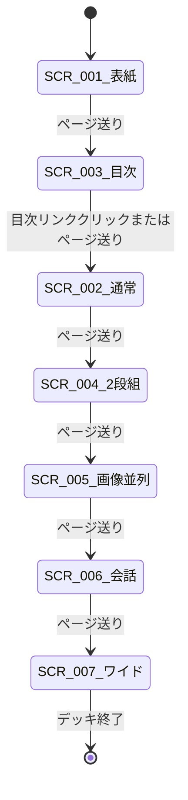
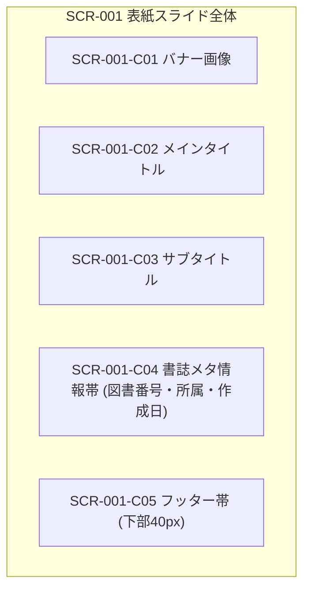
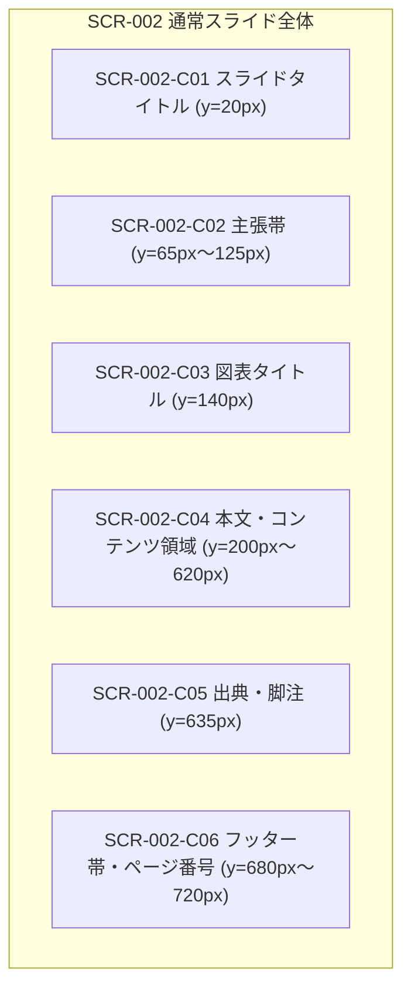
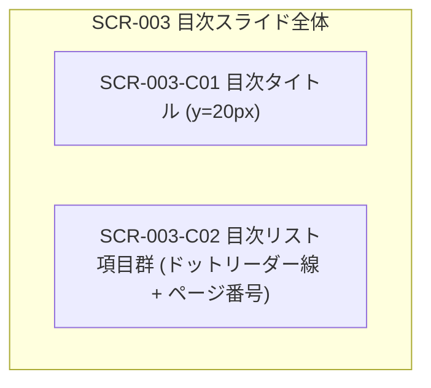
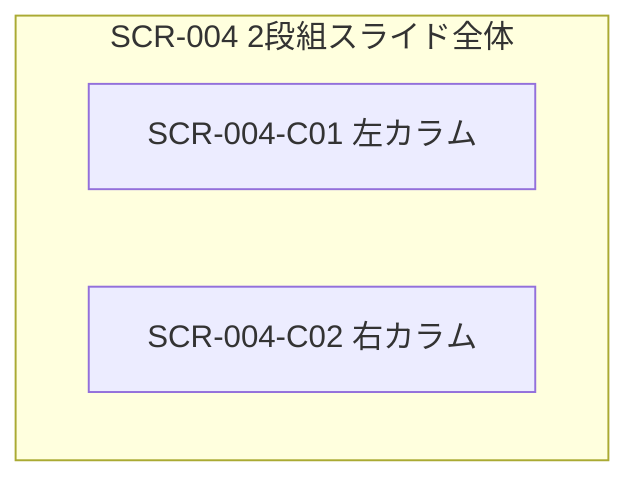
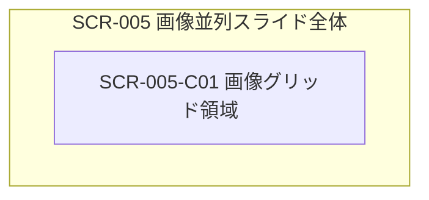
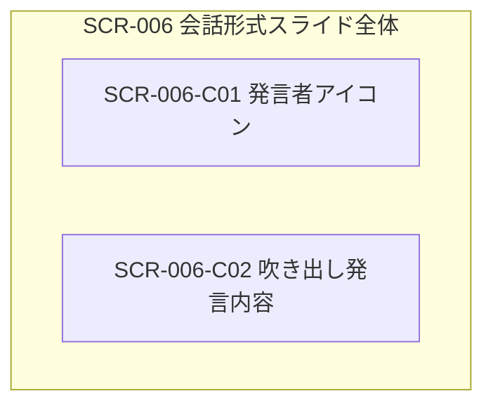
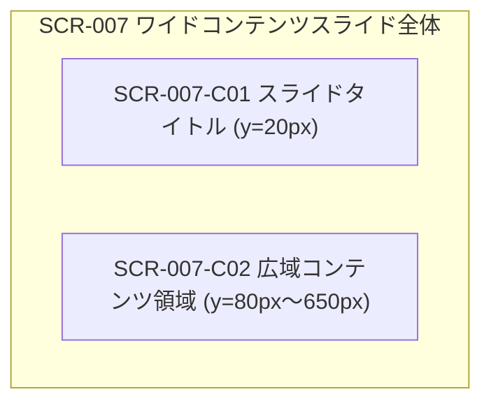

# 1 本書の位置づけ

## 1.1 目的
「marp-slide-mcp」が提供する各スライド画面の見た目（レイアウト、寸法、部品配置、表示状態）および画面間の遷移関係を定める。

## 1.2 記述対象
記述対象は [[03_documentation_standard#2.1 図書一覧|図書一覧]] の本書の行に従う。

## 1.3 記述対象外と参照先
- 画面から呼び出す機能の振る舞い: [[02_functional_specification#1 本書の位置づけ|機能仕様書]]
- 画面部品に表示するデータの型・桁・値域形式: [[06_data_structure_specification#1 本書の位置づけ|データ構造仕様書]]

## 1.4 改版履歴
| 版 | 日付 | 起因PBI | 変更概要 |
| :--- | :--- | :--- | :--- |
| 1.0.0 | 2026-11-04 | PBI-016 | 初版作成（旧機能仕様書LAY仕様からの独立移管） |

# 2 画面遷移

## 2.1 画面遷移図

## 2.2 画面遷移定義
| 遷移ID | 遷移元 | 遷移先 | 契機 | 条件 | 上位ID |
| :--- | :--- | :--- | :--- | :--- | :--- |
| `TRN-001` | `SCR-001` | `SCR-003` | ページ送り操作 | 目次スライドが存在する場合 | `FNC-004` |
| `TRN-002` | `SCR-001` | `SCR-002` | ページ送り操作 | 目次スライドが存在しない場合 | `FNC-001` |
| `TRN-003` | `SCR-003` | `SCR-002` | 目次リンク選択 | 該当ページが存在する場合 | `FNC-004` |
| `TRN-004` | `SCR-002` | `SCR-002` | ページ送り操作 | 次ページが存在する場合 | `FNC-001` |

# 3 画面仕様

## 3.1 SCR-001 表紙スライド
| 項目 | 内容 |
| :--- | :--- |
| 上位ID | `FNC-001` |
| 状態 | Approved |
| 後継ID | なし |
| 目的 | デッキ全体の表紙および書誌メタ情報の提示 |
| 表示条件 | スライド1ページ目（`section[data-marpit-pagination="1"]`） |

### 3.1.1 画面の見た目

#### 3.1.1.1 寸法と余白
| 項目 | 値 |
| :--- | :--- |
| 画面サイズ | 960px × 720px (4:3) または 1280px × 720px (16:9) |
| 余白 | 上部マージン 220px（タイトル行数により150pxまで縮小）、左右 60px |
| 配色・フォント | 背景白（#ffffff）、フォント `BIZ UDGothic` / `Noto Sans CJK JP` |

#### 3.1.1.2 配置図

### 3.1.2 画面部品
| 部品ID | 名称 | 種別 | 表示内容の意味 | 形式参照 | 配置 |
| :--- | :--- | :--- | :--- | :--- | :--- |
| `SCR-001-C01` | バナー画像 | 画像 | 表紙右上のアクセント装飾 | [[06_data_structure_specification#2.1 DAT-TYP-001 SlideDeck|DAT-TYP-001-F05]] | 右上固定（幅240px） |
| `SCR-001-C02` | メインタイトル | テキスト | プレゼンテーションの本題 | [[06_data_structure_specification#2.2 DAT-TYP-002 TitleSlide|DAT-TYP-002-F01]] | 中央上（36pt太字） |
| `SCR-001-C03` | サブタイトル | テキスト | 補足説明・副題 | [[06_data_structure_specification#2.2 DAT-TYP-002 TitleSlide|DAT-TYP-002-F02]] | タイトル直下（20pt） |
| `SCR-001-C04` | 書誌メタ情報 | テキスト | 図書番号、所属、作成日 | [[06_data_structure_specification#2.2 DAT-TYP-002 TitleSlide|DAT-TYP-002-F03]] | 下部固定（y=540px） |
| `SCR-001-C05` | フッター帯 | 矩形 | プライマリカラー帯 | [[06_data_structure_specification#2.1 DAT-TYP-001 SlideDeck|DAT-TYP-001-F03]] | 下端（y=680px〜720px） |

### 3.1.3 表示状態
| 状態 | 表示条件 | 見た目の差分 |
| :--- | :--- | :--- |
| 1行タイトル | タイトルが30文字以下 | 上部マージン220px、フォント36pt |
| 複数行タイトル | タイトルが3行以上 | 上部マージン150px、フォント24pt縮小 |

## 3.2 SCR-002 通常スライド
| 項目 | 内容 |
| :--- | :--- |
| 上位ID | `FNC-001` |
| 状態 | Approved |
| 後継ID | なし |
| 目的 | 単一の主張とコンテンツ（本文・図表）の提示 |
| 表示条件 | 2ページ目以降の通常スライド |

### 3.2.1 画面の見た目

#### 3.2.1.1 寸法と余白
| 項目 | 値 |
| :--- | :--- |
| 画面サイズ | 960px × 720px (4:3) または 1280px × 720px (16:9) |
| 余白 | 上部マージン 200px、左右 60px、下部 60px |
| 配色・フォント | 主張欄背景（#f2f4f8）、アクセントボーダー（4px） |

#### 3.2.1.2 配置図

### 3.2.2 画面部品
| 部品ID | 名称 | 種別 | 表示内容の意味 | 形式参照 | 配置 |
| :--- | :--- | :--- | :--- | :--- | :--- |
| `SCR-002-C01` | スライドタイトル | テキスト | ページの主題 | [[06_data_structure_specification#2.3 DAT-TYP-003 NormalSlide|DAT-TYP-003-F01]] | 左上（28pt太字） |
| `SCR-002-C02` | 主張帯 | テキスト | 1スライド1主張の結論 | [[06_data_structure_specification#2.3 DAT-TYP-003 NormalSlide|DAT-TYP-003-F02]] | タイトル直下帯領域 |
| `SCR-002-C03` | 図表タイトル | テキスト | 図表の補足説明 | [[06_data_structure_specification#2.3 DAT-TYP-003 NormalSlide|DAT-TYP-003-F03]] | 主張帯直下（18pt） |
| `SCR-002-C04` | 本文領域 | コンテンツ | 段落、箇条書き、表、図 | [[06_data_structure_specification#2.3 DAT-TYP-003 NormalSlide|DAT-TYP-003-F04]] | 本文枠内（18pt基準） |
| `SCR-002-C05` | 出典 | テキスト | データの引用元・注釈 | [[06_data_structure_specification#2.3 DAT-TYP-003 NormalSlide|DAT-TYP-003-F07]] | フッター手前（12pt） |
| `SCR-002-C06` | ページ番号 | テキスト | 現在ページ / 総ページ数 | [[06_data_structure_specification#2.3 DAT-TYP-003 NormalSlide|DAT-TYP-003-F01]] | 右下フッター帯内 |

### 3.2.3 表示状態
| 状態 | 表示条件 | 見た目の差分 |
| :--- | :--- | :--- |
| 主張なし | `claim` が未指定 | 本文上端が y=120px へ繰り上がり領域拡大 |
| 図表タイトルなし | `chartTitle` が未指定 | 本文上端が y=160px へ繰り上がり領域拡大 |

## 3.3 SCR-003 目次スライド
| 項目 | 内容 |
| :--- | :--- |
| 上位ID | `FNC-004` |
| 状態 | Approved |
| 後継ID | なし |
| 目的 | 全通常スライドのタイトルとページ番号リンクの一覧提示 |
| 表示条件 | `<!-- _class: toc -->` 指定時または自動生成時 |

### 3.3.1 画面の見た目

#### 3.3.1.1 寸法と余白
| 項目 | 値 |
| :--- | :--- |
| 画面サイズ | 960px × 720px (4:3) または 1280px × 720px (16:9) |
| 余白 | 上部マージン 120px、左右 60px、下部 60px |
| 配色・フォント | ドットリーダー線（3px dotted）、ページ番号右寄せ |

#### 3.3.1.2 配置図

### 3.3.2 画面部品
| 部品ID | 名称 | 種別 | 表示内容の意味 | 形式参照 | 配置 |
| :--- | :--- | :--- | :--- | :--- | :--- |
| `SCR-003-C01` | 目次タイトル | テキスト | 「目次」または「Table of Contents」 | [[06_data_structure_specification#2.3 DAT-TYP-003 NormalSlide|DAT-TYP-003-F01]] | 左上固定 |
| `SCR-003-C02` | 目次項目リスト | リスト | スライドタイトルとページリンク | [[06_data_structure_specification#2.3 DAT-TYP-003 NormalSlide|DAT-TYP-003-F01]] | 最大12項目を縦並び整列 |

### 3.3.3 表示状態
| 状態 | 表示条件 | 見た目の差分 |
| :--- | :--- | :--- |
| 1ページ目次 | 項目数が12項目以下 | 単一ページで完結 |
| 分割目次 | 項目数が13項目以上 | 13項目以降を「目次 (続き)」として次スライドに分割 |

## 3.4 SCR-004 2段組スライド
| 項目 | 内容 |
| :--- | :--- |
| 上位ID | `FNC-003` |
| 状態 | Approved |
| 後継ID | なし |
| 目的 | 左右2列に分割したコンテンツの対比表示 |
| 表示条件 | `<!-- _class: columns-2 -->` 指定時 |

### 3.4.1 画面の見た目

#### 3.4.1.1 寸法と余白
| 項目 | 値 |
| :--- | :--- |
| 画面サイズ | 960px × 720px (4:3) または 1280px × 720px (16:9) |
| カラム幅 | 各列 48% 幅、カラム間ギャップ 4% |
| 配色・フォント | 通常スライドと同一 |

#### 3.4.1.2 配置図

### 3.4.2 画面部品
| 部品ID | 名称 | 種別 | 表示内容の意味 | 形式参照 | 配置 |
| :--- | :--- | :--- | :--- | :--- | :--- |
| `SCR-004-C01` | 左カラム | コンテンツ | 左側の対比内容 | [[06_data_structure_specification#2.4 DAT-TYP-004 TwoColumns|DAT-TYP-004-F01]] | 左列（幅48%） |
| `SCR-004-C02` | 右カラム | コンテンツ | 右側の対比内容 | [[06_data_structure_specification#2.4 DAT-TYP-004 TwoColumns|DAT-TYP-004-F02]] | 右列（幅48%） |

### 3.4.3 表示状態
| 状態 | 表示条件 | 見た目の差分 |
| :--- | :--- | :--- |
| 標準 | 通常の2段組 | 左右均等分割 |

## 3.5 SCR-005 画像並列スライド
| 項目 | 内容 |
| :--- | :--- |
| 上位ID | `FNC-003` |
| 状態 | Approved |
| 後継ID | なし |
| 目的 | 複数画像（2〜4枚）の横並びグリッド表示 |
| 表示条件 | `<!-- _class: images-2 -->`〜`images-4` 指定時 |

### 3.5.1 画面の見た目

#### 3.5.1.1 寸法と余白
| 項目 | 値 |
| :--- | :--- |
| 画面サイズ | 960px × 720px (4:3) または 1280px × 720px (16:9) |
| グリッド配置 | 2枚時は各48%、3枚時は各31%、4枚時は各23% |
| 配色・フォント | 画像枠シャドウ、直下太字キャプション（14pt） |

#### 3.5.1.2 配置図

### 3.5.2 画面部品
| 部品ID | 名称 | 種別 | 表示内容の意味 | 形式参照 | 配置 |
| :--- | :--- | :--- | :--- | :--- | :--- |
| `SCR-005-C01` | 画像グリッド | グリッド | 画像とキャプションの組 | [[06_data_structure_specification#2.5 DAT-TYP-005 ImageGridItem|DAT-TYP-005]] | 横一列等幅均等配置 |

### 3.5.3 表示状態
| 状態 | 表示条件 | 見た目の差分 |
| :--- | :--- | :--- |
| 2枚並列 | `images-2` | 2列グリッド |
| 3枚並列 | `images-3` | 3列グリッド |
| 4枚並列 | `images-4` | 4列グリッド |

## 3.6 SCR-006 会話形式スライド
| 項目 | 内容 |
| :--- | :--- |
| 上位ID | `FNC-003` |
| 状態 | Approved |
| 後継ID | なし |
| 目的 | 発言者アイコンと吹き出しによる会話タイムラインの提示 |
| 表示条件 | `<!-- _class: conversation-content -->` 指定時 |

### 3.6.1 画面の見た目

#### 3.6.1.1 寸法と余白
| 項目 | 値 |
| :--- | :--- |
| 画面サイズ | 960px × 720px (4:3) または 1280px × 720px (16:9) |
| 吹き出し余白 | パディング 12px、角丸 8px |
| 配色・フォント | 吹き出し背景（`color-mix` による薄いプライマリ色） |

#### 3.6.1.2 配置図

### 3.6.2 画面部品
| 部品ID | 名称 | 種別 | 表示内容の意味 | 形式参照 | 配置 |
| :--- | :--- | :--- | :--- | :--- | :--- |
| `SCR-006-C01` | アイコン・発言者 | 画像・テキスト | 発言者の識別表示 | [[06_data_structure_specification#2.3 DAT-TYP-003 NormalSlide|DAT-TYP-003-F04]] | 左側配置（幅60px） |
| `SCR-006-C02` | 吹き出し | 矩形・テキスト | 発言テキスト | [[06_data_structure_specification#2.3 DAT-TYP-003 NormalSlide|DAT-TYP-003-F04]] | アイコン右側吹き出し |

### 3.6.3 表示状態
| 状態 | 表示条件 | 見た目の差分 |
| :--- | :--- | :--- |
| 標準 | 箇条書き構文 | 交互または順次タイムライン表示 |

## 3.7 SCR-007 ワイドコンテンツスライド
| 項目 | 内容 |
| :--- | :--- |
| 上位ID | `FNC-003` |
| 状態 | Approved |
| 後継ID | なし |
| 目的 | 主張帯を排し画面全域を使用した巨大図表の表示 |
| 表示条件 | `<!-- _class: wide-content -->` 指定時 |

### 3.7.1 画面の見た目

#### 3.7.1.1 寸法と余白
| 項目 | 値 |
| :--- | :--- |
| 画面サイズ | 960px × 720px (4:3) または 1280px × 720px (16:9) |
| 余白 | 上部マージン 80px、左右 40px、下部 50px |
| 配色・フォント | 通常スライドと同一 |

#### 3.7.1.2 配置図

### 3.7.2 画面部品
| 部品ID | 名称 | 種別 | 表示内容の意味 | 形式参照 | 配置 |
| :--- | :--- | :--- | :--- | :--- | :--- |
| `SCR-007-C01` | スライドタイトル | テキスト | 主題 | [[06_data_structure_specification#2.3 DAT-TYP-003 NormalSlide|DAT-TYP-003-F01]] | 左上固定 |
| `SCR-007-C02` | 広域コンテンツ | コンテンツ | 表やMermaid図 | [[06_data_structure_specification#2.3 DAT-TYP-003 NormalSlide|DAT-TYP-003-F04]] | 画面全域（高さ570px） |

### 3.7.3 表示状態
| 状態 | 表示条件 | 見た目の差分 |
| :--- | :--- | :--- |
| 標準 | `wide-content` 指定 | 主張帯を非表示とし本文領域を上部へ拡大 |
