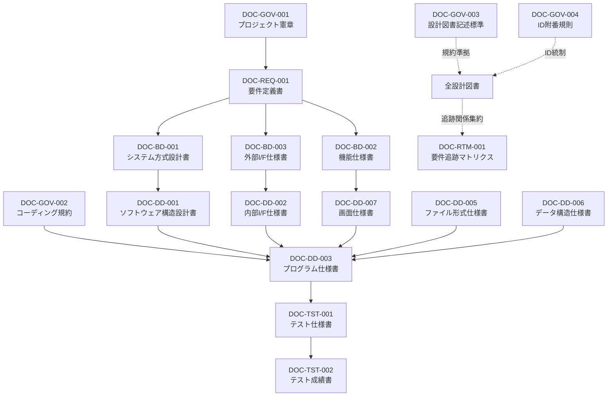

# 1 本書の位置づけ

## 1.1 目的
「marp-slide-mcp」における設計図書体系全体のナビゲーション、全体マップ、および各図書への参照索引を定める。

## 1.2 記述対象
記述対象は [[03_documentation_standard#2.1 図書一覧|図書一覧]] の本書の行に従う。

## 1.3 記述対象外と参照先
- 各図書の詳細内容: 各設計図書本文
- 要件追跡状況: [[01_traceability_matrix#2 追跡表|要件追跡表]]

## 1.4 改版履歴
| 版 | 日付 | 起因PBI | 変更概要 |
| :--- | :--- | :--- | :--- |
| 1.0.0 | 2026-11-04 | PBI-016 | 初版作成（DOC-GOV-003およびDOC-GOV-004準拠） |

# 2 図書一覧

## 2.1 図書一覧表
| 文書ID | 図書名 | 標準ファイル | 版 | 状態 |
| :--- | :--- | :--- | :--- | :--- |
| `DOC-IDX-001` | 設計図書索引 | `docs/README.md` | 1.0.0 | Approved |
| `DOC-GOV-001` | プロジェクト憲章 | `docs/00_project_charter/01_project_charter.md` | 1.0.0 | Approved |
| `DOC-GOV-002` | コーディング規約 | `docs/00_project_charter/02_coding_standards.md` | 1.0.0 | Approved |
| `DOC-GOV-003` | 設計図書記述標準 | `docs/00_project_charter/03_documentation_standard.md` | 1.0.0 | Approved |
| `DOC-GOV-004` | ID附番規則 | `docs/00_project_charter/04_id_numbering_rules.md` | 1.0.0 | Approved |
| `DOC-REQ-001` | 要件定義書 | `docs/01_requirements/01_requirements_specification.md` | 1.0.0 | Approved |
| `DOC-BD-001` | システム方式設計書 | `docs/02_basic_design/01_system_architecture.md` | 1.0.0 | Approved |
| `DOC-BD-002` | 機能仕様書 | `docs/02_basic_design/02_functional_specification.md` | 1.0.0 | Approved |
| `DOC-BD-003` | 外部I/F仕様書 | `docs/02_basic_design/03_external_interface_specification.md` | 1.0.0 | Approved |
| `DOC-DD-001` | ソフトウェア構造設計書 | `docs/03_detail_design/01_software_structure_design.md` | 1.0.0 | Approved |
| `DOC-DD-002` | 内部I/F仕様書 | `docs/03_detail_design/02_internal_interface_specification.md` | 1.0.0 | Approved |
| `DOC-DD-003` | プログラム仕様書 | `docs/03_detail_design/03_program_specification.md` | 1.0.0 | Approved |
| `DOC-DD-004` | データベース仕様書 | 該当なし | - | - |
| `DOC-DD-005` | ファイル形式仕様書 | `docs/03_detail_design/05_file_format_specification.md` | 1.0.0 | Approved |
| `DOC-DD-006` | データ構造仕様書 | `docs/03_detail_design/06_data_structure_specification.md` | 1.0.0 | Approved |
| `DOC-DD-007` | 画面仕様書 | `docs/03_detail_design/07_screen_specification.md` | 1.0.0 | Approved |
| `DOC-TST-001` | テスト仕様書 | `docs/04_test/01_test_specification.md` | 1.0.0 | Approved |
| `DOC-TST-002` | テスト成績書 | `docs/04_test/02_test_report.md` | 1.0.0 | Approved |
| `DOC-RTM-001` | 要件追跡マトリクス | `docs/05_traceability/01_traceability_matrix.md` | 1.0.0 | Approved |

## 2.2 該当なし図書
| 図書名 | 理由 |
| :--- | :--- |
| `DOC-DD-004` データベース仕様書 | 本システムはRDBおよびSQLデータベースを使用せず、MarkdownテキストファイルおよびJSONキャッシュファイルによるファイルシステム永続化を採用しているため作成対象外とする。 |

# 3 図書間の参照関係

## 3.1 参照関係図

# 4 閲覧方法

## 4.1 Obsidianでの閲覧
本設計図書体系はObsidianの内部リンク構文に準拠している。
リポジトリの `docs/` ディレクトリをObsidianの保管庫（Vault）として開くことで、図書間の参照関係を双方向リンクおよびグラフビューとして直感的に探索できる。
