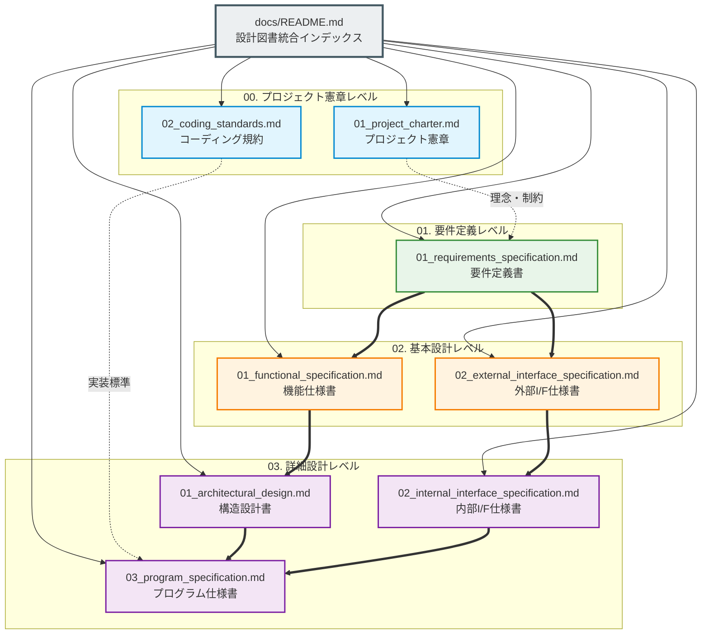

# marp-slide-mcp (Marp スライド作成環境) 設計図書体系

本ディレクトリ（`docs/`）は、「**marp-slide-mcp (Marp スライド作成環境)**」におけるすべての要件、基本設計、詳細設計、実装アルゴリズム、および開発ガバナンス規則を網羅的に形式知化した設計図書体系である。

IPA（情報処理推進機構）のシステム開発標準仕様書体系に準拠し、**Obsidian によるハイパーリンク閲覧**、および **将来の AI エージェントによる自律的 CI/CD（自動テスト生成・保守開発）** を想定した完全モジュール化・高機械可読性構造を採用している。

---

## 1. 設計図書体系マップ (Documentation Hierarchy)

---

## 2. 図書一覧および概要

| 階層 / 分類 | ドキュメント名 | 文書ID | 概要・対象読者 |
| :--- | :--- | :--- | :--- |
| **統合ハブ** | [`README.md`](README.md) | `DOC-INDEX-001` | 本設計図書全体のナビゲーション、全体マップ、およびトレーサビリティマトリクス |
| **00. 憲章** | [`00_project_charter/01_project_charter.md`](00_project_charter/01_project_charter.md) | `DOC-PC-001` | プロジェクトの背景・意義、目的・ゴール、スコープ、成功基準、SaaS制限ライセンス戦略 |
| **00. 規約** | [`00_project_charter/02_coding_standards.md`](00_project_charter/02_coding_standards.md) | `DOC-PC-002` | Google TypeScript準拠標準、および【全行直上平易コメント】の厳格な記述規則 |
| **01. 要件** | [`01_requirements/01_requirements_specification.md`](01_requirements/01_requirements_specification.md) | `DOC-REQ-001` | 業務要件、機能要件（`REQ-FNC-001`〜`007`）、非機能要件（IPAグレード）、制約条件 |
| **02. 基本** | [`02_basic_design/01_functional_specification.md`](02_basic_design/01_functional_specification.md) | `DOC-BD-001` | 5層アーキテクチャ、機能詳細（`FNC-xxx`）、スライド画面・レイアウト仕様（`LAY-xxx`） |
| **02. 基本** | [`02_basic_design/02_external_interface_specification.md`](02_basic_design/02_external_interface_specification.md) | `DOC-BD-002` | MCP Tools（7種）、CLIコマンド、Puppeteer/PptxGenJS連携、AI設定仕様 |
| **03. 詳細** | [`03_detail_design/01_architectural_design.md`](03_detail_design/01_architectural_design.md) | `DOC-DD-001` | モジュール構造（`MOD-xxx`）、データモデル（`SlideDeck` 等）、実行ライフサイクル |
| **03. 詳細** | [`03_detail_design/02_internal_interface_specification.md`](03_detail_design/02_internal_interface_specification.md) | `DOC-DD-002` | 内部関数シグネチャ（`INT-FN-xxx`）、Marpエンジン拡張API、DOM解析仕様 |
| **03. 詳細** | [`03_detail_design/03_program_specification.md`](03_detail_design/03_program_specification.md) | `DOC-DD-003` | `index.ts`, `marp.config.js`, `convert.js`, `theme.css` 各プログラムのアルゴリズム詳細 |

### 2.1 IPA共通フレーム2013 × PBI駆動アジャイル 標準テンプレート (`docs/templates/`)

PBI起点の新規機能開発・仕様変更・バグ修正時に各工程のAIスキル（`.agents/skills/ipa-*`）が参照・差分更新する標準テンプレート一式：

| 工程分類 | テンプレートファイル | テンプレートID | 対応スキル |
| :--- | :--- | :--- | :--- |
| **PBI定義 (起点)** | [`templates/98_pbi_template.md`](templates/98_pbi_template.md) | `TPL-PBI-098` | `ipa-pbi-orchestrator` |
| **業務要件定義** | [`templates/01_business_requirements.md`](templates/01_business_requirements.md) | `TPL-REQ-BIZ-001` | `ipa-requirements-analyst` |
| **機能要件定義** | [`templates/02_functional_requirements.md`](templates/02_functional_requirements.md) | `TPL-REQ-FNC-002` | `ipa-requirements-analyst` |
| **非機能要件定義** | [`templates/03_non_functional_requirements.md`](templates/03_non_functional_requirements.md) | `TPL-REQ-NFR-003` | `ipa-requirements-analyst` |
| **システム方式設計** | [`templates/04_system_architecture.md`](templates/04_system_architecture.md) | `TPL-ARC-SYS-004` | `ipa-system-architect` |
| **ソフトウェア詳細設計** | [`templates/05_software_design.md`](templates/05_software_design.md) | `TPL-DES-SWD-005` | `ipa-detail-designer` |
| **テスト仕様・成績書** | [`templates/06_test_specification.md`](templates/06_test_specification.md) | `TPL-TST-SPC-006` | `ipa-qa-engineer` |
| **要件追跡表 (RTM)** | [`templates/99_traceability_matrix.md`](templates/99_traceability_matrix.md) | `TPL-RTM-MAT-099` | `ipa-traceability-validator` |

---

## 3. 完全トレーサビリティマトリクス (Traceability Matrix)

PBI（プロダクトバックログ）から要件、基本設計、詳細設計、実装コードに至るまでの完全なトレーサビリティを以下に示す。

| `PBI_ID` | 要件ID (`REQ`) | 基本設計 機能ID (`FNC`) | 外部I/F (`EXT`) | モジュールID (`MOD`) | 内部I/F (`INT`) | プログラムID (`PRG`) | 主要実装ソースコード |
| :--- | :--- | :--- | :--- | :--- | :--- | :--- | :--- |
| `PBI-000` | `REQ-FNC-001` (ビジネス標準テーマ) | `FNC-001` (スライドスタイリング) | — | `MOD-THM-001` | — | `PRG-THM-001` | `themes/business-slide-theme.css` `themes/theme-colors.css` |
| `PBI-000` | `REQ-FNC-002` (自律要素リサイズ) | `FNC-002` (自動リサイズ機構) | — | `MOD-THM-001` `MOD-ENG-001` | — | `PRG-THM-001` `PRG-ENG-001` | `themes/business-slide-theme.css` `marp.config.js` |
| `PBI-000` | `REQ-FNC-003` (構造化レイアウト) | `FNC-003` (2段組/画像/会話) | `EXT-MCP-001` | `MOD-THM-001` `MOD-SRV-001` | `INT-FN-001` | `PRG-THM-001` `PRG-SRV-001` | `themes/business-slide-theme.css` `src/index.ts` |
| `PBI-000` `PBI-004` | `REQ-FNC-004` (目次完全自動生成) | `FNC-004` (目次プラグイン) | — | `MOD-ENG-001` `MOD-SRV-001` | `INT-ENG-001` `INT-ENG-002` `INT-FN-001` | `PRG-ENG-001` `PRG-SRV-001` | `marp.config.js` (`marp_toc`) `src/index.ts` |
| `PBI-000` | `REQ-FNC-005` (ネイティブPPTX変換) | `FNC-005` (DOM解析変換) | `EXT-CLI-002` `EXT-LIB-002` `EXT-LIB-003` | `MOD-PPT-001` | `INT-DOM-001` `INT-DOM-002` `INT-DOM-003` | `PRG-PPT-001` | `pptx_converter/convert.js` |
| `PBI-000` `PBI-001` `PBI-004` | `REQ-FNC-006` (MCPサーバー連携) | `FNC-006` (スライド操作API) | `EXT-MCP-001`〜 `EXT-MCP-007` | `MOD-SRV-001` | `INT-FN-001`〜 `INT-FN-005` | `PRG-SRV-001` | `src/index.ts` |
| `PBI-000` | `REQ-FNC-007` (AI協調プロンプト) | `FNC-007` (MBBプロンプト&Skill) | `EXT-CFG-002` | — | — | — | `.agents/skills/marp-slides/` `prompts/mcp_slide_generator.md` |
| `PBI-002` `PBI-005` | `REQ-FNC-008` (GitHub MCP連携・PAT分離・動的検証) | `FNC-008` (PAT分離・動的検証ゲート) | `EXT-MCP-008` | `MOD-INF-001` | — | `PRG-INF-001` | `docker-compose.yml` `.agents/mcp_config.json` `.env.example` |
| `PBI-003` `PBI-006` | `REQ-FNC-009` (GitHub標準テンプレート・運用スキル) | `FNC-009` (Issue/PR/ブランチ運用支援) | `EXT-DOC-001` | `MOD-SKL-001` | — | `PRG-SKL-001` | `.github/` `CONTRIBUTING.md` `.agents/skills/github-workflows/` |

---

## 4. Obsidian 閲覧ガイド

本設計図書群は、知識管理ツール **[Obsidian](https://obsidian.md/)** の機能を最大限に活かせるよう設計されている。

1. **グラフビュー (Graph View) の活用**:
   - 各ドキュメントは `[[<ドキュメント名>]]` 形式の内部リンクで密結合されており、Obsidianのグラフビューを開くことでシステム全体の論理構造と関連性を視覚的に俯瞰可能。
2. **YAML Frontmatter によるメタデータ検索**:
   - すべてのファイル冒頭に `id`, `title`, `version`, `status`, `tags` が記載されており、Obsidianの検索機能や Dataview プラグインによってタグ（`#requirements`, `#basic-design`, `#mcp` 等）ごとの絞り込みが可能。
3. **Mermaid ダイアグラムのネイティブ表示**:
   - アーキテクチャ図、データモデル（ER図）、シーケンス図、フローチャートが Obsidian 上で直接美しくレンダリングされる。

---

## 5. 将来的な AI / CI/CD 連携への寄与

- **機械可読な仕様書構造**:
  - 見出し、表、コードブロック、Zodスキーマ、型定義が構造化されているため、AIエージェント（LLM）が仕様書をコンテキストとして直接読み取り、新規機能の追加や単体テストコードの自動生成を行うことが極めて容易。
- **リグレッション防止**:
  - 各機能の「振る舞い」「引数」「戻り値」「境界値」が厳密に定義されているため、CIパイプラインで自動テストを実行する際の正解定義（オラクル）としてそのまま機能する。

---

## 6. 技術ポートフォリオとしてのハイライト

1. **ビジネス課題に対する深い洞察とアーキテクチャ設計**:
   - 単なるツール作成にとどまらず、「従来PowerPointの手作業の非効率」と「Markdownスライドのデザイン制約」という二律背反を解消する高度なアーキテクチャ（見出しアンカー、DOM計測PPTX変換、MCP統合）を具現化。
2. **IPA標準に準拠したプロフェッショナルな文書化能力**:
   - エンタープライズ開発現場で通用する「共通フレーム（SLCP-JCF）」に準拠し、初見の開発者や採用担当者にも設計意図が明瞭に伝わるドキュメント体系を構築。
3. **比類なきコード品質と保守性へのこだわり**:
   - ソースコード全行に対する「直上平易コメント規則」の徹底、Zodによる実行時型安全性、多段階Chromium探索など、堅牢なプロダクション品質を担保。
