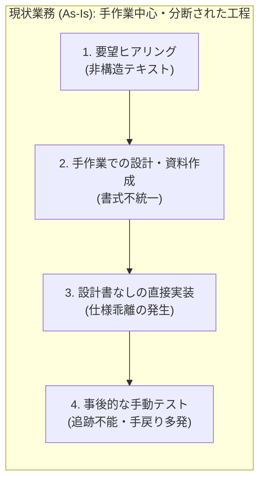
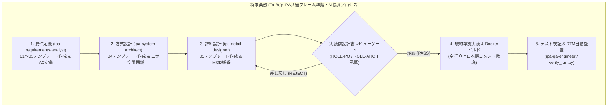

# 業務要件定義書 (Business Requirements Specification)

> **テンプレート利用ガイド**: 本ドキュメントは、IPA共通フレーム2013（SLCP-JCF2013）「要件定義プロセス（利害関係者要件の定義）」およびIPA『設計書作成の勘どころ』に準拠した業務要件定義書の標準雛形である。`ipa-requirements-analyst` スキルを用いて対象案件・機能に合わせて記述・更新すること。

---

## レビュアー向けサマリ
- **前版からの差分**: 初版作成
- **人間（承認者）が判断すべきポイント（3〜5点）**:
  1. システム化対象範囲（スコープ内・スコープ外）の境界定義が妥当か
  2. To-Be業務フローにおける人間とAIエージェント/システムの責務分担が合意通りか
  3. 業務上の成功基準（KPI・定量目標）が検収可能な指標になっているか
- **影響するQ-ID・基準ID**: `Q-03`（トレーサビリティ）、`D-01`（完了定義）
- **承認に必要な最小読解セット**: 「1. 背景と目的」「3. システム化範囲」「4. 業務フロー（As-Is / To-Be）」

---

## 1. 背景と目的 (Background & Objectives)

### 1.1 業務の背景・現状の課題 (As-Is Issues)
| 課題ID | 対象業務領域 | 現状の課題内容 | 業務上の悪影響（定量・定性） |
| :--- | :--- | :--- | :--- |
| **BIZ-ISS-001** | 資料作成・体裁調整 | 手作業によるレイアウト調整や書式統一に過大な工数が費やされている | 資料1件あたり作成時間の50%以上が非本質的な整形作業に浪費される |
| **BIZ-ISS-002** | 仕様・成果物の整合管理 | 要件定義から設計・テストまでの追跡が手作業であり、仕様変更時の影響漏れが発生する | 下流工程での手戻りコストが上流工程の10倍以上に膨張する |
| **BIZ-ISS-003** | AI生成物の品質統制 | AIへの単発指示だけでは組織標準の設計品質やセキュリティ基準が担保されない | レビュー負荷の増大および検収基準未達リスクの発生 |

### 1.2 プロジェクトの目的・達成すべき姿 (To-Be Goals)
1. **定量的目標 (KPI)**:
   - 定型ドキュメント・プレゼンテーション作成および設計〜検証サイクルのリードタイムを **50%以上短縮** する。
   - 要件ID（`REQ-*`）からモジュール（`MOD-*`）・テスト（`TEST-*`）までのトレーサビリティ断絶を **0件（100%追跡可能）** とする。
2. **定性的目標**:
   - Markdown正本主義とMCP自動化により、再現性・監査可能性の高いAI協調開発基盤を確立する。

---

## 2. ステークホルダーと役割定義 (Stakeholders & Roles)

> [!IMPORTANT]
> 個人情報保護方針（Q-09）に基づき、本ドキュメント内に個人の実名を記載してはならない。必ずロールIDで表記すること。

| ロールID | 役割名称 | 主な責務・システムとの関わり | 期待する価値・検収観点 |
| :--- | :--- | :--- | :--- |
| **ROLE-PO** | プロダクトオーナー / 承認者 | 業務要件の承認、スコープ裁定、工程ゲート承認 | 投資対効果の明確化、検収可能な成果物品質の担保 |
| **ROLE-ARCH** | システムアーキテクト | 方式設計、技術選定審査、非機能要件の充足確認 | 長期保守性、疎結合なモジュール構成、セキュリティ統制 |
| **ROLE-DEV** | 設計・実装エンジニア | 詳細設計書の作成、コーディング規約準拠の実装 | 曖昧さのない仕様書、Docker環境での完全なビルド再現性 |
| **ROLE-QA** | 品質保証・テスト担当 | テスト仕様策定、RTM検証、品質ゲート監査 | 観測可能な受入基準（AC）、自動化された追跡性検証 |

---

## 3. システム化範囲 (System Scope)

### 3.1 システム化対象（In-Scope）と対象外（Out-of-Scope）

| 業務プロセス | サブ業務 | 区分 | 担い手（人間 / AI / システム） | 備考・対応機能要件 |
| :--- | :--- | :---: | :--- | :--- |
| **1. 企画・要件定義** | 業務課題整理・要件一覧化 | **対象 (In)** | 人間 (`ROLE-PO`) + AI Skill | `REQ-F-001` にて構造化支援 |
| **2. 設計・製造** | スライド・設計図書生成 | **対象 (In)** | AI Skill + MCP Server | `REQ-F-001`, `REQ-F-002` |
| **3. 変換・出力** | PDF / 編集可能PPTX変換 | **対象 (In)** | システム (Docker Container) | `REQ-F-003` |
| **4. 品質検証** | トレーサビリティ自動検査 | **対象 (In)** | システム (`verify_rtm.py`) | `Q-03` ゲートで自動実行 |
| **5. 最終承認・配布** | 顧客提出承認・外部公開判断 | **対象外 (Out)** | 人間 (`ROLE-PO`) 専管事項 | AIによる自動承認・無断外部送信は禁止 |

---

## 4. 業務フロー定義 (Business Process Flow)

### 4.1 現状業務フロー (As-Is)

### 4.2 将来業務フロー (To-Be)

---

## 5. 業務上の制約条件・前提条件・未解決事項

### 5.1 業務・契約・コンプライアンス制約
1. **開発・実行環境の統一**: すべてのビルド・変換・検証スクリプトはDockerコンテナ内で実行する。
2. **機密情報・PIIの保護**: 設計書・コード・テスト証跡に実名・ローカル絶対パス・認証情報を一切含めない。

### 5.2 未解決事項・仮定管理台帳 (`Open Questions & Assumptions`)
| 課題ID (`Q-ID`) | 状態 | 対象箇所 | 質問内容・推奨案 | 設定した暫定仮定（外れた場合の影響範囲） |
| :--- | :---: | :--- | :--- | :--- |
| `Q-001` | 解決済 | 全体 | 成果物フォーマットの正本は何とするか？（推奨: Git管理可能なMarkdown） | Markdownを正本とし、PDF/PPTXは一方向生成成果物とする |

---

## 6. 改訂履歴・承認記録

| 版数 | 日付 | 変更者 (ロールID) | 変更内容 | 承認者 (ロールID) | 承認状態 |
| :--- | :--- | :--- | :--- | :--- | :---: |
| 1.0.0 | 2026-10-17 | `ROLE-ARCH` | IPA共通フレーム2013準拠 初版テンプレート策定 | `ROLE-PO` | Approved |
