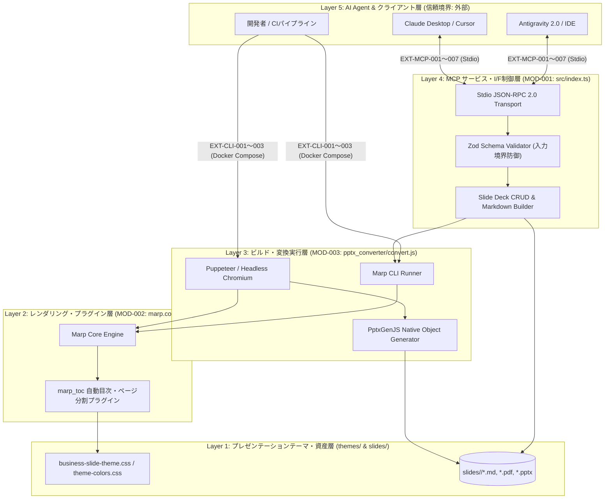

# システム方式設計書 (System Architecture Design Specification)

> **テンプレート利用ガイド**: 本ドキュメントは、IPA共通フレーム2013（SLCP-JCF2013）「システム方式設計プロセス」および基本設計（外部設計）に準拠したシステム方式設計書の標準雛形である。`ipa-system-architect` スキルを用いて、Mermaidによるシステム構成図、基盤環境、外部I/F一覧、およびエラー空間の閉鎖（受け皿定義）を記述すること。

---

## レビュアー向けサマリ
- **前版からの差分**: 初版作成
- **人間（承認者）が判断すべきポイント（3〜5点）**:
  1. 5層システム構成とコンポーネント間の責務分担・依存方向が単方向で疎結合か
  2. Docker基盤環境（Node.js 22 / Headless Chromium / Noto CJK）の構成が非機能要件（`REQ-NFR-001`〜`006`）を満たすか
  3. 外部I/F一覧およびエラーコード表の最終行に「上記以外（未定義エラー）」の受け皿が定義され、エラー空間が閉じているか
- **影響するQ-ID・基準ID**: `Q-03`（トレーサビリティ）、`Q-06`（エラー空間閉鎖）、`Q-09`（信頼境界・セキュリティ）
- **承認に必要な最小読解セット**: 「1. システム全体構成図（Mermaid）」「2. 基盤環境・インフラ方式」「3. 外部インターフェース一覧とエラー体系」

---

## 1. システム全体構成図 (System Architecture Diagram)

### 1.1 レイヤードアーキテクチャ構成図 (Mermaid)

### 1.2 アーキテクチャ設計方針と非機能要件との対応
| 対応非機能要件ID | 方式設計上の実現アプローチ |
| :--- | :--- |
| **`REQ-NFR-001` (可用性)** | Chromium実行パスの4段階フォールバック解決機構を `MOD-001` / `MOD-003` に実装し、環境差異による停止を防止する。 |
| **`REQ-NFR-002` (性能)** | Marp CLIおよびPuppeteerのヘッドレス描画をコンテナ内で直接実行し、不要なネットワーク通信を排除して高速変換を実現する。 |
| **`REQ-NFR-005` (セキュリティ)** | Layer 5とLayer 4の境界でZodスキーマによる厳格な型・文字数検証を実施し、標準出力（`stdout`）への不正ログ混入を防止する。 |
| **`REQ-NFR-006` (環境再現性・代替適応性)** | `.devcontainer/Dockerfile` および `docker-compose.yml` によりOS・ランタイム・日本語フォントをコード化（IaC）して固定するとともに、Dockerが利用できない環境向けにホスト上のNode 22・Chrome・Python 3による直接実行パイプラインと手順を公式定義する。 |

---

## 2. 基盤環境・インフラ構成仕様 (Infrastructure & Runtime Environment)

### 2.1 コンテナ実行基盤仕様
| 構成要素 | 採用技術・バージョン | 役割・設定値 |
| :--- | :--- | :--- |
| **コンテナベースOS** | Debian Bookworm (Node 22 Image) | マルチプラットフォーム（Windows / macOS / Linux）で同一のLinuxカーネル空間を提供 |
| **アプリケーションランタイム** | Node.js 22.x LTS (ES Modules) | MCPサーバー（TypeScriptビルド済JS）およびPPTX変換スクリプトの実行基盤 |
| **スクリプト検証ランタイム** | Python 3.x | トレーサビリティ検証スクリプト（`verify_rtm.py`）の実行基盤 |
| **ヘッドレスブラウザ** | Chromium (`/usr/bin/chromium`) | Marp PDF出力およびPPTX変換時のDOM座標・計算済みスタイル計測用エンジン |
| **日本語フォント体系** | `fonts-noto-cjk` | OS非依存で美しい日本語ゴシック体描画と正確な文字幅計測を保証 |

### 2.2 環境変数一覧
| 環境変数名 | 必須/任意 | デフォルト値 | 用途・説明 |
| :--- | :---: | :--- | :--- |
| `LANG` / `LC_ALL` | 必須 | `ja_JP.UTF-8` | 日本語文字コード・ロケール統一 |
| `CHROME_PATH` | 任意 | `/usr/bin/chromium` | Chromium実行バイナリパス（未指定時は4段階自動探索が稼働） |
| `PUPPETEER_ARGS` | 任意 | `--no-sandbox --disable-setuid-sandbox` | コンテナ内でのヘッドレスブラウザ安全起動オプション |
| `NODE_ENV` | 任意 | `development` / `production` | 実行モード制御 |

### 2.3 Dockerレス代替環境（ホスト直接実行）仕様
企業等のセキュリティ制限でDockerが利用できない環境において、ホストマシン単体でビルド・変換を行うための構成要件：
- **Node.js**: バージョン 22.x LTS 以上（`npm install`, `npm run build`）
- **ブラウザ**: Google Chrome または Chromium がインストール済みであること（Puppeteer / Marp CLI が参照）
- **Python**: Python 3.10+ および `python-pptx`（PPTX変換機能利用時のみ必要）
- **日本語フォント**: OS標準の日本語フォント（Windows: Meiryo / Yu Gothic、macOS: Hiragino Sans、Linux: Noto Sans CJK JP等）

---

## 3. 外部インターフェース一覧とエラー体系 (External Interfaces & Error Space)

### 3.1 外部インターフェース一覧 (`EXT-*`)
| 外部I/F ID | I/F名称 | 種別 / プロトコル | 対応要件ID | 対応モジュールID | 概要 |
| :--- | :--- | :--- | :--- | :--- | :--- |
| **EXT-MCP-001** | `generate_slide_deck` | MCP Tool (Stdio) | `REQ-F-001` | `MOD-001` | 構造化JSONからMarp Markdown・PDFを一括新規生成する |
| **EXT-MCP-002** | `get_slide_deck` | MCP Tool (Stdio) | `REQ-F-001` | `MOD-001` | 既存スライドのフロントマター・各ページ構造を解析取得する |
| **EXT-MCP-003** | `insert_slide` | MCP Tool (Stdio) | `REQ-F-001` | `MOD-001` | 指定ページ直後に新規スライドを挿入し再ビルドする |
| **EXT-MCP-004** | `update_slide` | MCP Tool (Stdio) | `REQ-F-001` | `MOD-001` | 指定ページのスライド内容を更新し再ビルドする |
| **EXT-MCP-005** | `delete_slide` | MCP Tool (Stdio) | `REQ-F-001` | `MOD-001` | 指定ページのスライドを削除し再ビルドする |
| **EXT-MCP-006** | `update_deck_settings` | MCP Tool (Stdio) | `REQ-F-001` | `MOD-001` | デッキ全体設定（比率・テーマ色・バナー・表紙）を更新する |
| **EXT-MCP-007** | `export_to_pdf` | MCP Tool (Stdio) | `REQ-F-003` | `MOD-001` | 指定 `fileId` またはMarkdownパスからPDFを再出力する |
| **EXT-CLI-001** | `npm run build:pdf` | CLI Command | `REQ-F-002`, `REQ-F-003` | `MOD-002` | 目次自動生成・テーマ適用の上でPDFを一括ビルドする |
| **EXT-CLI-002** | `npm run build:pptx` | CLI Command | `REQ-F-003` | `MOD-003` | DOM計測パイプラインによりネイティブ編集可能PPTXを生成する |

### 3.2 エラーコード一覧（エラー空間の閉鎖定義）

> [!IMPORTANT]
> **エラー空間閉鎖ルール（Q-06）**: 準正常系（設計された「できない」境界）を全行採番し、最終行に必ず受け皿 **「上記以外（未定義エラー: `ERR-SYS-999`）」** を定義する。各行IDは結合テスト（`06_test_specification.md`）の検証根拠となる。

| エラーID | 区分 | 発生条件 | 返却形態 / ステータス | 呼び出し側の期待動作・リカバリ方針 |
| :--- | :---: | :--- | :--- | :--- |
| **ERR-VAL-001** | 準正常系 | 必須パラメータ欠落、文字数上限超過（タイトル60文字超、主張250文字超等）、型不正 | MCP `isError: true` + Zod詳細メッセージ | エラー箇所のフィールドを修正して再実行する |
| **ERR-NOT-002** | 準正常系 | 指定された `fileId` または `markdownPath` のファイルが存在しない | MCP `isError: true` / CLI Exit `1` | `get_slide_deck` またはファイル一覧で有効なIDを確認する |
| **ERR-RNG-003** | 準正常系 | `targetPageNumber` または `insertAfterPage` が有効ページ範囲外 | MCP `isError: true` + 範囲外エラー文言 | `get_slide_deck` で総ページ数を確認し有効ページ番号を指定する |
| **ERR-ENV-004** | 準正常系 | Chromium実行バイナリが4段階探索のすべてで見つからない | MCP `isError: true` / CLI Exit `1` | Dockerコンテナ環境経由（`docker compose run --rm app`）で実行する |
| **ERR-SYS-999** | **異常系（受け皿）** | **上記以外（未定義エラー：ファイルI/O例外、子プロセス異常終了等）** | MCP `isError: true`（スタック漏洩防止・定型エラー返却）/ 中間ファイル削除 | プロセスをクラッシュさせずエラーメッセージを返し、一時ファイルをクリーンアップする |

---

## 4. アーキテクチャ判断記録 (ADR Summary)

| ADR ID | 決定事項 | 採用理由 | 却下した代替案と却下理由 |
| :--- | :--- | :--- | :--- |
| **ADR-001** | スライド見出し（`#`〜`######`）のCSS位置アンカー方式の採用 | 標準Markdown構文のみで表紙・主張帯・本文・出典の厳密配置を実現でき、LLMがHTMLタグを意識せず生成できるため | スライドごとに複雑なHTML/divタグを直接記述する方式（LLMの閉じタグ漏れや可読性低下を招くため却下） |
| **ADR-002** | Puppeteer DOM計測 + PptxGenJS によるネイティブPPTX生成 | CSSで計算された正確な座標・フォントサイズを保持したまま、PowerPoint上で再編集可能なテキスト・シェイプを出力できるため | スライド全体を単なる1枚のPNG画像としてPPTXに貼り付ける方式（出力後の文字修正が不可能なため却下） |
