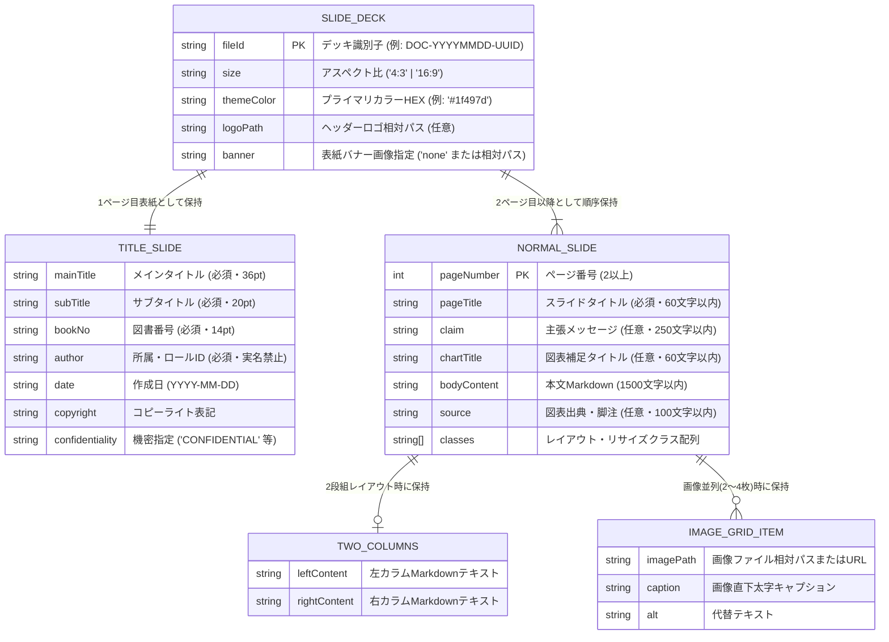

# ソフトウェア方式・詳細設計書 (Software Architecture & Detail Design Specification)

> **テンプレート利用ガイド**: 本ドキュメントは、IPA共通フレーム2013（SLCP-JCF2013）「ソフトウェア方式設計・ソフトウェア詳細設計プロセス」に準拠した詳細設計書の標準雛形である。**本設計書が承認・配置されるまで、新規ソースコードの実装・変更は原則禁止される（Pre-Implementation Gate）。** `ipa-detail-designer` スキルを用いて、ER図（データモデル）、モジュール一覧（`MOD-xxx`）、内部I/F・入出力仕様、および単体テスト観点を記述すること。

---

## レビュアー向けサマリ
- **前版からの差分**: 初版作成
- **人間（承認者）が判断すべきポイント（3〜5点）**:
  1. データモデル（ER図）のエンティティ関係・制約・型定義に曖昧さや不整合がないか
  2. モジュール一覧（`MOD-001`〜`MOD-003`）が上流要件（`REQ-F-*` / `REQ-NFR-*`）を漏れなくカバーしているか
  3. 内部関数の入出力仕様・例外分岐・単体テスト観点が、そのまま単体テスト（`TEST-UT-xxx`）の検証根拠として使える粒度か
- **影響するQ-ID・基準ID**: `Q-03`（トレーサビリティ）、`Q-10`（全行直上平易コメント規則・型安全）
- **承認に必要な最小読解セット**: 「1. データモデル設計（ER図）」「2. モジュール一覧（`MOD-xxx`）」「3. モジュール別入出力・処理論理仕様」

---

## 1. データモデル設計・ER図 (Data Model & ER Diagram)

### 1.1 論理データモデル (Mermaid `erDiagram`)

### 1.2 データモデル変更時の影響調査チェックリスト
- [x] スキーマ変更時は参照する全モジュール（`MOD-001`, `MOD-002`, `MOD-003`）への波及を `grep` で確認済みか。
- [x] すべての入力フィールドにZodスキーマによる型・文字数制約が定義されているか（`any` 型の使用禁止）。

---

## 2. モジュール一覧 (`MOD-xxx` 採番正本)

> [!IMPORTANT]
> 本テーブルの **モジュールID (`MOD-xxx`)** は、要件（`REQ-*`）とテストケース（`TEST-*`）を繋ぐ中核IDであり、`99_traceability_matrix.md` で機械検査される。
> ※ 本リポジトリの実設計図書（`docs/03_detail_design/01_architectural_design.md`）における詳細サブシステムID（`MOD-SRV-001`, `MOD-ENG-001`, `MOD-PPT-001`, `MOD-THM-001`）との対応も併記する。

| モジュールID | 実設計サブシステムID | モジュール名称 | 物理ファイルパス | 対応要件ID | 責務概要 |
| :--- | :--- | :--- | :--- | :--- | :--- |
| **MOD-001** | `MOD-SRV-001` | MCP スライド制御・生成モジュール | `src/index.ts` | `REQ-F-001` `REQ-NFR-001` `REQ-NFR-003` `REQ-NFR-005` `REQ-NFR-006` | MCP Stdio通信、Zod入力検証、スライドCRUD、Markdown生成・構文解析、PDF出力呼び出し（`CHROME_NO_SANDBOX` 保証） |
| **MOD-002** | `MOD-ENG-001` `MOD-THM-001` | Marp カスタムエンジン・テーマモジュール | `marp.config.js` `themes/business-slide-theme.css` | `REQ-F-002` `REQ-NFR-001` `REQ-NFR-006` | 見出しアンカーCSS絶対配置、自動リサイズ制御、Markdown-itトークン走査による自動目次生成・ページ分割、Marp CLI非対話実行安定化 |
| **MOD-003** | `MOD-PPT-001` | ネイティブ PPTX DOM変換モジュール | `pptx_converter/convert.js` | `REQ-F-003` `REQ-NFR-001` `REQ-NFR-002` `REQ-NFR-004` | PuppeteerによるヘッドレスHTML描画、DOM座標・計算済みスタイル抽出、PptxGenJSによる編集可能オブジェクト出力 |

---

## 3. モジュール別入出力仕様・内部ロジック設計

### 3.1 `MOD-001`: MCP スライド制御・生成モジュール (`src/index.ts`)

#### 内部関数インターフェース一覧
| 関数ID | 関数名 | 引数 (型) | 戻り値 (型) | 処理概要・例外仕様 |
| :--- | :--- | :--- | :--- | :--- |
| **INT-FN-001** | `resolveSlideContent` | `slide: NormalSlide` | `{ bodyContent: string; classes: string[] }` | `twoColumns` 指定時は `columns-2` クラスを付与し箇条書き2列に整形。`imageGrid` 指定時は `images-2`〜`4` を付与。`pageTitle` が `"目次"`（または `"Table of Contents"`）かつ本文が空の場合は `toc` クラスを自動補完。 |
| **INT-FN-002** | `generateMarpMarkdown` | `deck: SlideDeck` | `string` | フロントマター、テーマ色CSS変数、表紙スライド、通常スライド群を `---` 区切りで結合し完全なMarp Markdownを生成。 |
| **INT-FN-003** | `parseMarpMarkdown` | `content: string` | `{ frontmatter: Record<string, unknown>; slides: SlideRaw[] }` | 既存Markdownからフロントマターと各ページの生テキスト・構造を抽出。不正構文時は `ERR-VAL-001` 相当の例外を送出。 |
| **INT-FN-004** | `exportSlideToPdf` | `markdownPath: string` | `Promise<string>` | Chromiumパスを4段階解決し、`CHROME_NO_SANDBOX=1` を保証した上でMarp CLIを実行してPDFを生成。対象不在時は `ERR-NOT-002`、未定義例外は `ERR-SYS-999` 受け皿で捕捉。 |

#### 単体テスト観点 (`TEST-UT-001` の根拠)
- 正常系: `generateMarpMarkdown` が表紙と通常スライドの見出しアンカー（`#`〜`######`）を正しい順序で出力すること。
- 境界値: `pageTitle`（60文字）、`claim`（250文字）、`imageGrid`（2〜4枚）の境界値でZod検証が正しく動作すること。
- 準正常系/異常系: 必須項目欠落時に `ERR-VAL-001`、ページ範囲外指定時に `ERR-RNG-003` が返却されプロセスが停止しないこと。

---

### 3.2 `MOD-002`: Marp カスタムエンジン・テーマモジュール (`marp.config.js` / `themes/`)

#### 内部関数・スタイル処理仕様
| 関数/ルールID | 名称 | 入力 | 出力 | 処理論理・境界条件 |
| :--- | :--- | :--- | :--- | :--- |
| **INT-ENG-001** | `marp_toc` プラグイン | Markdown-it `state.tokens` | 目次注入・分割済み `state.tokens` | 1. `marpit_directives_parse` 直後に実行し、全スライドのH1/直下段落からタイトルを収集（表紙・目次除外）。 2. 12項目を超える場合は独立した目次スライド（`marpitSlideElement: 1/-1`, `id` 属性付与）を自動分割生成し、後続スライドの `marpitSlide`・`marpitSlideTotal`・`id` 属性をシフト補正。 3. 元のヘッダー/フッターおよび `h6`（コピーライト・機密指定）トークンを全目次ページへ保持・再注入。 |
| **INT-THM-001** | 見出しアンカー＆自動リサイズCSS | Marp HTMLセクション | 絶対配置・縮小済みDOM | `h1`〜`h5` 自体を非表示化し直後要素を配置。表（`.table-sm`/`.table-xs`）、コード、Mermaid SVG、画像を本文枠内に収める。 |

#### 単体テスト観点 (`TEST-UT-002` の根拠)
- 正常系: `<!-- _class: toc -->` スライドに通常スライドのタイトル一覧とページ番号リンクが生成され、ヘッダーロゴおよびフッター（コピーライト・機密指定）が維持されること。
- 境界値: 通常スライド12枚（1ページ目次）と13枚以上（例: 15枚＝表紙込み17ページ以上で2ページ目次に自動分割）の境界で、2ページ目以降の目次が独立した `<svg data-marpit-svg>` として生成され、ページ番号・アンカーIDのズレが0件であること。

---

### 3.3 `MOD-003`: ネイティブ PPTX DOM変換モジュール (`pptx_converter/convert.js`)

#### 内部処理フロー
1. **中間HTML生成**: Marp CLIを用いて対象Markdownから中間HTMLを生成する。
2. **DOM座標・スタイル計測**: Puppeteerで中間HTMLを描画し、各要素の `getBoundingClientRect()`（x, y, width, height）および `getComputedStyle()`（フォント、色、背景、枠線）を抽出する。
3. **ネイティブオブジェクト生成**: 96DPI基準でピクセル値をインチへ変換し、PptxGenJSのテキストボックス、テーブル、シェイプ、画像として配置して `.pptx` を保存する。
4. **クリーンアップ**: `finally` ブロックで中間HTMLを確実に削除する。

#### 単体テスト観点 (`TEST-UT-003` の根拠)
- 正常系: 96DPI座標変換およびRGB/HEXカラー変換が正確に計算され、編集可能な `.pptx` ファイルが出力されること。
- 準正常系/異常系: 変換エラー発生時にも中間一時ファイルが残存しないこと。

---

## 4. 実装前レビューゲート確認チェックリスト

- [x] 上流の要件ID（`REQ-F-001`〜`003`, `REQ-NFR-001`〜`006`）がすべて `MOD-001`〜`003` に割り当てられているか。
- [x] 各モジュールの入出力型・例外処理・単体テスト観点が明記されているか。
- [x] 実装時に `docs/00_project_charter/02_coding_standards.md` の **「全行直上平易コメント規則」** を適用する準備が整っているか。
