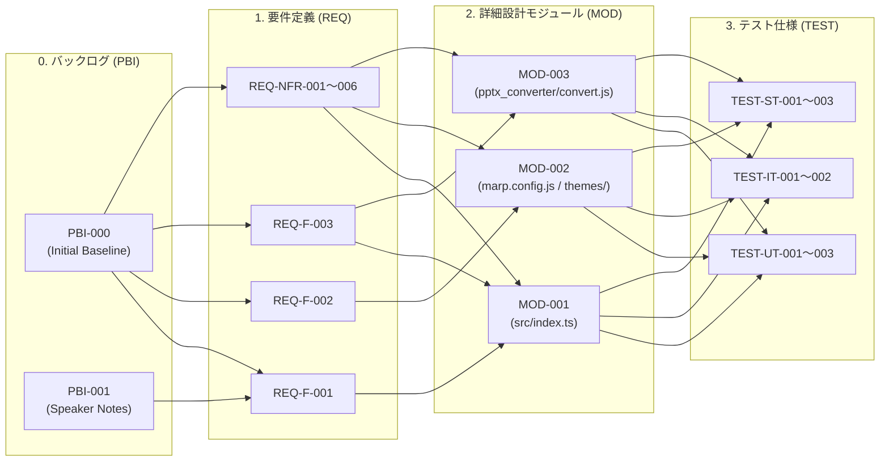

# 要件追跡マトリクス — RTM (Requirements Traceability Matrix)

> **テンプレート利用ガイド**: 本ドキュメントは、IPA共通フレーム2013（SLCP-JCF2013）および品質基準 **Q-03（トレーサビリティ断絶 0件）** を担保する要件追跡表（RTM）の正本雛形である。`ipa-traceability-validator` スキルおよび自動検証スクリプト `.agents/skills/ipa-traceability-validator/scripts/verify_rtm.py` によって、プロダクトバックログID（`PBI-*`）↔ 要件ID（`REQ-*`）↔ モジュールID（`MOD-*`）↔ テストID（`TEST-*`）の双方向整合性が機械的に検査される。

---

## レビュアー向けサマリ
- **前版からの差分**: PBI駆動型アジャイル統合に伴い、`PBI_ID` カラムおよびPBI双方向追跡指標を追加
- **人間（承認者）が判断すべきポイント（3〜5点）**:
  1. すべての機能要件（`REQ-F-*`）および非機能要件（`REQ-NFR-*`）に起点PBI（`PBI_ID`）、設計モジュール（`MOD-*`）、テストケース（`TEST-*`）が漏れなく割り当てられているか（前方追跡率 100%）
  2. 要件やPBIに紐付かない孤立モジュールや、検証根拠を持たないテストケースが存在しないか（後方追跡違反 0件）
  3. 自動検査スクリプト `verify_rtm.py` の実行結果が `PASS (Exit Code 0)` であるか
- **影響するQ-ID・基準ID**: `Q-03`（トレーサビリティ断絶0件）、`D-01`（完了定義）
- **承認に必要な最小読解セット**: 「1. トレーサビリティカバレッジ集計サマリー」「2. PBI ↔ 要件 ↔ モジュール ↔ テスト 双方向追跡マトリクス」

---

## 1. トレーサビリティカバレッジ集計サマリー

| 追跡指標 | 対象総数 | 追跡完了数 | カバレッジ / 断絶数 | 判定 (`Q-03`) |
| :--- | :---: | :---: | :---: | :---: |
| **PBIバックログ追跡 (`PBI-*` → `REQ-*` & `MOD-*` & `TEST-*`)** | 4 件 | 4 件 | **100.0%** (断絶 0件) | PASS |
| **機能要件の前方追跡 (`REQ-F-*` → `PBI-*` & `MOD-*` & `TEST-*`)** | 3 件 | 3 件 | **100.0%** (断絶 0件) | PASS |
| **非機能要件の前方追跡 (`REQ-NFR-*` → `PBI-*` & `MOD-*` & `TEST-*`)** | 6 件 | 6 件 | **100.0%** (断絶 0件) | PASS |
| **設計モジュールの後方追跡 (`MOD-*` → `REQ-*` & `TEST-*`)** | 3 件 | 3 件 | **100.0%** (孤立 0件) | PASS |
| **テストケースの根拠追跡 (`TEST-*` → `REQ-*` & `MOD-*`)** | 10 件 | 10 件 | **100.0%** (根拠欠落 0件) | PASS |

---

## 2. PBI ↔ 要件 ↔ モジュール ↔ テスト 双方向追跡マトリクス (RTM本体)

> [!NOTE]
> `PBI_ID` カラムには、該当する要件・設計・テストを追加または変更したPBI識別子（`PBI-001` 等。初期構築ベースライン分は `PBI-000`）を記録する。

### 2.1 機能要件トレーサビリティマトリクス (`REQ-F-xxx`)

| `PBI_ID` | 要件ID (`REQ`) | 要件名称 | 方式設計 外部I/F (`EXT`) | 詳細設計 モジュールID (`MOD`) | 単体テストID (`TEST-UT`) | 結合テストID (`TEST-IT`) | 総合テストID (`TEST-ST`) | 追跡状態 |
| :--- | :--- | :--- | :--- | :--- | :--- | :--- | :--- | :---: |
| `PBI-000`<br>`PBI-001`<br>`PBI-003` | **REQ-F-001** | 構造化スライドデッキ生成・編集機能 | `EXT-MCP-001`〜`006` | `MOD-001` | `TEST-UT-001` | `TEST-IT-001`<br>`TEST-IT-002`<br>`TEST-IT-003` | `TEST-ST-001` | OK |
| `PBI-000`<br>`PBI-004` | **REQ-F-002** | 自律的要素リサイズ・目次自動生成機能 | `EXT-CLI-001` | `MOD-001`<br>`MOD-002` | `TEST-UT-002` | `TEST-IT-001` | `TEST-ST-001`<br>`TEST-ST-002` | OK |
| `PBI-000` | **REQ-F-003** | 高品質PDF・編集可能ネイティブPPTX出力機能 | `EXT-MCP-007`<br>`EXT-CLI-001`<br>`EXT-CLI-002` | `MOD-001`<br>`MOD-003` | `TEST-UT-003` | `TEST-IT-002` | `TEST-ST-002` | OK |

---

### 2.2 非機能要件トレーサビリティマトリクス (`REQ-NFR-xxx`)

| `PBI_ID` | 要件ID (`REQ`) | 非機能分類 (IPA 6大項目) | 方式設計・実現手段 | 詳細設計 モジュールID (`MOD`) | 検証テストID (`TEST`) | 追跡状態 |
| :--- | :--- | :--- | :--- | :--- | :--- | :---: |
| `PBI-000` | **REQ-NFR-001** | 1. 可用性（Chromium 4段階自動探索・例外保護） | 多段階バイナリ解決・共通エラーハンドラ | `MOD-001`<br>`MOD-003` | `TEST-IT-002`<br>`TEST-ST-001` | OK |
| `PBI-000` | **REQ-NFR-002** | 2. 性能・拡張性（PDF 30秒 / PPTX 60秒以内） | コンテナ内直接変換・ブラウザ即時解放 | `MOD-002`<br>`MOD-003` | `TEST-ST-002` | OK |
| `PBI-000`<br>`PBI-001`<br>`PBI-004` | **REQ-NFR-003** | 3. 運用・保守性（全行直上平易コメント・Zod検証） | コーディング規約強制・Zodスキーマ定義 | `MOD-001`<br>`MOD-002`<br>`MOD-003` | `TEST-UT-001`<br>`TEST-ST-003` | OK |
| `PBI-000` | **REQ-NFR-004** | 4. 移行性（Markdown / PDF / PPTX オープン出力） | 標準ファイルフォーマット出力パイプライン | `MOD-003` | `TEST-ST-002` | OK |
| `PBI-000`<br>`PBI-002`<br>`PBI-003` | **REQ-NFR-005** | 5. セキュリティ（PII・絶対パス完全排除・入力検証） | `.githooks/pre-commit`・入力境界検証 | `MOD-001`<br>`MOD-002`<br>`MOD-003` | `TEST-ST-003`<br>`TEST-ST-004` | OK |
| `PBI-000` | **REQ-NFR-006** | 6. システム環境（Docker Dev Container OS非依存） | Node 22 + Chromium + Noto CJK コンテナ固定 | `MOD-002` | `TEST-ST-001` | OK |

---

## 3. 視覚的トレーサビリティグラフ (Mermaid)



---

## 4. 自動検証コマンド

```bash
# Dockerコンテナ内で verify_rtm.py を実行し、ID整合性を機械検証する
docker compose run --rm app python3 .agents/skills/ipa-traceability-validator/scripts/verify_rtm.py
```
