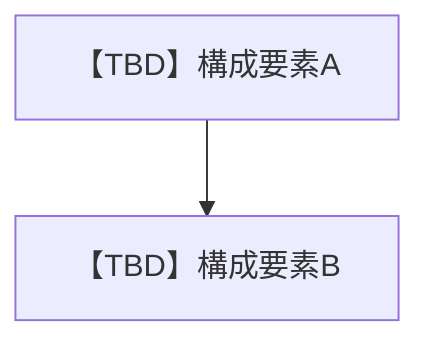

# 1 本書の位置づけ

## 1.1 目的
【TBD】本書が存在する理由を1〜2文で記載する。

## 1.2 記述対象
記述対象は [[03_documentation_standard#2.1 図書一覧|図書一覧]] の本書の行に従う。

## 1.3 記述対象外と参照先
- 要件: [[tpl_01_requirements_specification#3 機能要件|機能要件]]

## 1.4 改版履歴
| 版 | 日付 | 起因PBI | 変更概要 |
| :--- | :--- | :--- | :--- |
| 【TBD】 | 【TBD】 | 【TBD】 | 【TBD】 |

# 2 システム構成

## 2.1 構成図

## 2.2 実行環境
| 項目 | 内容 |
| :--- | :--- |
| 【TBD】 | 【TBD】 |

# 3 方式判断記録

## 3.1 ADR-NNN 【TBD】判断名
| 項目 | 内容 |
| :--- | :--- |
| 上位ID | 【TBD】 |
| 状態 | 【TBD】Draft / Approved / Deprecated |
| 後継ID | 【TBD】廃止時のみ記載 |
| 背景 | 【TBD】 |
| 判断 | 【TBD】 |
| 代替案 | 【TBD】 |
| 影響 | 【TBD】 |
