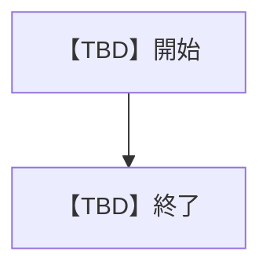
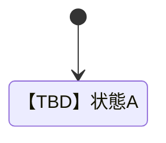

# 1 本書の位置づけ

## 1.1 目的
【TBD】本書が存在する理由を1〜2文で記載する。

## 1.2 記述対象
記述対象は [[03_documentation_standard#2.1 図書一覧|図書一覧]] の本書の行に従う。

## 1.3 記述対象外と参照先
- 画面の見た目と遷移: [[tpl_07_screen_specification#2 画面遷移|画面遷移]]

## 1.4 改版履歴
| 版 | 日付 | 起因PBI | 変更概要 |
| :--- | :--- | :--- | :--- |
| 【TBD】 | 【TBD】 | 【TBD】 | 【TBD】 |

# 2 機能仕様

## 2.1 FNC-NNN 【TBD】機能名
| 項目 | 内容 |
| :--- | :--- |
| 上位ID | 【TBD】 |
| 状態 | 【TBD】Draft / Approved / Deprecated |
| 後継ID | 【TBD】廃止時のみ記載 |
| 概要 | 【TBD】 |

### 2.1.1 振る舞い
【TBD】正常系・準正常系・異常系を観測可能な事実で記載する。

### 2.1.2 業務フロー

### 2.1.3 状態遷移

