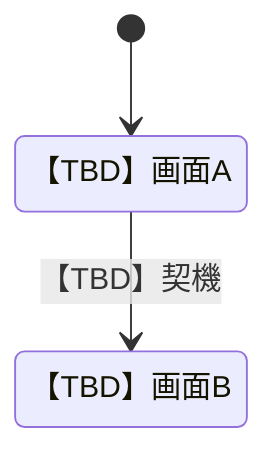
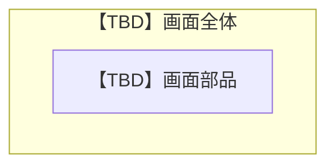

# 1 本書の位置づけ

## 1.1 目的
【TBD】本書が存在する理由を1〜2文で記載する。

## 1.2 記述対象
記述対象は [[03_documentation_standard#2.1 図書一覧|図書一覧]] の本書の行に従う。

## 1.3 記述対象外と参照先
- 画面から呼び出す機能: [[tpl_02_functional_specification#2 機能仕様|機能仕様]]
- 表示データの形式: [[tpl_06_data_structure_specification#2 データ構造|データ構造]]

## 1.4 改版履歴
| 版 | 日付 | 起因PBI | 変更概要 |
| :--- | :--- | :--- | :--- |
| 【TBD】 | 【TBD】 | 【TBD】 | 【TBD】 |

# 2 画面遷移

## 2.1 画面遷移図

## 2.2 画面遷移定義
| 遷移ID | 遷移元 | 遷移先 | 契機 | 条件 | 上位ID |
| :--- | :--- | :--- | :--- | :--- | :--- |
| 【TBD】 | 【TBD】 | 【TBD】 | 【TBD】 | 【TBD】 | 【TBD】 |

# 3 画面仕様

## 3.1 SCR-NNN 【TBD】画面名
| 項目 | 内容 |
| :--- | :--- |
| 上位ID | 【TBD】FNC の ID |
| 状態 | 【TBD】Draft / Approved / Deprecated |
| 後継ID | 【TBD】廃止時のみ記載 |
| 目的 | 【TBD】 |
| 表示条件 | 【TBD】 |

### 3.1.1 画面の見た目

#### 3.1.1.1 寸法と余白
| 項目 | 値 |
| :--- | :--- |
| 画面サイズ | 【TBD】幅×高さと単位 |
| 余白 | 【TBD】上・右・下・左と単位 |
| 配色・フォント | 【TBD】 |

#### 3.1.1.2 配置図

### 3.1.2 画面部品
| 部品ID | 名称 | 種別 | 表示内容の意味 | 形式参照 | 配置 |
| :--- | :--- | :--- | :--- | :--- | :--- |
| 【TBD】 | 【TBD】 | 【TBD】 | 【TBD】 | 【TBD】DAT IDへのリンクのみ | 【TBD】座標・サイズと単位 |

### 3.1.3 表示状態
| 状態 | 表示条件 | 見た目の差分 |
| :--- | :--- | :--- |
| 【TBD】 | 【TBD】 | 【TBD】 |
