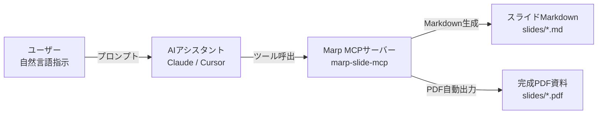

<style>
@import '../../themes/business-slide-theme.css';

:root {
  --banner-image: url('banner.svg');
}
</style>

<script defer src="../../themes/vendor/mermaid.min.js"></script>
<script defer src="../../themes/vendor/marp-mermaid-loader.js"></script>

# タイトル

Marp ビジネススライドの使い方

## サブタイトル

～標準デザインテンプレートと機能の活用ガイド～

### 図書番号

図書番号：D01-000001

### 所属・氏名

オープンソース推進部
システム設計課
山田 太郎

---

<!-- _class: toc -->

# 目次

---

# ページタイトル

通常ページテンプレ

## ページ主張

- ここはページの主な主張
  - 箇条書きも対応

### 主張補足タイトル

本文タイトル

#### 本文

- 本文は箇条書きが基本だが、平文形式、Mermaid図、コードブロック等も記入可能

例えばこんな感じの文章や、コードブロックなど。

```python
# コードブロック
hoge = a + b
print(hoge)
```

##### 図表出典

図表出典：サンプル記述

###### コピーライト

© 2026 N-Y-Public

###### 機密指定

CONFIDENTIAL

---

<!-- _class: conversation-content -->

# ページタイトル

会話レイアウト（conversation-content）の使用例

## ページ主張

- 新しい会話形式のレイアウトを利用できます
  - アイコンと吹き出しによるタイムライン形式で対話を表現します

### 主張補足タイトル

利用イメージ

#### 本文

-  **ユーザー** このレイアウトの仕組みはどうなっているのですか？
-  **Marp自動生成** Markdownのリスト記法と画像記法（``）を使うだけで、自動的に吹き出しとアイコンに変換される仕組みです！
- **名無し** なるほど！アイコン画像を指定しない場合は、このように自動でデフォルトの「シルエットアイコン」が表示されるので便利ですね。
- アイコンの色やテキスト色もテーマから自動抽出されます。プレゼンのアクセントとして自由に活用してください。

##### 図表出典

図表出典：サンプル記述

###### コピーライト

© 2026 N-Y-Public

###### 機密指定

CONFIDENTIAL

---

<!-- _class: wide-content -->

# ページタイトル

ワイドレイアウト（wide-content）の使用例

##

<!-- H2（主張・灰色帯）は非表示になります -->

### 主張補足タイトル

利用イメージ

#### 本文

- ここからワイドコンテンツの本文になります
- `<!-- _class: wide-content -->` を指定すると、
  H2背景帯が非表示になります
- 画面幅をより広く使い、大きな写真や複雑な図表などを配置するのにおすすめです
- 会話レイアウトや通常レイアウトと組み合わせて、用途に合わせて使い分けることができます

##### 図表出典

図表出典：サンプル記述

###### コピーライト

© 2026 N-Y-Public

###### 機密指定

CONFIDENTIAL

---

<!-- _class: claim-2 table-7 -->

# ページタイトル

はみ出し防止と10段階統一サイズ調整クラス

## ページ主張

- 全要素に統一された10段階数字クラス（1が標準・10が極小）で滑らかな微調整が可能
  - 最小の10は従来の最小限界値よりさらに2段階小さい極小サイズまで対応

### 主張補足タイトル

各要素に対応する10段階統一数字クラス一覧（全要素共通仕様）

#### 本文

| 対象要素 | 統一数字クラス（1〜10） | 旧互換クラス | 役割・効果（1が最大、10が極小） |
| :--- | :--- | :--- | :--- |
| **表 (Table)** | `table-1` 〜 `table-10` | `table-sm`, `table-xs`等 | フォントサイズ（26pt〜6pt）を微調整。10は旧最小(8pt)より2段階小 |
| **本文 (Text)** | `text-1` 〜 `text-10`<br>(エイリアス: `body-1`〜`10`) | `dense`, `denser`等 | 本文文字倍率（scale 1.0〜0.35）を微調整。10は旧最小(0.50)より2段階小 |
| **図表 (Mermaid)** | `mermaid-1` 〜 `mermaid-10` | `mermaid-sm`, `xs`相当 | Mermaid図の最大高さ（100%〜28%）を微調整。10は旧最小(55%)より2段階小 |
| **画像 (Image)** | `img-1` 〜 `img-10`<br>(エイリアス: `image-1`〜`10`) | — | 単一画像の最大高さ（100%〜20%）を微調整 |
| **コード (Code)** | `code-1` 〜 `code-10` | `code-sm`, `code-xs`等 | コードフォントサイズ（18pt〜5pt）を微調整。10は旧最小(7pt)より2段階小 |

- ※ クラスは `<!-- _class: claim-2 text-3 table-5 -->` のように半角スペース区切りで併用可能（`claim-1`〜`8` や `wide-content` 等とも併用可）

##### 図表出典

図表出典：スタイル調整ガイド

###### コピーライト

© 2026 N-Y-Public

###### 機密指定

CONFIDENTIAL

---

<!-- _class: claim-2 -->

# ページタイトル

環境構築：GitHubクローン後のセットアップ

## ページ主張

- リポジトリをクローン後、依存パッケージ導入とTypeScriptビルドで準備完了
  - Claude Desktop 等の設定ファイルに本MCPサーバーを登録して利用開始

### 主張補足タイトル

セットアップ手順とクライアント登録

#### 本文

- **ステップ1：依存パッケージのインストール**
  - リポジトリ直下で `npm install` を実行し、ライブラリ群を導入
- **ステップ2：MCPサーバーのビルド**
  - `npm run build` を実行し、`build/index.js` を生成
- **ステップ3：MCPクライアントへの登録**
  - `claude_desktop_config.json` 等の `mcpServers` に実行コマンドを追加
  - 例：`"marp-slide-mcp": { "command": "node", "args": ["<path>/build/index.js"] }`

##### 図表出典

図表出典：公式環境構築ガイド

###### コピーライト

© 2026 N-Y-Public

###### 機密指定

CONFIDENTIAL

---

<!-- _class: claim-2 table-sm -->

# ページタイトル

VS Code による MCP 設定と活用（2通りのスコープ）

## ページ主張

- リポジトリ限定（Workspace）と全プロジェクト共通（User）の2通りの設定に対応
  - GitHub Copilot や Claude Code 等から自然言語でスライド生成が可能

### 主張補足タイトル

VS Code での MCP 設定方式とスコープ別の使い分け

#### 本文

| 設定スコープ | 設定ファイル配置場所 | 特長・適用シナリオ |
| :--- | :--- | :--- |
| **ワークスペース設定**<br>(プロジェクト限定) | `.vscode/mcp.json` | 当該リポジトリを開いている時のみツールが有効化。<br>プロジェクトごとにMCPツールを分離したい場合に最適。 |
| **ユーザー設定**<br>(全プロジェクト共通) | Windows: `%APPDATA%\Code\User\mcp.json`<br>Mac: `~/Library/.../Code/User/mcp.json`<br>Linux: `~/.config/Code/User/mcp.json` | どのプロジェクトを開いていても本ツールを常時呼び出し可能。<br>PC内の「共通スライド生成エンジン」として利用。 |

- ※ 実行コマンド: `"command": "node", "args": ["<本リポジトリの絶対パス>/build/index.js"]`

##### 図表出典

図表出典：VS Code MCP 設定仕様書

###### コピーライト

© 2026 N-Y-Public

###### 機密指定

CONFIDENTIAL

---

<!-- _class: claim-2 table-sm -->

# ページタイトル

Dockerが使えない環境での対応（ホスト直接実行）

## ページ主張

- 企業の社内ポリシー制約下でもNode 22・Chrome・Python 3のホスト環境で実行可能
  - Docker Desktopが導入できないPCでも完全なビルド・変換機能を担保

### 主張補足タイトル

Dockerレス環境における前提要件とセットアップ手順

#### 本文

| 項目 | 必要環境 / コマンド | 内容と留意事項 |
| :--- | :--- | :--- |
| **Node.js** | `v22.x LTS`（または互換） | `npm install` 後に `npm run build` でMCPをビルド |
| **ブラウザ** | Google Chrome / Chromium | Marp CLI および PPTX 変換でヘッドレス利用（パス自動検出） |
| **Python** | `Python 3.10+` | `pip install python-pptx`（ネイティブPPTX変換時に必要） |
| **日本語フォント** | OS標準フォント | Windows: Meiryo/Yu Gothic、Mac: Hiragino、Linux: Noto CJK |

- ※ Chromeが特殊なパスにある場合は環境変数 `CHROME_PATH` に実行ファイルパスを指定
- ※ ビルドコマンド: `npm run build:pdf`（PDF出力）、`npm run build:pptx-custom`（PPTX出力）

##### 図表出典

図表出典：Dockerレス環境構築ガイド

###### コピーライト

© 2026 N-Y-Public

###### 機密指定

CONFIDENTIAL

---

<!-- _class: claim-2 table-sm -->

# ページタイトル

トークンを消費しない手動 PDF・PPTX エクスポート

## ページ主張

- スライド手修正時は生成AIやMCPを経由せずCLI・GUIから即座に再出力可能
  - MCPと100%同一の内部ツールを直接叩くことでAIトークン消費ゼロで高速出力

### 主張補足タイトル

Docker / ローカル / GUI による手動エクスポートコマンド体系

#### 本文

| 実行環境 | 対象範囲 | 実行コマンド / 操作手順 |
| :--- | :--- | :--- |
| **Docker環境** | **特定スライド** | `docker compose run --rm app npx @marp-team/marp-cli --config-file marp.config.js --pdf slides/.../*.md -o slides/.../*.pdf --allow-local-files --no-stdin`<br>PPTX: `docker compose run --rm app node pptx_converter/convert.js slides/.../*.md slides/.../*.pptx` |
| **Docker環境** | **全スライド** | `docker compose run --rm app npm run build:pdf`（または `build:pptx-custom`） |
| **ローカル環境** | **特定スライド** | `npx @marp-team/marp-cli --config-file marp.config.js --pdf slides/.../*.md -o slides/.../*.pdf --allow-local-files`<br>PPTX: `node pptx_converter/convert.js slides/.../*.md slides/.../*.pptx` |
| **VS Code GUI** | **特定スライド** | コマンドパレット（`Ctrl+Shift+P`）→ `Marp: Export slide deck` を選択 |

##### 図表出典

図表出典：手動エクスポート仕様書

###### コピーライト

© 2026 N-Y-Public

###### 機密指定

CONFIDENTIAL

---

<!-- _class: claim-2 table-sm -->

# ページタイトル

提供されるMCPツール一覧と機能

## ページ主張

- スライド新規作成・編集・削除・設定変更・PDF出力まで7つのツールを提供
  - AI が自然言語指示を適切なツール呼び出しに変換し、正確な操作を実現

### 主張補足タイトル

7つの主要ツール概要

#### 本文

| ツール名 | 主要機能・役割 |
| :--- | :--- |
| `generate_slide_deck` | 規約に準拠した Marp スライドを一括新規作成 |
| `get_slide_deck` | 既存スライド Markdown の構造化解析・要素取得 |
| `insert_slide` / `update_slide` | 任意位置への新規スライド挿入・既存スライドの更新 |
| `delete_slide` | 不要になったスライドページの安全な削除 |
| `update_deck_settings` | テーマカラー、画面比率、表紙バナー等の一括更新 |
| `export_to_pdf` | Marp CLI を実行し、高品質な配信用 PDF を即座に出力 |

##### 図表出典

図表出典：MCPツール仕様書

###### コピーライト

© 2026 N-Y-Public

###### 機密指定

CONFIDENTIAL

---

<!-- _class: claim-2 mermaid-sm -->

# ページタイトル

MCPサーバーの利用フローとAI連携

## ページ主張

- 自然言語で AI に要望を伝えるだけで、スライド生成からPDF出力まで自動完結
  - AI がプロンプト規約に基づき自律連携し、高品質なスライドを自動構築

### 主張補足タイトル

AI と MCP サーバーの対話連携アーキテクチャ

#### 本文



##### 図表出典

図表出典：AI連携ワークフロー設計

###### コピーライト

© 2026 N-Y-Public

###### 機密指定

CONFIDENTIAL

---

<!-- _class: claim-2 table-sm -->

# ページタイトル

成果物の出力先と資料別ディレクトリ構造

## ページ主張

- 各スライド資料は slides/ 配下に専用ディレクトリを作成して独立管理
  - Markdown・PDF・PPTX・個別画像アセットが同一フォルダ内にまとまり保守性向上

### 主張補足タイトル

資料専用ディレクトリ（slides/<資料名>/）と生成アーティファクト

#### 本文

| 成果物 / 配置 | ファイル形式・配置場所 | 内容と用途 |
| :--- | :--- | :--- |
| **資料専用フォルダ** | `slides/<資料名>/` | 各プレゼンテーションごとに1つ作成される専用ディレクトリ |
| **スライドMarkdown** | `slides/<資料名>/<資料名>.md` | MCPツールや手動で作成・編集する原本 |
| **PDF 成果物** | `slides/<資料名>/<資料名>.pdf` | `export_to_pdf` や Marp CLI で自動出力された配信用 |
| **PPTX 成果物** | `slides/<資料名>/<資料名>.pptx` | `build:pptx-custom` により図形・テキスト変換された編集用 |
| **画像アセット** | `slides/<資料名>/banner.svg` 等 | 個別資料で使用する表紙バナーやヘッダーロゴ等の配置領域 |

- ※ テーマ（`themes/`）や共通リソース（`../../themes/`）を参照し、資料ごとに自己完結した管理が可能です

##### 図表出典

図表出典：リポジトリ構成仕様（資料専用ディレクトリ設計）

###### コピーライト

© 2026 N-Y-Public

###### 機密指定

CONFIDENTIAL

---

<!-- _class: claim-2 table-sm -->

# ページタイトル

MCP各要素の受付文字数・上限規約

## ページ主張

- スキーマ（Zod）により各要素の最大文字数が厳格に定義されレイアウト崩れを未然に防止
  - 上限超過時はバリデーションエラーとなり、AI による自動再試行や修正を促進

### 主張補足タイトル

MCPツール（generate_slide_deck等）で受付可能な主要要素と上限

#### 本文

| 要素名 (プロパティ) | 上限文字数 / 形式 | 役割・表示領域と適用ルール |
| :--- | :--- | :--- |
| `pageTitle` | **60文字以内** | スライド左上の大見出し（1〜2行で簡潔に表現） |
| `claim` | **250文字以内** | 上部グレー帯の主要メッセージ（箇条書き3〜5行） |
| `chartTitle` | **60文字以内** | 本文領域直上の小見出し・セクション名 |
| `bodyContent` | **1,500文字以内** | Markdown本文、表、Mermaid図、コード等 |
| `twoColumns` | 左右各1,500文字 | 2段組レイアウト用の構造化コンテンツ |
| `imageGrid` | 配列（2〜4枚推奨） | 画像並列グリッド（キャプション・代替テキスト付） |

- ※ 上限値を超えるテキストはレイアウト破綻防止のためバリデーションで弾かれます

##### 図表出典

図表出典：MCPスキーマ仕様書（src/index.ts）

###### コピーライト

© 2026 N-Y-Public

###### 機密指定

CONFIDENTIAL

---

<!-- _class: claim-2 table-sm -->

# ページタイトル

自律開発用 Marp スキル（.agents/skills）の活用

## ページ主張

- AI エージェントが自律的にスライド設計・編集・出力を行う専用スキルを同梱
  - ユーザーが「スライドを作成して」と指示するだけで、規約に沿った資料を自動構築

### 主張補足タイトル

Marp スライド生成スキル（marp-slides）の構成と役割

#### 本文

| 項目 | 内容・仕様 | 詳細と活用メリット |
| :--- | :--- | :--- |
| **配置場所** | `.agents/skills/marp-slides/` | 配布リポジトリ同梱でクローン後即座に利用可能 |
| **設計規約** | MBB標準（ワンスライド・ワンメッセージ） | 結論優先（Pyramid Principle）の構成を自動徹底 |
| **二重実行** | MCPモード ＆ 直接Markdown | MCP利用可能時はAPI呼び出し、不可時は直接生成 |
| **リファレンス** | ツール仕様・デザイン集・CSS規約 | 表・Mermaid・2段組等のベストプラクティスを内包 |

- ※ Antigravity や Claude 等の AI が本スキルを自動参照し、高品質なスライドを自律生成します

##### 図表出典

図表出典：エージェントスキル仕様（SKILL.md）

###### コピーライト

© 2026 N-Y-Public

###### 機密指定

CONFIDENTIAL

---

<!-- _class: claim-2 table-sm -->

# ページタイトル

ライセンス条項（SaaS制限付きソースアベイラブル）

## ページ主張

- 社内資料作成や受託・保守・コンサルティング等の有償役務には自由に利用可能
  - ただし、第三者向け有償SaaS／クラウドサービス／有料APIとしての提供は禁止

### 主張補足タイトル

`LICENSE` の許諾範囲と利用条件の要約

#### 本文

| 区分 | 許諾・制限の具体的内容 | 適用例・備考 |
| :--- | :--- | :--- |
| **商用・社内利用** | **無制限に許可** | 自社業務、営業提案、顧客向け納品スライドの作成 |
| **保守・役務提供** | **有償提供可能** | SI構築、導入支援、技術相談、保守契約の対価受領 |
| **改変・再配布** | **条件付き許可** | 同一ライセンス・著作権表示を保持したコード改変・配布 |
| **SaaS / クラウド** | **事前の書面許可なく禁止** | 本機能を有償Webサービスや有料MCP等として提供すること |

- ※ 著作権表示および許諾表示をすべての複製物・派生ソフトウェアに保持する必要があります
- ※ SaaS 形態でのサービス提供を希望する場合は、著作権者への事前の書面許諾が必要です

##### 図表出典

図表出典：LICENSE（Custom License with SaaS Restriction）

###### コピーライト

© 2026 N-Y-Public

###### 機密指定

CONFIDENTIAL


